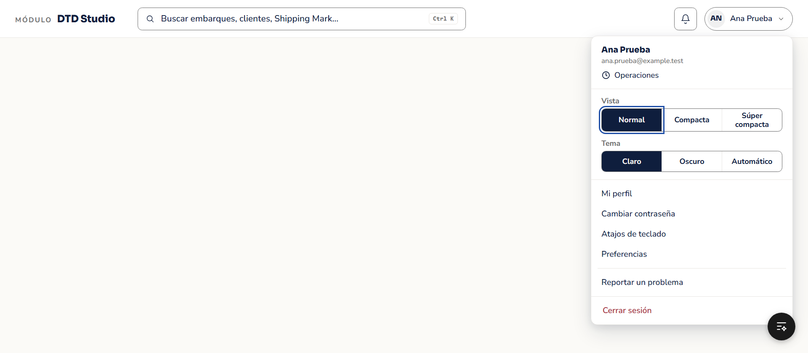
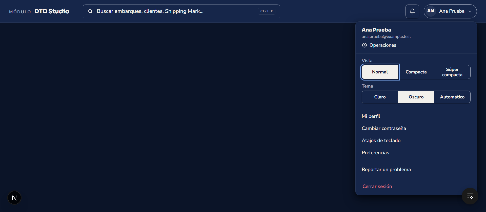
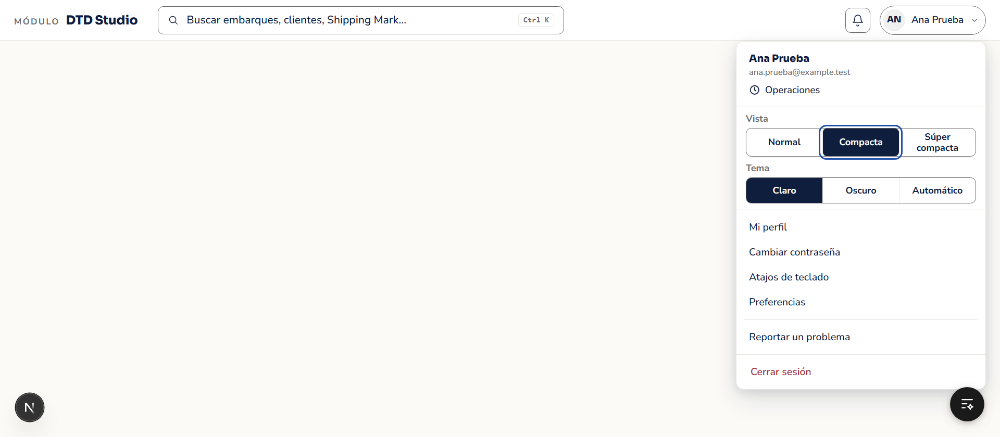
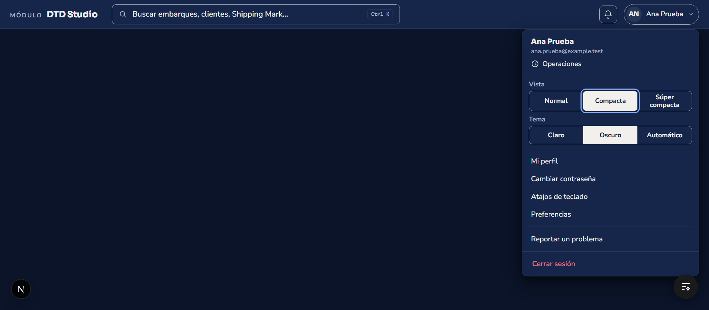
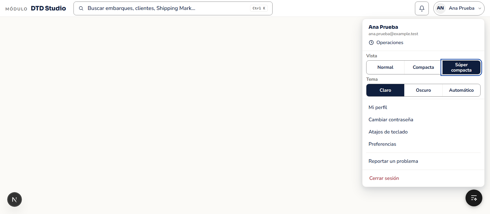
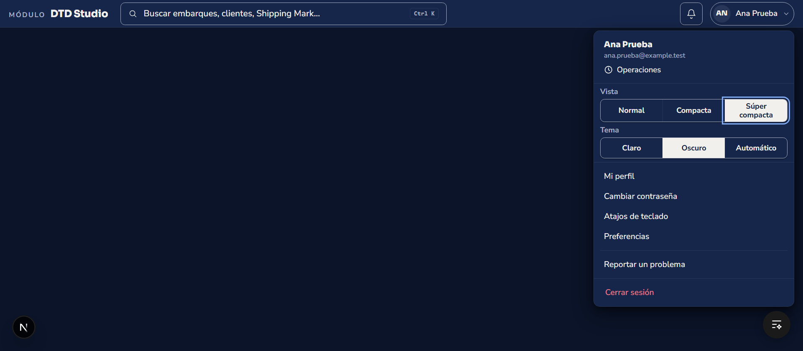

# Handoff · SDD-0714 — Vista y tema en el menú del usuario

Fecha: 2026-11-23 · Worker: Claude (Opus 5.5) · Rama: `claude/menu-usuario-vistas-8b67c9` · Reserva: `codex/sdd-reserve-0714-menu-usuario-vista-y-tema` + `refs/dtd/reservations/0714` (publicadas).

## Qué pidió Sam

«Menú del usuario: sí, así, y que la vista quede guardada en mi usuario (opción B)» (2026-11-23, maqueta aprobada).

## Qué quedó

- La barra superior ya no lleva el selector de vista ni el sol/luna. Quedan buscar, Conversaciones, la campana y la pastilla con el nombre.
- Menú del usuario, en orden: nombre y rol real → **Vista** (Normal / Compacta / Súper compacta) → **Tema** (Claro / Oscuro / Automático) → Mi perfil y las opciones de cuenta que ya existían → Cerrar sesión.
- **Opción B, sin migración:** se guarda en `user_metadata.studio_apariencia = { vista, tema }` con `auth.updateUser({ data })` (`app/studio/(app)/_actions/apariencia-actions.ts`). La acción valida contra el catálogo. `localStorage` queda como respaldo y el script anti-parpadeo lo sigue aplicando. Al montar el Studio, `AparienciaUsuario` aplica lo de la cuenta si difiere; si la cuenta no tiene nada y el navegador sí, lo sube una vez.
- «Automático» sigue a `prefers-color-scheme`, también en vivo.
- Admin › Apariencia usa el mismo hook y ofrece Automático.
- El menú se arma con `opcionesDeCuenta` en `StudioTopbar.tsx`: el Modo de prueba (SDD-0713) entra con una entrada. **No se agregó.**
- Se borró `DensityToggle.tsx` con su prueba; el estilo `.studio-vista` se reusa con el modificador `--menu`.

## Evidencia

Turno de PC dado por Dir_DTD el 2026-11-23.

| Comprobación | Estado |
|---|---|
| vitest: `StudioTopbar-menu-usuario`, `AparienciaUsuario`, `apariencia-actions`, `apariencia-predeterminada`, `browser-state-contract`, `claridad-t5e-contract`, `estilos-texto-contract` | PASÓ: 7 archivos, 85 pruebas |
| `tsc --noEmit` | PASÓ (exit 0) |
| eslint de los 16 archivos tocados | PASÓ (exit 0) |
| `docs:check` / `sdd:check` | PASÓ |
| `/ui-check` | PASÓ con 2 ajustes menores, ya aplicados: hover ≠ elegido; Tab fuera cierra el menú |
| Capturas claro/oscuro × 3 vistas | HECHAS (abajo) |
| build / `pnpm verify` completo | NO EJECUTADO en local; lo cubre el CI de la PR |
| `carril.mjs` | revisión previa (server action + «usuario» en la ruta) |

### Capturas

Hechas con `next dev` y Chrome headless a 1280 × 560 y escala 1,5, con datos ficticios («Ana Prueba», `example.test`, rol «Operaciones»). Salen de una página temporal fuera de `/studio` que montaba la `StudioTopbar` real; la página no entró al commit. La «N» de abajo a la izquierda es el indicador de `next dev`.

| Vista | Claro | Oscuro |
|---|---|---|
| Normal |  |  |
| Compacta |  |  |
| Súper compacta |  |  |

Se ve: el orden de la maqueta, el foco en la vista marcada al abrir, y «Súper compacta» que baja de línea sin cortarse (BTN-01 v1.3, regla 6).

## Riesgo aceptado

- **Recargar antes de que termine `updateUser`.** Al elegir una vista o un tema, el cambio se aplica y se guarda local al instante, y la escritura a la cuenta sale después. Si la persona recarga antes de que esa escritura termine, el layout lee de la cuenta el valor anterior, `AparienciaUsuario` lo aplica y pisa el local: la elección se pierde y hay que repetirla. La ventana es de una ida y vuelta a Supabase Auth (I: menos de un segundo en condiciones normales). Se acepta porque el daño es solo cosmético y se corrige con un clic. Mitigarlo pediría marcar la escritura pendiente en `localStorage` y preferir lo local mientras siga pendiente. Queda para una adenda si alguien lo reporta.

## Impacto documental

- `docs/specs/0714-menu-usuario-vista-y-tema/spec.md` (nueva).
- `app/studio/CLAUDE.md`, regla 2: la vista y el tema viven en el menú del usuario.

## Pendientes de esta tarea

- PR #802 abierta; espera la revisión independiente que lanza Dir_DTD y el CI verde en la cabeza. No se fusiona desde aquí.

## FUERA DE ALCANCE DETECTADO

- Los nombres de rol vienen de `ROLE_LABELS` en español; un usuario con zh-CN ve el rol en español.
- El hover del `.studio-vista` de SDD-0688 rellenaba igual que la opción elegida; aquí solo se corrigió dentro del menú (el selector de la barra ya no existe).
