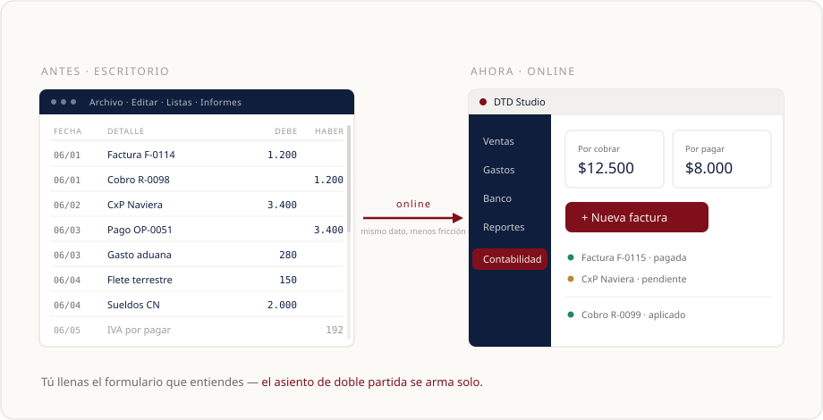
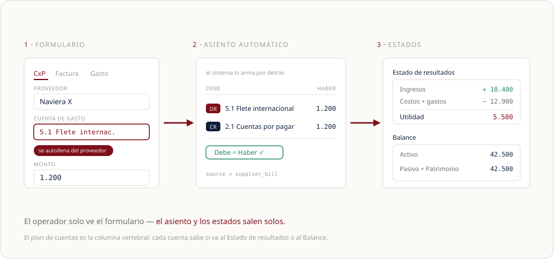

# Contabilidad QBO online · cómo trabaja QuickBooks y qué adoptamos en DTD Cargo

> **Qué es:** investigación de cómo **QuickBooks Online (QBO)** organiza la contabilidad —su
> lógica interna y su forma sencilla de presentarla— con un **veredicto función por función para
> DTD Cargo**: *qué ya hacemos, qué adaptamos y qué dejamos para después*. El objetivo es que un
> operador acostumbrado a QBO se sienta en casa en el Studio.
>
> **Esto no es una spec ni nos obliga.** Es contexto para construir lo que falta en la parte
> contable. Cada "paso para DTD" del cierre será su propio SDD cuando se decida.
>
> **Fecha:** 13 junio 2026 · **Estado:** research-context (no gobernante) · **Confidencialidad:** interno
> **Relacionado:** SDD-0040 (Contabilidad) · 0021 (Facturación) · 0041 (Cobranzas) · 0044 (Tesorería) · 0039 (Gastos) · 0052 (Reportes)

---

## TL;DR

DTD **ya tiene montada la columna vertebral contable** que QBO popularizó: plan de cuentas
jerárquico, asientos de doble partida que el sistema arma **solo** detrás de cada formulario, y
estados financieros (P&L + Balance) derivados automáticamente. Eso **no hay que reinventarlo**.

Lo que QBO hace y a DTD **le falta** son tres cosas concretas, todas para **acelerar la carga y
cerrar el puente entre la operación y la contabilidad**:

1. ⭐ **Proveedor atado a una cuenta de gasto por defecto** → al cargar su factura, la cuenta se autollena.
2. **Cuentas con categorías que se autollenan** al crearlas (la cascada *Tipo → Subtipo* de QBO).
3. **Gastos del operario imputados a una cuenta del plan** (hoy van por categoría, sueltos de la contabilidad).

El resto (formulario de cliente, conciliación bancaria, cash flow) es paridad u opcional.

---

## 1 · El cambio de mentalidad: del escritorio a online

QBO ganó porque cambió **cómo se ve** la contabilidad, no las reglas (que son las de siempre:
doble partida). El QuickBooks **de escritorio** ponía al frente el **libro mayor**: registros
densos, columnas, menús de contador. El **online** puso al frente un **panel por función**
(Ventas, Gastos, Banco, Reportes) y formularios simples; el asiento contable quedó **escondido**.



**La idea que importa:** el usuario **nunca escribe un asiento**. Llena un formulario que entiende
(una factura, el pago de un proveedor, un gasto) y el sistema traduce eso a débito/crédito por
detrás. A esto se le llama **"forms-first"**.

> **Veredicto DTD:** ✅ **ya lo hacemos en espíritu.** El Studio ya tiene navegación lateral por
> módulos (Facturación, Cobranzas, Tesorería, Contabilidad, Reportes). El operador QBO reconoce el
> patrón. Cero trabajo aquí; el gráfico de arriba sirve para explicarlo.

---

## 2 · Cómo "piensa" QBO la contabilidad (forms-first)

Cada documento que el usuario carga se convierte en un asiento balanceado **automáticamente**:

| El usuario carga… | QBO arma por detrás (oculto) |
|---|---|
| **Factura** a un cliente | DR Cuentas por cobrar · CR Ingresos |
| **Cobro** de esa factura | DR Banco/Caja · CR Cuentas por cobrar |
| **Factura de proveedor** (Bill) | DR Cuenta de gasto · CR Cuentas por pagar |
| **Pago** de esa factura | DR Cuentas por pagar · CR Banco |
| **Gasto** directo | DR Cuenta de gasto · CR Banco |

El **plan de cuentas** es la columna vertebral: define en qué "casilla" cae cada movimiento, y de
ahí salen el **Estado de resultados (P&L)** y el **Balance** sin trabajo manual.



> **Veredicto DTD:** ✅ **ya lo hacemos, idéntico.** El Studio genera el asiento automático en
> factura, cobro, cuenta por pagar y pago (`source='invoice' │ 'receipt' │ 'supplier_bill' │
> 'supplier_payment'`), y valida que el debe cuadre con el haber antes de guardar (`entryTotals()`).
> Es la parte **más madura** del ERP. No se toca.

---

## 3 · Función por función: qué hace QBO y qué hacemos nosotros

Leyenda: ✅ ya lo haces · 🔧 adáptalo (hueco real) · 🔁 parecido / opcional · ⏸️ no urgente

| # | Función de QBO | Qué hace QBO | DTD hoy | Veredicto |
|---|---|---|---|---|
| 1 | **Plan de cuentas con cascada Tipo → Subtipo** | Eliges un *Account Type* y QBO filtra los *Detail Types* válidos; el subtipo **ubica la cuenta solo** en P&L o Balance. | Plan jerárquico por `code` + 6 tipos + campo `qbo_type` reservado (el formulario **no lo usa**). | 🔧 **Adáptalo** — es el "esquema automatizado" que pediste. Ver §4. |
| 2 | **Plan de cuentas inicial precargado** | Al abrir empresa, precrea cuentas base; algunas no se pueden borrar. | Siembra **84 cuentas** (plan VE estándar, migración `0078`). | ✅ **Ya lo haces, mejor.** Refinamiento menor: cuentas "sistema" no-borrables. |
| 3 | **Forms-first + asiento automático** | El usuario llena formularios; el asiento DR/CR se arma y valida solo. | Igual, en factura/cobro/CxP/pago. | ✅ **Ya lo haces, igual que QBO.** |
| 4 | **Formulario de cliente** | display name, billing+shipping, **payment terms**, método preferido, tax id, adjuntos. | name, email, teléfono, dirección, **RIF**, tier, GPS + **Shipping Mark** + **verificación CNE/SENIAT**. | 🔁 **Parecido, y en algo mejor.** Ver §5. Opcional. |
| 5 | **Proveedor + cuenta de gasto por defecto** ⭐ | El proveedor guarda una **cuenta de gasto**; su factura la **autollena**. | El proveedor **no** guarda cuenta; se elige a mano en cada factura. | 🔧 **Adáptalo — tu pedido textual.** Ver §6. |
| 6 | **Gasto imputado a una cuenta del plan** | Cada gasto cae en una cuenta del plan (la misma del proveedor). | El gasto usa `category` (taxi, hotel, alquiler…), **no** una cuenta. | 🔧 **Adáptalo — puente operación↔contabilidad.** Ver §7. |
| 7 | **Estados financieros automáticos** | P&L, Balance y Cash Flow salen del plan + asientos. | P&L + Balance ya salen solos; Cash Flow parcial. | ✅ **Ya lo haces** (P&L + Balance). |
| 8 | **Conciliación bancaria** | Cruza los movimientos del banco contra el registro. | No existe. | ⏸️ **No lo tienes — nice-to-have.** |
| 9 | **Navegación por función (sidebar)** | Sidebar por rol + panel de tarjetas. | El Studio ya lo tiene. | ✅ **Ya lo haces en espíritu.** |

Las secciones que siguen profundizan los tres 🔧 (que es lo accionable) y el 🔁 del cliente.

---

## 4 · El plan de cuentas: la cascada "Tipo → Subtipo" (lo que pediste investigar)

### Cómo lo hace QBO

QBO clasifica **cada cuenta en dos capas**:

1. **Account Type** (capa 1, ~15 opciones): define **en qué estado** aparece la cuenta.
   - *Van al Balance:* Bank, Accounts Receivable, Other Current Assets, Fixed Assets, Accounts
     Payable, Credit Card, Other Current Liabilities, Long Term Liabilities, Equity.
   - *Van al P&L:* Income, Other Income, Cost of Goods Sold, Expenses, Other Expense.
2. **Detail Type** (capa 2, ~150 subtipos): una **subcategoría dentro del tipo**. No cambia la
   contabilidad — sirve para **organizar y para que el sistema sepa dónde ubicar la cuenta** sin
   que el usuario lo decida.

**El truco de UX (el "esquema automatizado"):** cuando creas una cuenta, eliges el **Tipo** y QBO
**filtra automáticamente** los subtipos válidos. Eliges "Expenses" → te muestra *Advertising, Rent,
Office Supplies, Travel, Utilities…*. Eliges el subtipo y **listo**: la cuenta ya sabe que es un
gasto operativo y que cae en el P&L. El usuario nunca decide "esto va al Balance o al P&L" — el
subtipo lo decide por él.

```
Crear cuenta:
  Tipo:    [ Gastos ▼ ]
              └─► el sistema filtra subtipos válidos para Gastos:
  Subtipo: [ Alquiler ▼ ]   (Alquiler · Servicios · Sueldos · Viáticos · Publicidad …)
              └─► queda fijado: va al P&L, lado deudor. Cero decisión manual.
```

### Qué tienes hoy en DTD

El plan de cuentas (SDD-0040) ya es **jerárquico** por `code` (1, 1.1, 1.1.2…) y cada cuenta tiene
un `type` de **6 valores**:

| `type` | Significado | Estado | Lado normal |
|---|---|---|---|
| `A` | Activo | Balance | Debe |
| `P` | Pasivo | Balance | Haber |
| `PT` | Patrimonio | Balance | Haber |
| `I` | Ingresos | P&L | Haber |
| `CGS` | Costo de ventas | P&L | Debe |
| `G` | Gastos | P&L | Debe |

Es decir: **la capa 1 de QBO ya la tienes** (tu `type` cumple el papel del *Account Type* — ya
decide Balance vs P&L y el lado normal vía `normalSide()`). Y hay un campo **`qbo_type` ya
reservado** en la tabla `accounts`, hoy sin usar en el formulario.

### El veredicto y cómo adaptarlo

🔧 **Te falta la capa 2 (subtipo) y la cascada al crear la cuenta.** Hoy el operador escribe el
`code` a mano y elige uno de los 6 tipos — funciona, pero no es el "ya está todo" de QBO.

**Propuesta (futuro SDD):** definir un set chico de **subtipos por cada uno de los 6 tipos**,
guardarlos en `qbo_type` (o una columna `detail_type`), y en el drawer de crear cuenta hacer la
cascada *Tipo → filtra Subtipos → sugiere el `code` y la ubicación*. Un set inicial pensado para
DTD (logística + trading China↔Venezuela):

| Tipo | Subtipos sugeridos para DTD |
|---|---|
| **A** Activo | Banco/Caja · Cuentas por cobrar · Inventario en tránsito · Activo fijo · Otros activos |
| **P** Pasivo | Cuentas por pagar · IVA por pagar · Anticipos de clientes · Préstamos · Otros pasivos |
| **PT** Patrimonio | Capital · Aportes del dueño · Retiros del dueño · Resultados acumulados |
| **I** Ingresos | Flete / logística · Trading propio · Otros ingresos |
| **CGS** Costo de ventas | Flete internacional · Aduana e impuestos de importación · Transporte terrestre · Consolidación |
| **G** Gastos | Sueldos · Alquiler · Servicios · Viáticos · Comisiones bancarias · Publicidad |

> Esto **no rompe** lo existente: los 6 tipos siguen mandando en P&L/Balance; el subtipo solo
> agrega granularidad y enciende la cascada. Las 84 cuentas sembradas se pueden etiquetar con su
> subtipo en una migración de datos.

---

## 5 · Formulario de cliente

**QBO** pide: nombre, **display name** (cómo sale en la factura), empresa, email, teléfono,
dirección de **facturación** y de **envío** por separado, **condiciones de pago** (Net 15/30/60 →
calcula el vencimiento solo), método de pago preferido, tax id, notas y adjuntos.

**DTD hoy** pide: nombre, email, teléfono, dirección, **RIF** (validado), tier (regular/VIP/premium),
notas, GPS — más **Shipping Mark** (`DTD-####`) y **verificación de identidad CNE/SENIAT**.

> **Veredicto:** 🔁 **parecido, y en lo importante mejor.** El Shipping Mark y la verificación de
> identidad son tuyos y QBO **no los tiene**. Si en algún momento quieres acercarte a QBO, lo que
> aporta valor real es: **`display_name`** (nombre comercial en la factura), **`payment_terms`**
> (para que el vencimiento de la factura se calcule solo) y separar **dirección de facturación vs
> de envío**. No es urgente.

---

## 6 · Proveedor + cuenta de gasto por defecto ⭐ (tu pedido textual)

### Cómo lo hace QBO

En la ficha del proveedor hay una sección **Accounting** con un campo **"Default expense account"**.
Lo configuras **una sola vez**. Después, **cada vez que cargas una factura de ese proveedor**, QBO
**precarga esa cuenta** en el renglón — el usuario solo escribe el monto.

```
Sin cuenta por defecto:           Con cuenta por defecto:
  Factura de proveedor              Factura de proveedor
   Proveedor: [ Naviera X ]          Proveedor: [ Naviera X ]
   Cuenta:    [ ????????  ] ← pensar  Cuenta:   [ Flete internacional ] ← autollenado
   Monto:     [ 1.200     ]           Monto:     [ 1.200 ]
```

**Restricción de QBO:** la cuenta por defecto solo puede ser de tipo **gasto** (Expenses / Other
Expense) — no deja poner un activo ni una cuenta de banco, para que un gasto no termine mal
clasificado. *(En negocios con inventario, QBO permite también Costo de ventas.)*

**Por qué importa:** acelera la carga (5×) **y** fija consistencia — el mismo proveedor siempre
imputa a la misma cuenta, así no depende de la memoria de quien carga.

### Qué tienes hoy en DTD

La ficha de proveedor (SDD-0044, Tesorería) guarda: nombre, nombre CN, tipo (proveedor_cn / naviera
/ agente_aduanal / servicio), país, moneda, canal de pago, contacto, RIF, notas. **No guarda
cuenta contable.** Y la cuenta por pagar (`supplier_bills`) **sí** tiene un `expense_account_id`
que hoy se elige **a mano en cada factura**.

### El veredicto y cómo adaptarlo

🔧 **Adáptalo — es el cambio de mayor valor y el más barato.** Ya tienes las dos piezas (la ficha
del proveedor y el `expense_account_id` en la factura); solo falta **el cable entre ellas**.

**Propuesta (futuro SDD — el Paso 1 del roadmap):**
- Columna `suppliers.default_expense_account_id` (FK → `accounts`), **restringida a cuentas tipo
  `G` o `CGS`** y `is_postable = true` (el equivalente a la restricción de QBO).
- Selector "Cuenta de gasto por defecto" en el drawer de proveedor.
- Al crear una cuenta por pagar (o un gasto) de ese proveedor, **precargar** ese
  `expense_account_id` (el operador lo puede cambiar si el caso lo amerita).

Esto encaja exactamente con el modelo de asiento que ya corre (`DR cuenta de gasto / CR cuentas por
pagar`); solo cambia **de dónde viene la cuenta** (del proveedor, no de la memoria del operador).

---

## 7 · Gasto imputado a una cuenta del plan

**QBO** imputa **cada gasto a una cuenta del plan** — la misma cuenta que tiene el proveedor por
defecto. Así el gasto **es** contabilidad desde que se carga.

**DTD hoy** tiene dos mundos un poco separados:
- La **contabilidad formal** (cuentas por pagar, asientos) → sí usa cuentas del plan.
- Los **gastos del operario** (`expenses`, SDD-0039: taxi, comida, hotel, vuelo, peaje, combustible,
  aduana, alquiler de oficina CN, sueldos locales…) → usan un **`category`** (enum operativo) y
  **no** una cuenta del plan. Los reportes los consolidan **por categoría**, no por cuenta contable.

> **Veredicto:** 🔧 **adáptalo — es el puente que falta.** Hoy un gasto del operario no aparece
> "solo" en el Estado de resultados formal; hay que reconciliarlo aparte. La adaptación: **mapear
> cada `ExpenseCategory` a una cuenta del plan** (una tabla de mapeo `categoría → cuenta`, o un
> `account_id` directo en `expenses`). Es el **mismo concepto** que la cuenta por defecto del
> proveedor (§6): que la categoría operativa "ya sepa" a qué cuenta contable va. Con esto, el gasto
> del operario entra a la contabilidad **sin doble carga**.

---

## 8 · Lo que QBO tiene y a DTD no le urge

- **Conciliación bancaria** (⏸️): QBO cruza los movimientos descargados del banco contra el
  registro y marca "conciliado" cuando la diferencia es 0. DTD no lo tiene; las cuentas de banco se
  mueven solo vía cobros y pagos. En Venezuela hay menos feeds bancarios automáticos, así que una
  **conciliación manual periódica** alcanza al inicio.
- **Estado de flujo de efectivo completo** (⏸️): DTD ya tiene P&L y Balance automáticos y un
  `cashflowReport` parcial (SDD-0052). El cash flow formal de tres secciones (operación / inversión
  / financiamiento) es un refinamiento posterior.

---

## 9 · Pasos para armar la estructura contable de DTD (roadmap de contexto)

Ordenados por valor. **Nada de esto se construye en esta investigación** — cada uno sería su propio
SDD cuando se decida.

1. ⭐ **Proveedor → cuenta de gasto por defecto** (§6). El de mayor valor y el más barato.
   *Delta:* `suppliers.default_expense_account_id` (FK→accounts, solo `G`/`CGS`) + selector en el
   drawer + autollenado en la cuenta por pagar / gasto.
2. **Cascada Tipo → Subtipo al crear cuenta** (§4). El "esquema automatizado" de QBO.
   *Delta:* set de subtipos por tipo, poblar `qbo_type`/`detail_type`, cascada en el drawer de cuenta.
3. **Gasto → cuenta del plan** (§7). El puente operación↔contabilidad.
   *Delta:* mapeo `ExpenseCategory → cuenta` (o `account_id` en `expenses`).
4. **Cuentas "sistema" no-borrables + una "Sin categorizar"** (§3/§4). Robustez del plan (como QBO).
5. **Cliente: `display_name` + `payment_terms`** (§5, opcional). Vencimiento de factura calculado solo.
6. **Conciliación bancaria + cash flow completo** (§8, futuro, no urgente).

---

## 10 · Fuentes (documentación oficial de Intuit)

- Plan de cuentas y tipos/subtipos:
  `https://quickbooks.intuit.com/learn-support/en-us/help-article/chart-accounts/learn-account-detail-types-chart-accounts/L2gCy0rfy_US_en_US`
  · `…/learn-chart-accounts-quickbooks-online/L2yc6KBob_US_en_US`
  · `…/manage-default-special-accounts-chart-accounts/L3WvLaIfa_US_en_US`
- Doble partida y asientos:
  `https://quickbooks.intuit.com/learn-support/en-us/help-article/accounting-bookkeeping/accounts-affected-debits-credits/L1yrTdFhF_US_en_US`
  · `https://quickbooks.intuit.com/global/resources/bookkeeping/double-entry-bookkeeping-guide/`
- Proveedor / cuenta de gasto por defecto:
  `https://quickbooks.intuit.com/learn-support/en-us/help-article/vendor-management/add-vendor-quickbooks-online/L29cgm4Ag_US_en_US`
  · `…/reports-and-accounting/vendor-default-expense-account/00/1363613`
- Cliente:
  `https://quickbooks.intuit.com/learn-support/en-us/help-article/manage-customers/edit-customer-info-quickbooks-online/L2Ph3B88N_US_en_US`
- Navegación y migración escritorio→online:
  `https://quickbooks.intuit.com/learn-support/en-us/help-article/bookkeeping-processes/understand-navigation-menu-quickbooks-online/L310NeoHY_US_en_US`
  · `…/migrate-services/migrate-quickbooks-desktop-quickbooks-online/L3qXKVcIK_US_en_US`
- Estados financieros:
  `https://quickbooks.intuit.com/learn-support/en-us/help-article/balance-sheet/balance-sheet-report/L9NRqupae_US_en_US`
  · `https://quickbooks.intuit.com/global/resources/invoicing/profit-and-loss-statement/`

> Algunos detalles de UI de QBO cambian entre versiones/regiones; los conceptos contables (doble
> partida, tipo→subtipo, cuenta por defecto del proveedor) son estables. Verificado contra ayuda
> oficial de Intuit en junio 2026.
