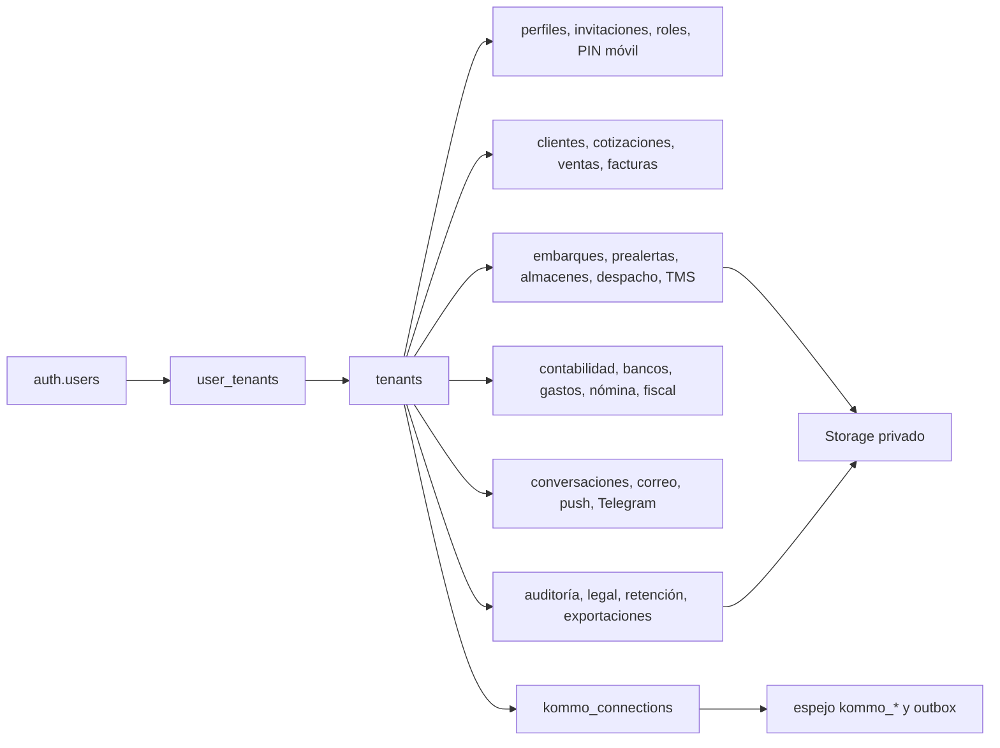
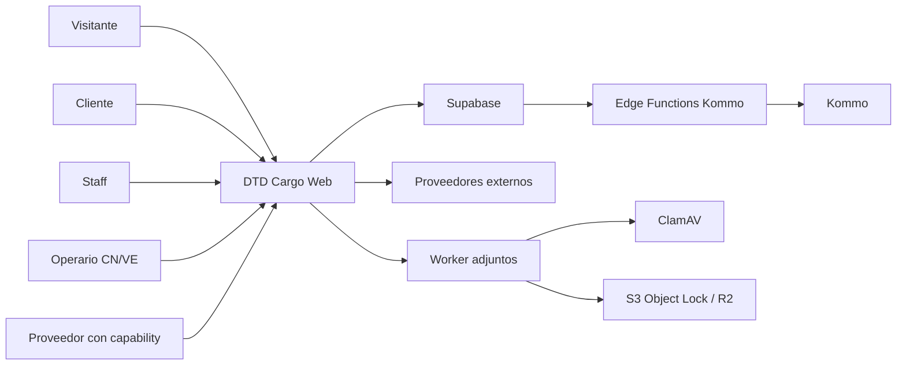
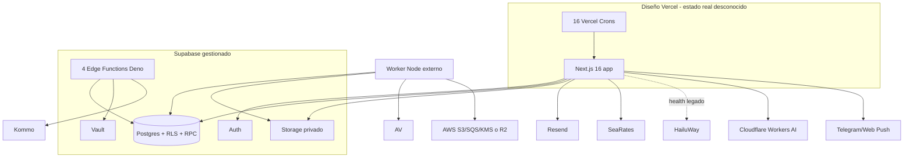
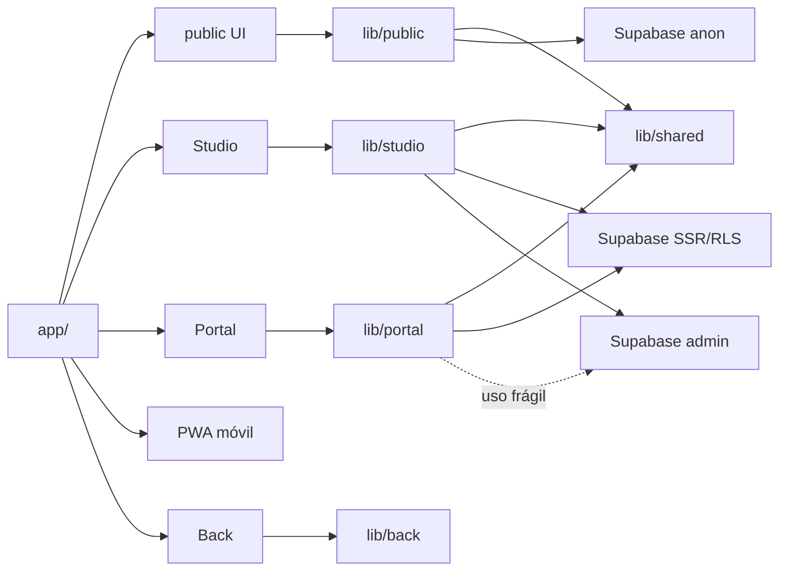
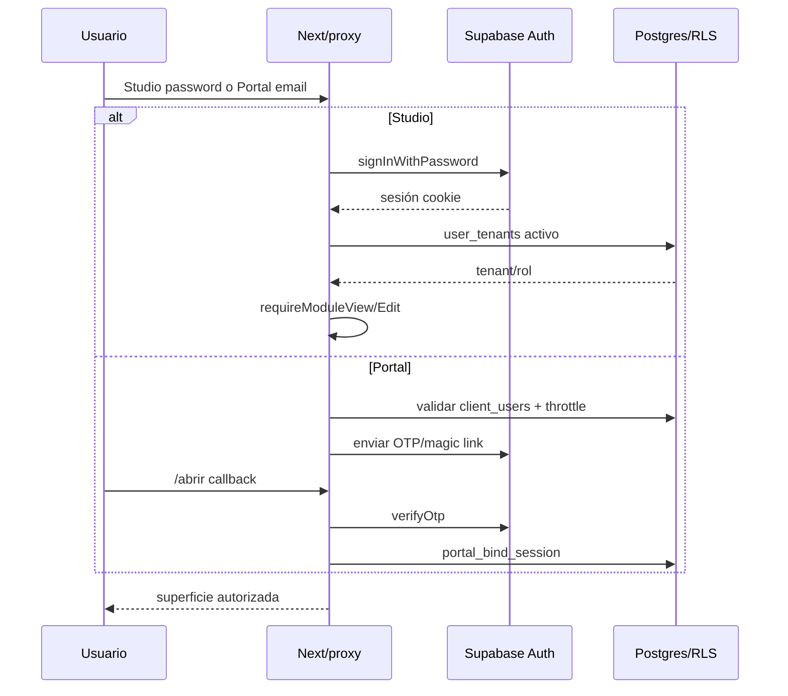
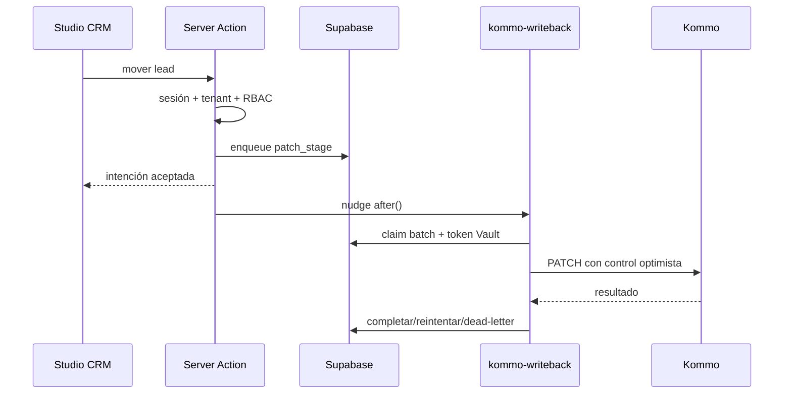
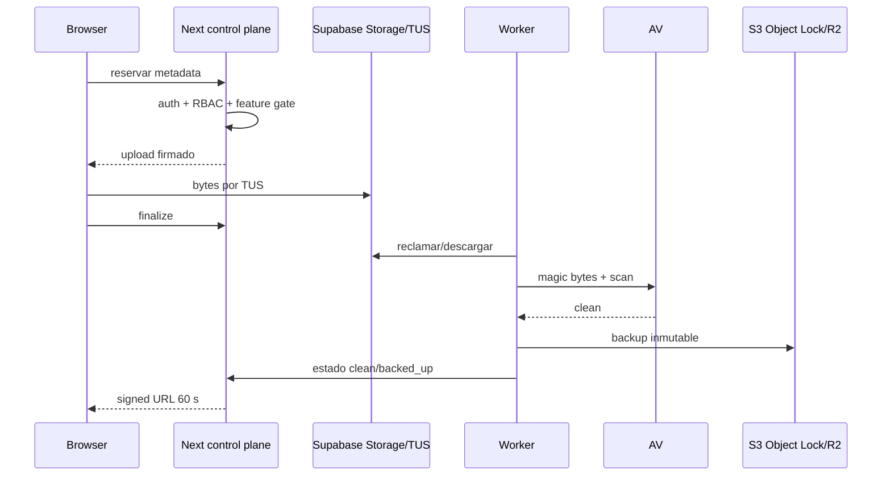
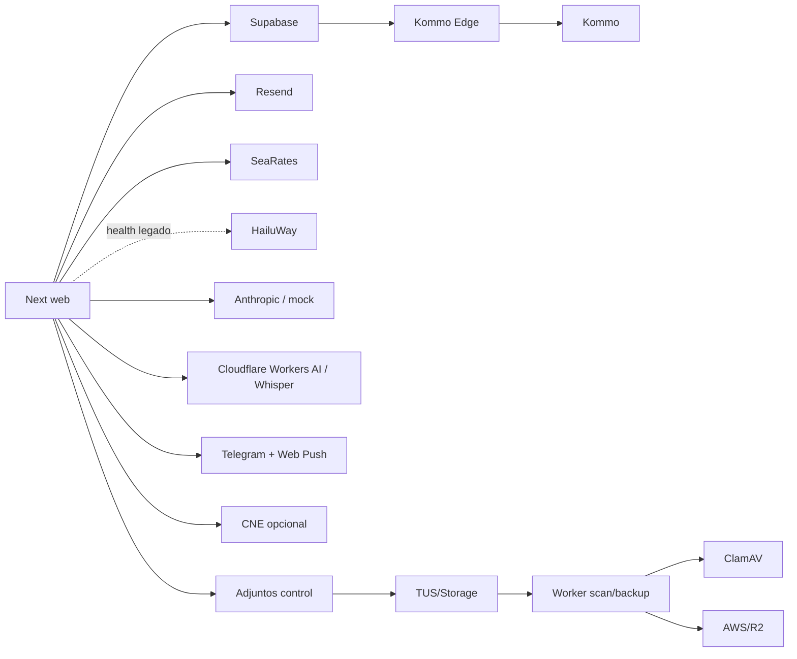

# Know-how técnico consolidado — DTD Cargo

> **Evidencia histórica, no estado vigente.** Este documento conserva la
> auditoría read-only hecha contra `1610d667` el 2026-08-30. Fue reubicado en
> `docs/audits/` durante el saneamiento del 2026-09-01; no se reescribieron sus
> conteos para que la evidencia mantenga su corte original. Antes de usar una
> cifra o conclusión operativa, debe contrastarse con el `origin/main` actual.
> Al reubicarlo, `origin/main` estaba en `2a2e81bf`: SDD-0286 ya protegía los
> `GET` de Studio por módulo y los advisories transitivos altos compatibles ya
> estaban cerrados. Los HTML derivados quedaron fuera de Git.

**Fecha de corte:** 2026-08-30
**Baseline auditado:** `origin/main@1610d667e744baf11b115bb523b5c7c491500d58`
**Modo:** ingeniería inversa read-only; sin cambios de aplicación, migraciones, datos, Cloud ni producción
**Worktree aislado:** `C:\Users\Trabajo\Desktop\Developer\software\DTD-worktrees\project-knowledge-handoff`
**Veredicto de handoff:** **🟡 Operable con riesgos**

> Este informe describe el repositorio y las comprobaciones locales ejecutadas. No afirma el estado de Vercel, Supabase Cloud, DNS, AWS, proveedores ni datos cuando esa evidencia no estaba disponible. Los valores de secretos no fueron leídos ni copiados.

## Convenciones de evidencia

- **CONFIRMADO:** observado directamente en código, configuración o ejecución local reproducible.
- **INFERIDO:** conclusión de alta confianza derivada de varias evidencias, pero no demostrada en runtime alojado.
- **DESCONOCIDO:** no existe evidencia suficiente en el repositorio o requeriría acceso externo no autorizado.
- Las rutas `archivo:línea` apuntan al baseline indicado. Los conteos son una foto del corte y deben regenerarse si cambia `origin/main`.

## Alcance y controles de no destrucción

La investigación cubrió topología, stack, arquitectura, frontend, backend, datos, autenticación, integraciones, variables de entorno, infraestructura, CI/CD, pruebas, despliegue, operación local, flujos, seguridad, accesibilidad, deuda y conocimiento implícito. Se creó un worktree desde `origin/main` porque el checkout principal tenía trabajo ajeno. En la corrida original sólo se escribieron los cuatro artefactos de `project-knowledge/`; no hubo seed, migración, deploy, consulta de filas, cambio de secretos, commit ni push. Los dos Markdown fueron reubicados posteriormente sin alterar el alcance de aquella auditoría.

El checkout principal contenía cuatro commits documentales locales no publicados y cambios ajenos en `pnpm-lock.yaml`/`pnpm-workspace.yaml`. En particular, `docs/CODEX_HANDOFF.md` existe allí, pero **no** en el baseline remoto: se usó sólo como pista y todas sus cifras se re-mideron.

# 1. Executive Summary

DTD Cargo es una plataforma logística y administrativa venezolana/china construida como un **monolito modular multi-superficie** en una sola aplicación Next.js. En el mismo paquete conviven el sitio público, un ERP interno llamado Studio, el Portal del cliente, una PWA móvil para operaciones CN/VE/ERP/EMP y un Back/CMS. El backend combina Server Components, Server Actions, Route Handlers y RPC/PostgREST sobre Supabase; cuatro Edge Functions Deno y workers de adjuntos son satélites asíncronos.

El repositorio es grande y activo: 4.748 archivos versionados, 182 páginas, 81 Route Handlers, 89 `actions.ts` bajo `app/` (93 en todo el repo), 56 módulos Studio, 394 migraciones, 305 specs SDD, 496 archivos Vitest y 14 suites Playwright. La calidad local tiene defensas poco comunes: gate de 15 pasos, contratos SQL, reconstrucción del esquema desde cero, reglas de frontera RSC/público↔ERP, gobernanza ejecutable y pruebas Deno.

El handoff no alcanza todavía autonomía operativa completa. Faltan evidencia alojada, un ambiente reproducible no productivo, CI independiente, inventario vigente de secretos/proveedores, procedimiento verificable de despliegue total y ownership de operaciones. Además, la auditoría confirmó riesgos prioritarios:

1. La matriz RBAC financiera/administrativa se aplica en Next, pero varias tablas conceden CRUD a cualquier `authenticated` del mismo tenant; RLS evita cruce de tenant, no separación de funciones.
2. El bucket WORM de backups se retiene, pero la KMS CMK asociada no; una eliminación/reemplazo del stack puede conservar objetos ilegibles.
3. La auditoría productiva de dependencias reportó 2 advisories de severidad alta, 1 moderado y 1 bajo, fuera del gate; su explotabilidad e impacto contextual en esta aplicación no se evaluaron.
4. Drafts y colas offline guardan capability token, fotos, firma, documento, GPS y datos comerciales en `localStorage`; hay caps/retry, pero no TTL, cifrado ni purga de logout demostrados.
5. Hay fallas WCAG confirmadas: zoom móvil bloqueado, idioma HTML incorrecto en chino, diálogo sin contrato de foco y otros huecos.

**Conclusión:** el equipo nuevo puede entender el sistema, instalar dependencias, trabajar con SDD, ejecutar gran parte del gate y desarrollar de forma segura. No debe asumir que puede operar producción ni aprobar un lanzamiento sin cerrar los unknowns externos y los riesgos altos.

# 2. System Overview

## Problema que resuelve

El sistema cubre el ciclo comercial y logístico de DTD Cargo:

- captación pública, calculadoras LCL/FCL/terrestre, academia, contenido y registro;
- clientes, cotizaciones, órdenes, compras, embarques, prealertas y tracking;
- recepción/estiba/bodega/despacho móvil en China y Venezuela;
- facturación, cobranzas, tesorería, gastos, bancos, contabilidad, nómina y fiscal;
- Portal para envíos, documentos, compras, facturas, reclamos y soporte;
- CRM mediante un espejo de Kommo y una outbox de escritura;
- comunicaciones por correo, push y Telegram;
- documentos/adjuntos con subida reanudable, antivirus y backup inmutable.

## Unidades de producto

| Superficie | Propósito | Páginas medidas | Entrada principal | Estado de evidencia |
|---|---:|---:|---|---|
| Sitio público y auxiliares | adquisición, información, cálculo, registro y capabilities | 44 | `app/page.tsx`, `app/tarifas/`, `app/registro/`, `app/p/[token]/` | CONFIRMADO |
| Studio ERP | operación interna y administración | 87 | `app/studio/(app)/layout.tsx` | CONFIRMADO |
| Portal cliente | autoservicio de clientes | 30 | `app/portal/(app)/layout.tsx` | CONFIRMADO |
| PWA móvil | operación CN/VE/ERP/EMP | 19 | `app/m/layout.tsx` | CONFIRMADO |
| Back/CMS | administración de contenido | 2 | `app/back/` | CONFIRMADO |
| Edge Functions | integración asíncrona Kommo | 4 | `supabase/functions/*/index.ts` | Código confirmado; deploy desconocido |
| Workers de adjuntos | scan y backup de archivos | scripts Node | `scripts/attachments-pilot-worker.mjs` | Código confirmado; hosting desconocido |

Studio registra 56 módulos distribuidos en Operación, Comercial, Finanzas, Marketing y Sistema (`lib/studio/modules.ts:20-35,91-187`). El Portal es una quinta superficie real; la documentación que enumera sólo cuatro está desactualizada (`docs/architecture/module-sdd-map.md:83-88`).

# 3. Repository Topology

## Clasificación

**CONFIRMADO:** un paquete privado `dtdcargo-web`, sin `src/`, sin submódulos y sin múltiples workspaces. `pnpm-workspace.yaml` sólo fija overrides/builds; no declara `packages:`. No es un monorepo multi-paquete.

```text
DTDCargo/
├── app/                    1.117 archivos · App Router y cinco superficies
│   ├── api/                65 Route Handlers de los 81 route.ts totales
│   ├── studio/             ERP interno
│   ├── portal/             Portal cliente
│   ├── m/                  PWA CN/VE/ERP/EMP
│   └── back/               CMS
├── components/               68 archivos · UI pública compartida
├── lib/                      913 archivos · dominio, queries, auth e integraciones
│   ├── studio/              núcleo ERP
│   ├── portal/              dominio Portal
│   ├── public/              acceso público permitido
│   ├── back/                dominio CMS
│   ├── shared/              único puente común
│   └── db/                  clientes Supabase SSR/browser/admin
├── supabase/                 555 archivos
│   ├── migrations/          394 migraciones
│   ├── tests/               138 contratos + 2 helpers SQL
│   └── functions/           4 Edge Functions Deno
├── scripts/                  116 archivos · gates, workers, seeds, generadores
├── e2e/                       14 specs Playwright
├── docs/                    1.766 archivos · 305 specs SDD + arquitectura/runbooks
├── infra/                      CloudFormation del piloto de adjuntos
├── .harness/                  checkpoints de implementación
└── project-knowledge/         este handoff generado
```

Lenguajes predominantes: 1.272 `.ts`, 905 `.tsx`, 536 `.sql` y 967 `.md`. El conteo de `docs/` incluye 873 artefactos Norte **tracked** bajo `docs/design/studio/_norte/`; son generados pero forman parte del árbol del commit. No hay Dockerfile, Compose, Terraform ni workflow de GitHub versionados. `graphify-out/graph.json` y `.mcp.json`, anunciados por documentación, no están en el baseline y no pudieron usarse.

## Inventario de entrypoints

- 182 `page.tsx`.
- 47 `layout.tsx`.
- 81 `route.ts`; 65 viven bajo `app/api/`.
- 89 `app/**/actions.ts`, 87 con directiva canónica `"use server"`; el repo tiene otros 4 módulos `lib/studio/*/actions.ts` que no son entrypoints App Router.
- 4 `supabase/functions/*/index.ts`.
- 17 endpoints de cron en `app/api/cron/` y 16 programados en `vercel.json`.
- Scripts de scan/backup, ClamAV, CloudFormation, validación y generación bajo `scripts/`.

# 4. Technology Stack

| Capa | Tecnología | Versión/uso confirmado | Evidencia |
|---|---|---|---|
| Runtime web | Node.js | local `v24.15.0`; no pin en manifest | ejecución local, `package.json` |
| Package manager | pnpm | local `11.1.2`, lock v9; sin `packageManager` | `pnpm-lock.yaml`, ejecución local |
| Framework | Next.js App Router | `16.2.11` | `package.json:60` |
| UI | React / React DOM | `19.2.4` | `package.json:63-64` |
| Lenguaje | TypeScript | 5.x strict, ES2022, `noEmit`, alias `@/*` | `tsconfig.json:2-29` |
| Estilos | Tailwind CSS / PostCSS | Tailwind 4, CSS/tokens propios | `postcss.config.mjs`, `app/globals.css` |
| Datos/Auth/Storage | Supabase | JS `^2.106.1`, SSR `^0.5.2`, PostgreSQL/RLS/RPC | `package.json`, `lib/db/` |
| Unit/integration | Vitest + Testing Library | Vitest `^4.1.7`, jsdom | `vitest.config.mts` |
| Navegador | Playwright | `^1.60.0`, 3 proyectos | `playwright.config.ts:48-52` |
| Edge | Deno | 4 funciones, verificadas con Deno 2 vía script | `scripts/check-edge-functions.mjs` |
| IA | Anthropic SDK | runtime Anthropic o mock | `lib/studio/agents/runtime/llm-client-factory.ts:2-41` |
| Archivos | Uppy/TUS, AWS SDK, file-type, Sharp | subida, scan y backup | `package.json:45-59` |
| Documentos | React PDF, qrcode | PDFs, diplomas y QR | `package.json` |
| Hosting diseñado | Vercel | app + crons | `vercel.json` |

No hay ORM, contenedor de inyección, CQRS global, Redux, Zustand, TanStack Query, SWR, MobX ni XState de primera parte. Las consultas van a PostgREST/RPC; los patrones outbox existen sólo en dominios específicos. Las Edge Functions quedan fuera de `tsc` (`tsconfig.json:38-41`) y requieren el check Deno independiente.

# 5. Architecture

## Forma real

**INFERIDO con evidencia fuerte:** monolito modular multi-superficie, desplegable como una aplicación Next.js, con Supabase como plataforma de datos/identidad y satélites asíncronos.

```text
Browser / móvil / proveedor
          │
          ▼
Next.js 16 · un proceso lógico
├── páginas y layouts RSC
├── componentes cliente
├── Server Actions
├── Route Handlers / webhook / crons
└── proxy de refresco de sesión
          │
          ├── lib/public · lib/portal · lib/studio · lib/back · lib/shared
          ▼
Supabase: Auth + Postgres/RPC/RLS + Storage + Vault
          │
          ├── 4 Edge Functions Kommo
          └── workers scan/backup de adjuntos
```

## Boundaries aplicados

- La UI pública y `components/` no pueden importar Studio, `lib/db` ni Supabase directamente (`eslint.config.mjs:48-102`).
- `lib/public/` sí usa el cliente anon, pero no puede importar Studio/DB (`eslint.config.mjs:103-120`).
- Back no puede importar Studio (`eslint.config.mjs:122-138`).
- El puente permitido es `lib/shared/`.
- Studio usa módulos de dominio `lib/studio/*`, pero el límite no es una arquitectura en capas rígida: algunas Server Actions escriben directamente a tablas.
- Seguridad usa dos capas conceptuales: RLS por tenant y RBAC por rol. El código declara que no son intercambiables, aunque el modelo SQL no aplica RBAC de forma uniforme.

## Patrones relevantes

- Server Action: sesión/tenant → guard RBAC → parsing/validator manual → query/RPC → `revalidatePath`/redirect.
- Query modules: funciones puras que reciben un `SupabaseClient`; su seguridad depende del tipo de cliente y del caller.
- Outbox: Kommo escribe primero una intención local y una Edge Function drena hacia el proveedor.
- Capabilities: enlaces `/p/[token]`, invitaciones y acceso temporal usan tokens como autoridad.
- Fail-closed: adjuntos, correo, salud y rutas privilegiadas se apagan o degradan cuando falta configuración.
- SDD/gobernanza: specs numeradas, políticas ejecutables, registros generados y checkpoints de evidencia.

## Contrato frágil de `service_role`

`lib/db/admin.ts:10-11` dice que el cliente admin no debe usarse en Server Components, pero 12 páginas/layouts Portal lo importan. Los caminos revisados prueban identidad/ownership o filtran tenant/cliente antes de consultar, por lo que no se confirmó lectura cross-client; aun así, el control depende de procedencia de IDs y convención, no de una frontera compilable. Falta `import "server-only"` y una revisión sistemática de los 12 callsites.

# 6. Applications and Services

| Componente | Tipo | Tecnología | Entry point | Puerto | DB | Dependencias | Deploy esperado |
|---|---|---|---|---:|---|---|---|
| Web multi-superficie | Aplicación | Next.js/React | `app/layout.tsx` | 3000 local | Supabase | todas las integraciones | Vercel, inferido por config |
| Sitio público | Superficie | RSC + client React | `app/page.tsx` | mismo | RPC públicas/HTTP | Supabase anon, WhatsApp; HailuWay sólo health/config legado | dentro de web |
| Studio | Superficie ERP | RSC/Actions/API | `app/studio/(app)/layout.tsx` | mismo | Supabase | correo, CRM, IA, tarifas, push | dentro de web |
| Portal | Superficie cliente | RSC/Actions | `app/portal/(app)/layout.tsx` | mismo | Supabase | correo, documentos, tracking | dentro de web |
| PWA | Superficie móvil | React/RSC/Actions | `app/m/layout.tsx` | mismo | Supabase | cámara/Storage | dentro de web |
| Back | Superficie CMS | RSC/Actions | `app/back/` | mismo | Supabase | contenido público | dentro de web |
| Cron routes | Jobs HTTP | Next Route Handlers | `app/api/cron/*` | mismo | Supabase | proveedores | Vercel Cron, 16 declarados |
| Kommo Edge | 4 funciones | Deno/Supabase | `supabase/functions/*/index.ts` | gestionado | Supabase/Vault | Kommo | Supabase Edge, estado desconocido |
| Worker adjuntos | Worker | Node/AWS/R2/AV | `scripts/attachments-pilot-worker.mjs` | N/A | Supabase | ClamAV, S3/R2, SQS | estado/host desconocido |
| PostgreSQL test | Infra efímera | Docker `postgres:17` | scripts SQL/rebuild | dinámico | local temporal | Docker | sólo gate local |

## Índice de componentes principales

| Componente/ruta | Responsabilidad | Depende de | Usado por |
|---|---|---|---|
| `proxy.ts` | refresco Auth y routing de Studio/Back | Supabase SSR, cookies | rutas protegidas |
| `lib/db/server.ts` | cliente SSR anon+sesión/RLS | env Supabase | RSC/Actions |
| `lib/db/client.ts` | cliente browser anon+sesión/RLS | env Supabase | componentes cliente |
| `lib/db/admin.ts` | cliente `service_role`, omite RLS | secreto server | API/workers y Portal actualmente |
| `lib/studio/rbac.ts` | matriz de permisos por rol/módulo | catálogo módulos | guards/UI |
| `lib/studio/rbac-guard.ts` | enforcement server-side | sesión, tenant, RBAC | páginas/Actions |
| `lib/public/*-queries.ts` | datos públicos por RPC anon | `supabase-anon.ts` | calculadoras/contenido |
| `lib/portal/*` | identidad y queries Portal | RLS + helpers | 30 páginas Portal |
| `lib/studio/kommo-*` | espejo, outbox y nudge CRM | Supabase/Vault/Edge | Studio CRM |
| `lib/studio/attachments/*` | reserva, subida, validación, gate | Storage/TUS/AV/backup | Gastos y API |
| `scripts/verify.mjs` | gate secuencial de 15 pasos | pnpm, Docker/env opcionales | cierre local |
| `docs/specs/*` | contratos SDD y decisiones | index/gate | desarrollo/gobernanza |

# 7. Backend Architecture

El backend no es un servicio separado: vive dentro de Next.js y Supabase.

## Canales de ejecución

1. **Server Components/layouts:** cargan sesión y datos durante render.
2. **Server Actions:** 89 archivos bajo `app/` (87 con `"use server"`); validación manual de `FormData`, guard RBAC, mutación y revalidación. Cuatro `lib/studio/*/actions.ts` son módulos de dominio, no entrypoints App Router.
3. **Route Handlers:** 81 totales; 65 bajo `app/api/`, incluyendo Studio, móvil, Portal, públicos, webhook, debug y crons.
4. **RPC/PostgREST:** consultas directas desde `lib/*`; no existe ORM.
5. **Edge Functions Deno:** sync/webhook/writeback/push de Kommo.
6. **Workers/scripts:** adjuntos, infraestructura, seeds y generadores.

`app/studio/(app)/tracking/nuevo/actions.ts:51-171` ejemplifica el patrón: parsea/valida, comprueba tenant y edición, inserta `shipments`, dispara eventos/workflow/costing best-effort y redirige. También demuestra que `Action → query module` es convención, no límite obligatorio.

## Mapa backend por dominio

| Dominio | Responsabilidad y dependencias | Entradas | Persistencia | Eventos / integraciones |
|---|---|---|---|---|
| Identity / RBAC | sesión Supabase, tenancy, roles, PIN y guards (`lib/auth`, `rbac.ts`, `rbac-guard.ts`, `proxy.ts`) | layouts, usuarios/invitaciones Actions | `user_tenants`, perfiles, invitaciones, operarios | Supabase Auth; auditoría de identidad |
| Comercial | clientes, tarifas, cotizaciones, ventas/compras y proveedores | módulos `clientes`, `cotizador`, `ordenes-*`; Actions | `clients`, `rates`, `quotes`, sales/purchase orders, suppliers | registro, mail/push, CRM/writeback |
| Operaciones / WMS / TMS | embarques, recepción CN/VE, inventario, despacho, tracking y rutas | módulos Studio/móvil; `/api/studio/shipments*` | shipments/events, warehouses, receipts, inventory, TMS | triggers de estado, push, documentos, SeaRates |
| Finanzas | facturación, cobranzas, tesorería, contabilidad, bancos, gastos, nómina/fiscal | módulos Studio y postings de `lib/studio/accounting` | invoices/receipts, journal entries/lines, accounts, statements, payroll | ledger, email, documentos; compensaciones manuales en algunos flujos |
| Portal | autoservicio cliente, compras, facturas, referidos, academia y mensajes | 13 Actions, callback y 30 páginas; `lib/portal` | `client_users` + ERP filtrado por cliente | magic link, email/push, YouTube; alta no atómica DTD-9017 |
| CRM / Kommo | espejo de leads/contactos/tareas y outbox | Studio CRM, crons, 4 Edge Functions | 12 `kommo_*`, sync logs, outbox/connections | API/webhook Kommo, Vault, retry 429/5xx |
| Notificaciones | mail, Telegram, Web Push, conversaciones y colas | crons, webhooks Resend/Telegram y helpers | `mail_logs`, subscriptions/outboxes, conversations/messages | Resend, Telegram, push services |
| Adjuntos | reserva/finalize/scan/download/restore/evidencia | 6 routes Studio, `lib/studio/attachments`, worker | `documents`, Storage privado, receipts/jobs | TUS, AV, S3/SQS/KMS o R2 |
| Agentes / Gobernanza | runtime LLM, tools/policies, workflow y auditoría | `/api/studio/agents/run`, cron workflow, scripts governance | agents, skills, runs/approvals, workflow/audit | Anthropic o MockLLM, notificaciones |
| Back / Contenido | CMS liviano y datos públicos; Marca es circuito separado | 2 Actions Back, queries públicas, `/marca/doc` | tablas `back_*`/`news_posts`; `brand-assets` | Supabase; CDN/Fuentes del visor |

Conteo estructural: Studio 715 archivos/75 Actions/5 routes; Portal 127/13/3; Back 7/2/0; API Studio 26 routes; crons 17; `lib/studio` 721 archivos y `lib/portal` 61. Estos son dominios lógicos dentro del mismo proceso web, no servicios desplegables independientes.

## Manejo de errores y degradación

- Configuración crítica suele lanzar/fallar cerrado.
- Integraciones no esenciales usan mock/no-op o registran pendiente.
- Los crons exigen `CRON_SECRET` según revisión estática.
- Hay `error.tsx` propios sólo en Studio y Portal; público, Back y móvil dependen del fallback de Next.
- No hay logger estructurado transversal; predominan `console.*`, tablas de auditoría y health endpoints.

# 8. Frontend Architecture

## Composición y estado

- App Router con RSC por defecto y 512 archivos `"use client"`.
- 388 archivos usan `useState`; 147 usan `useActionState`.
- Estado distribuido entre servidor, URL, formularios y estado React local; no hay store global de tercera parte.
- UI Studio propia en `app/studio/_components/ui/`; tokens en `app/studio/tokens.css`.
- UI pública en `components/` y CSS de marca; no debe importar ERP/DB.
- Fuentes mediante `next/font`; 16 combinaciones peso/familia se cargan globalmente. JetBrains Mono vive fuera del layout y debe inyectarse donde se usa.

## Navegación y rendering

- Redirecciones heredadas viven en `next.config.ts`; `/portal/login` y `/track*` llegan a `/entrar`.
- La página pública `/tarifas` carga RPCs en paralelo y delega cálculo interactivo a `CalculadoraForm`.
- Portal y Studio usan layouts como segunda barrera tras `proxy.ts`.
- PWA comparte dominios pero implementa login por PIN y flujos adaptados a cámara/touch.

## Calidad web confirmada

Positivos:

- 23/23 páginas públicas normativas tienen metadata; 21 canonical y 3 `noindex`.
- `robots.ts`, sitemap dinámico, OpenGraph y JSON-LD escapado.
- Uso extendido de `next/image`; videos grandes lazy-load con `IntersectionObserver` y espacio reservado.
- 54 referencias a `prefers-reduced-motion` y foco visible global en Studio (`app/studio/tokens.css:397-405`).
- HSTS, `nosniff`, Referrer-Policy y Permissions-Policy; CSP presente pero parcial por excepciones documentadas más adelante (`next.config.ts:38-151`).

Huecos comprobados:

- PWA bloquea zoom (`app/m/layout.tsx:53-58`).
- `<html lang="es">` no cambia cuando Studio usa `zh-CN` (`app/layout.tsx:312-314`, `lib/i18n/LocaleProvider.tsx:37-63`).
- Falta skip link global (`app/layout.tsx:308-341`).
- `RunAgentModal` no implementa nombre/foco/trap/Escape/restauración aunque existe un hook canónico (`app/studio/(app)/admin/agentes/_components/RunAgentModal.tsx:95-163`, `app/studio/_components/ui/drawer/useDialogA11y.ts:34-114`).
- `FichaF2` salta niveles de heading; FCL no anuncia resultado; tabs no implementan teclado ARIA completo.
- Placeholders medidos: `grey-500/60` ≈ 2,43:1 y `grey-700/60` ≈ 3,69:1, bajo 4,5:1.
- El layout raíz declara 16 variantes/pesos globales mediante `next/font` (`app/layout.tsx:24-52`). El impacto real en bytes transferidos y CWV no fue medido.

# 9. Data Architecture

## Plataforma y escala

- Supabase Postgres, Auth, Storage, RPC, Vault y Edge Functions.
- 394 migraciones SQL.
- 255 tablas `public.*` detectadas estáticamente.
- 255 con RLS habilitado; 237 con política explícita.
- 18 con RLS sin política, principalmente auditoría/throttles/catálogos internos: deny-by-default, no exposición.
- 14 buckets declarados en migraciones, todos privados.
- 140 archivos SQL de prueba: 138 `*.test.sql` ejecutables + `_supabase-platform-stubs.sql` y `_tenant-isolation.assert.sql`.
- No existe `supabase/config.toml`; el repo no define un stack Supabase local persistente.

## Modelo conceptual



El patrón dominante es `tenant_id` + RLS. Entidades maestras del ERP incluyen clientes, embarques, cotizaciones, órdenes, facturas, recibos y contabilidad. Kommo es la excepción declarada: maestro del embudo comercial con espejo local `kommo_*`, sync logs y outbox; el ERP no escribe directamente el espejo.

## Migraciones y contratos

- La numeración se valida con `pnpm sdd:check`/`check-numbering.mjs`.
- Hay 11 colisiones históricas exactas allowlisted porque ya fueron aplicadas; tres migraciones usan `0394`. No deben renumerarse.
- El gate reconstruyó localmente el esquema con Postgres 17: 394 archivos, 376 aplicados al rebuild y 18 ledger-only, seguido por barrido de aislamiento sobre 219 tablas con dos tenants de prueba.
- Aplicar producción exige el runbook, autorización nominal y una migración por vez. Esta investigación no lo hizo.

## Conexión, pooling y atomicidad

- La aplicación no abre conexiones Postgres directas ni trae ORM/driver SQL. `lib/db/server.ts`, `client.ts` y `admin.ts` hablan por Supabase JS sobre HTTP/PostgREST/Auth/Storage; por tanto el pooling efectivo es administrado por Supabase.
- `.env.example:64-66` documenta `DATABASE_URL` hacia el pooler Supabase en puerto 6543, pero no existe consumidor runtime, paquete `pg`/`postgres` ni pool configurable. Tamaño, modo y límites del pool alojado son **DESCONOCIDOS**.
- Se midieron 256 llamadas `.rpc(` en 143 archivos. La atomicidad compleja suele delegarse a funciones Postgres; por ejemplo, el presupuesto de agentes usa `FOR UPDATE` (`supabase/migrations/0015_agents.sql:210-227`). No existe un transaction client TypeScript transversal.
- Algunos flujos TypeScript son secuenciales y compensan best-effort. El endpoint de eventos de embarque actualiza `shipments`, inserta evento y revierte manualmente si falla (`app/api/studio/shipments/[id]/events/route.ts:96-135`).
- El registro público también es no atómico: cliente, Auth y binding Portal son pasos separados. `alta-health` detecta el incidente conocido `DTD-9017`, pero no lo repara (`app/registro/actions.ts:232-389`; `lib/studio/alta-health.ts:1-23`; `app/api/cron/alta-health/route.ts:1-42`).
- Los scripts de rebuild aplican migraciones con `--single-transaction`; los contratos SQL terminan en rollback y ambos eliminan su Postgres Docker temporal (`scripts/check-schema-rebuild.mjs:21,214-231,278`; `scripts/run-sql-tests.mjs:14,137-138`).

## Índices, constraints, views, triggers y funciones

Conteo estático de declaraciones acumuladas en las 394 migraciones; no representa el catálogo final de Cloud y puede incluir reemplazos históricos.

| Objeto | Declaraciones encontradas | Borrados encontrados | Ejemplo |
|---|---:|---:|---|
| Índices | 690 en 197 migraciones | 5 | índice parcial compuesto `clients_tenant_name_idx` (`supabase/migrations/0006_clients.sql:32-33`) |
| Views | 2 | 0 | `supplier_scorecard_v` con `security_invoker` (`supabase/migrations/0236_supplier_scorecard.sql:317-323`) |
| Triggers | 265 en 132 migraciones | 95 | touch/reloj de llegada (`supabase/migrations/0002_shipments.sql:102-126`) |
| Funciones | 581 | no consolidado | RPCs, triggers y helpers versionados |
| Primary keys | 320 | — | `tenants.id` y PK compuesta `user_tenants` (`supabase/migrations/0001_init_tenancy.sql:9-28`) |
| Foreign keys / `REFERENCES` | 824 | — | `user_tenants → auth.users/tenants` (`supabase/migrations/0001_init_tenancy.sql:23-28`) |
| `UNIQUE` | 327 | — | `(tenant_id, code)` en `shipments` (`supabase/migrations/0002_shipments.sql:31-51`) |
| `CHECK` | 527, excluyendo `WITH CHECK` de RLS | — | enums, estados y rangos en múltiples migraciones |

La segunda view es `clients_phone_no_normalizable` (`supabase/migrations/0353_normaliza_telefonos_clientes.sql:101-119`). Los conteos se reprodujeron con `rg --pcre2` sobre `supabase/migrations/*.sql`; catálogo, uso y advisors de índices en producción requieren una inspección metadata-only autorizada.

## Storage

- `erp-attachments` es privado, 25 MB, con tipos restringidos (`supabase/migrations/0310_erp_attachments_bucket.sql:1-25`).
- Paths canónicos rechazan traversal; uploads sin `upsert`; descarga sólo con `scan_status=clean`; URL firmada 60 s.
- Validación por magic bytes/MIME/SHA-256 y antivirus fail-closed.
- La documentación legal enumera 12 buckets observados mientras las migraciones declaran 14; el inventario Cloud es desconocido.

## Inicialización y seeds

- Desde cero, el único procedimiento reproducible demostrado es `node scripts/check-schema-rebuild.mjs`: crea PostgreSQL 17 desechable, aplica/normaliza las 394 migraciones y ejecuta el barrido de aislamiento. No deja una DB servible para `pnpm dev`.
- Una base existente se actualiza con migraciones correlativas mediante el runbook `docs/runbooks/aplicar-migraciones-prod.md`, una por vez y con autorización nominal; no hay migrador automático de aplicación.
- `pnpm seed` ejecuta `scripts/seed.ts` contra el Supabase configurado y **escribe datos**. Sólo debe usarse en un entorno aislado/no productivo explícitamente aprobado; no se ejecutó durante esta investigación.
- No existe `supabase/config.toml`, snapshot canónico ni fixture que convierta un clone en un backend persistente completo. Catálogos/fixtures requeridos por E2E Tier 3 proceden de una branch efímera y scripts específicos.

# 10. Authentication & Authorization

## Identidades

| Superficie | Autenticación | Membresía/alcance | Enforcement |
|---|---|---|---|
| Studio | email + password Supabase | `user_tenants` activo | `proxy.ts`, layout, `rbac-guard.ts` |
| Portal | magic link/OTP | `client_users` / RPC de binding | `/entrar`, `/abrir`, layout Portal, RLS |
| Back | email + password | gate propio | proxy/layout |
| PWA operario | PIN 4 dígitos | operario/tenant/región | RPC, throttle, cookie HTTP-only |
| Proveedor | capability `/p/[token]` | token de prealerta | página/query con service role |
| Crons/debug | bearer/shared secret | endpoint concreto | Route Handler |

`proxy.ts:62-176` usa `auth.getUser()` para refrescar cookies y separar rutas. Studio repite sesión/membresía en `app/studio/(app)/layout.tsx:34-99`; guards de módulo/acción viven en `lib/studio/rbac-guard.ts:55-183`. Los módulos de dinero y administración están restringidos en `lib/studio/rbac.ts:160-188`.

## Ciclo de sesión y credenciales

| Superficie | Alta/login | Refresh/cookie | Logout | Recuperación/cambio |
|---|---|---|---|---|
| Studio | `signInWithPassword` | Supabase SSR; `proxy.ts` refresca token | `auth.signOut()` y redirect a `/studio/login` (`app/studio/(app)/actions.ts:13-17`) | Flujo `/studio/login/recuperar`; cambio autenticado en `app/studio/_components/wiring/ProfileModal.tsx:266` |
| Back | password Supabase | mismo proxy/cookies SSR | comparte patrón Auth del área | no se halló flujo Back independiente; **DESCONOCIDO** si Studio recovery es el procedimiento operativo |
| Portal | `signInWithOtp` + bind | Supabase SSR y layout Portal | `auth.signOut()` → `/entrar` (`app/portal/actions.ts:11-15`) | No existe contraseña por decisión explícita; acceso sólo magic link (`app/portal/actions.ts:17-19`) |
| PWA operario | RPC de PIN con throttle | cookie HTTP-only `SameSite=Lax`, revalidada server-side | borra cookie bajo `/m` (`lib/auth/operario-session.ts:259-270`) | reset/rotación de PIN es operación Studio; ownership externo no confirmado |
| Capability proveedor | token de URL | sin sesión de usuario; capacidad por token | no hay logout | revocación/expiración depende del recurso y su contrato |

No se observó almacenamiento browser de tokens Supabase por código propio: el ciclo normal queda en cookies gestionadas por el cliente SSR. El matcher de `proxy.ts` es crítico; una pantalla que use `auth.getUser()` fuera del matcher puede perder refresh y expulsar al usuario al vencer el token.

## Distinción crucial

- **RLS:** aislamiento de tenant/propiedad en Postgres.
- **RBAC:** capacidad por rol/módulo en Next.

La auditoría confirmó que varias tablas sensibles sólo aplican la primera. `invoices`, mailing y conciliación bancaria conceden CRUD a `authenticated` con política por tenant (`supabase/migrations/0077_invoices.sql:108-118`, `supabase/migrations/0018_mailing.sql:295-336`, `supabase/migrations/0167_bank_reconciliation.sql:107-138`). Un usuario autenticado puede evitar la UI y usar PostgREST directamente dentro de su tenant. Cross-tenant permanece bloqueado; separación de funciones intra-tenant no.

Manifestación adicional: la descarga de documentos sólo exige sesión y la RLS permite CRUD tenant-wide (`app/api/studio/attachments/[id]/download/route.ts:8-18`, `supabase/migrations/0097_documentos_hub.sql:100-121`). Conocer un UUID podría saltar el acceso del módulo.

## Riesgos de sesión/capability

- La cookie móvil contiene UUID de operario sin firma/HMAC; el servidor revalida activo con service role. Forja condicionada a conocer un UUID activo: riesgo medio.
- El borrador packing-list conserva token en el nombre de clave `localStorage` y PII/comercial en valor, hasta 12 snapshots sin TTL/limpieza. Las colas offline móviles también persisten foto/firma/receptor/documento/notas/GPS o Shipping Mark; borran tras retry exitoso, pero no demuestran cifrado, TTL o limpieza por logout/dispositivo compartido (`app/m/_lib/pod-queue.ts:20-38`, `app/m/_lib/photo-queue.ts:24-39`, `app/m/_lib/split-queue.ts:30-43`).
- El cliente admin no incluye una frontera `server-only` y su uso Portal depende de scoping correcto de cada caller.

# 11. External Integrations

| Integración / naturaleza | Autenticación | Retry / timeout explícito | Dependencia y consumidor local | Sin configuración / estado |
|---|---|---|---|---|
| Supabase — API activa | URL+anon; JWT/cookies; `service_role` admin | No configurados en wrappers; defaults SDK desconocidos | `lib/db/{server,client,admin}.ts`; Auth/DB/RPC/Storage/Vault/Edge | Protegido no arranca sin URL+anon; admin lanza sin service role. Cloud **DESCONOCIDO** |
| Kommo — API + webhook | OAuth desde Vault; Bearer service role entre servicios; secreto webhook en query | 4 intentos para 429/5xx, `Retry-After` o backoff; sin timeout HTTP explícito | `lib/studio/kommo-*`, espejo/outbox y 4 Edge Functions | Writeback dry-run por defecto; sin token falla cerrado. Deploy/Vault **DESCONOCIDOS** |
| Resend — API + webhook | Bearer API key; webhook HMAC/Svix | Sin timeout/retry HTTP explícito; batch usa idempotency key | `lib/studio/mail/*`, mail cron, conversaciones/notificaciones | `mock_no_key`; `mail_logs` puede quedar `queued`. Proveedor **DESCONOCIDO** |
| Anthropic — API activa | `x-api-key` vía SDK | Sin timeout/retry SDK configurado; máximo 10 iteraciones de tools, no retries HTTP | agente Studio, bitácora, CEO brief | `MockLLMClient` sin key o con `LLM_FORCE_MOCK=1` |
| Cloudflare Workers AI / Whisper — API activa | Bearer `CLOUDFLARE_API_TOKEN` + account ID/model | Sin timeout ni retry explícito | `lib/studio/bitacora/transcribe.ts:53-104`; `/api/studio/bitacora/transcribe`; `NuevaReunionClient` | Sin account/token falla cerrado; cuenta/deploy **DESCONOCIDOS** |
| OpenRouter — health-only | Bearer API key | Health 5 s, sin retry | `/studio/debug`, `lib/studio/integration-health.ts:219-235` | Sin runtime de generación hallado; falta key → `skipped` |
| SeaRates — API activa | Platform ID/API key y JWT Bearer GraphQL | Timeout 12 s, sin retry; token cacheado hasta `exp−60s` | rates/tracking, cron refresh, cache `ocean_rates` | `mock_no_key`, sin HTTP; contrato/proveedor **DESCONOCIDO** |
| HailuWay — health/legado | `x-api-key` | Health 5 s, sin retry | sólo `integration-health.ts`/`env-status.ts`; no se halló consumidor funcional | `skipped`; estado funcional **DESCONOCIDO** |
| Telegram — API + webhook | Token en URL Bot API; shared secret webhook | Sin timeout/retry explícito | alert routing, bugs, CEO brief, crons/contacto | Error/no-op controlado; proveedor **DESCONOCIDO** |
| Web Push — API activa | VAPID public/private/subject | Sin timeout/retry inmediato; outbox aporta durabilidad | opt-in y cron `push-drain` | Sin VAPID → no-op; TTL 24 h usuario/12 h operario |
| AWS S3/SQS/KMS/CFN — piloto | Claves estáticas o default credential chain según pieza | Defaults SDK; AV HTTP 60 s | worker y scripts adjuntos | Variables/gates faltantes → fail-closed; hosting **DESCONOCIDO** |
| Cloudflare R2 — API S3 piloto | Access+secret+endpoint | Defaults SDK; sin retry/timeout explícito | worker, live validation y restore | Allow explícito/HTTPS/retención; falta → throw. Estado **DESCONOCIDO** |
| ClamAV / AV HTTP — piloto | Bearer compartido; `clamd` loopback | 60 s HTTP/socket, sin retry | worker + `scripts/attachments-clamav-http.mjs` | Allow/token obligatorios; fail-closed |
| CNE — API opcional | Sin API key en provider actual | Abort 8 s, sin retry | `lib/studio/identity/providers/cne-cedulave.ts`, clientes | Sin URL → `null` y piso manual; proveedor **DESCONOCIDO** |
| WhatsApp — enlace saliente | Ninguna | No aplica | `wa.me` en público, registro, Portal y móvil | No hay API saliente; el usuario confirma envío |
| GA4 + Google Ads — scripts browser | IDs públicos; Consent Mode v2 | Navegador; no se configura retry | `components/Analytics.tsx:20-42,232-265` | Dev apagado sin env; producción tiene fallback cableado. Cuenta **DESCONOCIDA** |
| Nominatim — geocoding API | Sin key; `User-Agent` identificable | Sin timeout/retry; `cache: no-store` | `lib/studio/geocoding.ts:1-87`; Action clientes | Error a UI, sin fallback automático; límite 1 req/s no implementado server-side |
| Vercel REST — API read-only | Bearer token+project; team opcional | Sin timeout/retry; cache Next 60 s | historial en `/studio/debug`, `lib/studio/vercel-deploys.ts:1-117` | `mock_no_token`, sin HTTP; proyecto **DESCONOCIDO** |
| YouTube — iframe/embed | Sin key | Navegador | addons y Academia Portal | URL inválida → placeholder; addon carga iframe al click |
| Marca: Google Fonts + CDN — recursos browser | Sin key; visor gated por Marca | Navegador; sin fallback/retry propio | HTML `brand-assets`; hosts exactos en `next.config.ts:56-127` | Código documenta historial de docs rotos/blancos; estado alojado **DESCONOCIDO** |

Las 20 filas son el inventario externo observable en el baseline. API activa, health-only, iframe, recurso browser y simple enlace no son equivalentes. No se confirmó ningún SLA, cuota contratada, owner, cuenta ni disponibilidad alojada sólo por encontrar el consumidor.

Riesgos específicos:

- Tres superficies aceptan secreto/capability en query string y pueden filtrarlo en access logs, historial o copias de URL: Kommo (`supabase/functions/kommo-webhook/index.ts:326-335`), Telegram —limitación del contrato actual con el proveedor— (`app/api/telegram/webhook/route.ts:1-6,33-46`) y el HTML interno legacy CBM (`app/admin/cbm-estudio/route.ts:4-8,69-95`). CBM falla cerrado sin token, pero no tiene throttle propio.
- CNE transmite nacionalidad/cédula por GET y no exige HTTPS; enlaces manuales son `http://`.
- `/verificar` aplica throttle Next, pero RPCs `academy_verify_diploma` y `markbox_existe_publico` son ejecutables por `anon`, permitiendo evadirlo.
- La migración del drain Kommo deja `cron.schedule` comentado; el nudge de aplicación existe, pero programación externa es desconocida.
- Nominatim promete respetar 1 req/s “via cache + UX”, pero el fetch usa `cache: "no-store"`, sin timeout/retry, y la Action sólo comprueba usuario —no membresía, RBAC ni throttle— (`lib/studio/geocoding.ts:1-11,40-45`; `app/studio/(app)/clientes/actions.ts:381-401`). El cumplimiento del contrato del proveedor no está demostrado.

# 12. Configuration & Environment Variables

`.env.example` contiene 107 asignaciones y comentarios. El escaneo estático reproducible encontró 119 nombres referenciados y 34 no declarados: 115/30 si se excluyen cuatro variables del host/herramienta (`BASE_URL`, `CODEX_HOME`, `LOCALAPPDATA`, `PLAYWRIGHT_BROWSERS_PATH`). Hay 22 declaradas sin referencia literal directa. No se leyeron valores.

## Categorías

- **Arranque web:** `NEXT_PUBLIC_SUPABASE_URL`, `NEXT_PUBLIC_SUPABASE_ANON_KEY`.
- **Backend privilegiado:** `SUPABASE_SERVICE_ROLE_KEY`, `DATABASE_URL`.
- **Seguridad operativa:** `CRON_SECRET`, `MARCA_ACCESS_SECRET`, `EMAIL_UNSUBSCRIBE_SECRET`, `NEWSLETTER_IP_HASH_SECRET`.
- **Correo:** `RESEND_API_KEY`, `RESEND_WEBHOOK_SECRET`, `RESEND_INBOUND_WEBHOOK_SECRET`.
- **CRM:** `KOMMO_WEBHOOK_SECRET`, `KOMMO_PUSH_DRY_RUN`; tokens de negocio en Vault.
- **IA:** `ANTHROPIC_API_KEY`, `OPENROUTER_API_KEY`, modelos, `LLM_FORCE_MOCK`, Cloudflare.
- **Tarifas/APIs:** `SEARATES_*`, `NEXT_PUBLIC_HAILUWAY_API`, `DTD_API_KEY`.
- **Notificaciones:** `TELEGRAM_*`, `NEXT_PUBLIC_VAPID_PUBLIC_KEY`, `VAPID_PRIVATE_KEY`, `VAPID_SUBJECT`.
- **Adjuntos:** familia `DTD_ATTACHMENTS_*` para AV, backup, AWS/R2 y evidencias.
- **E2E:** `E2E_SUPABASE_*`, `STUDIO_E2E_*`, `E2E_ENVIRONMENT_KIND=ephemeral`.

## Matriz exhaustiva de variables declaradas

“Obligatoria” se evalúa por componente: sólo las dos variables públicas de Supabase son indispensables para arrancar las superficies autenticadas; las demás son condicionales al flujo o proveedor. “Ninguno” significa que el código falla cerrado, degrada o no habilita la función. Los defaults mostrados son públicos/no sensibles y proceden del ejemplo o del código; no se inspeccionaron valores de ningún `.env.local`.

### Aplicación, CMS, Supabase, IA e integraciones

| Variable | Componente | Obligatoria | Default | Propósito | Fuente esperada |
|---|---|---|---|---|---|
| `NEXT_PUBLIC_HAILUWAY_API` | Health/config HailuWay legado | Condicional: reactivar HailuWay real | Ejemplo `http://localhost:3000` | URL base del ERP externo | Deployment HailuWay |
| `DTD_API_KEY` | Health/cliente legado HailuWay | Condicional | Ninguno | Cabecera `X-DTD-Key` | HailuWay / secret manager |
| `NEXT_PUBLIC_WHATSAPP_NUMBER` | Fallback de contacto público | No; sin uso estático directo | Ejemplo público | Número visible | Configuración comercial |
| `NEXT_PUBLIC_CONTACT_EMAIL` | Fallback de contacto público | No; sin uso estático directo | Ejemplo público | Email visible | Configuración comercial |
| `NEXT_PUBLIC_SITE_URL` | SEO, enlaces, correo, Portal/Studio | No; debe fijarse en producción | `https://dtdcargo.com`; algunos flujos locales usan localhost | URL canónica/base | Dominio aprobado/Vercel |
| `NEXT_PUBLIC_GA_ID` | Analytics público | No | ID cableado posible en producción; dev apagado | Measurement ID GA4 | Google Analytics |
| `CBM_ESTUDIO_TOKEN` | `/admin/cbm-estudio` | Sí para esa presentación | Ninguno; ausencia → 503 | Gate interno | Secret manager |
| `DEBUG_HEALTH_SECRET` | `/api/debug/health` | Sí para diagnóstico | Ninguno; ausencia → 503 | Bearer de health | Vercel/secret manager |
| `DATABASE_URL` | Payload/Postgres declarado | Condicional; sin uso estático directo | Ninguno | Connection string/pooler | Supabase/gestor DB |
| `PAYLOAD_SECRET` | Payload CMS declarado | Condicional; sin runtime observable | Ninguno | Firmas/sesión Payload | Secret manager |
| `S3_ENDPOINT` | Storage Payload declarado | Condicional; sin runtime observable | Ninguno | Endpoint S3-compatible | Proveedor Storage |
| `S3_REGION` | Storage Payload declarado | Condicional | `eu-west-2` en ejemplo | Región S3 | Proveedor Storage |
| `S3_BUCKET` | Storage Payload declarado | Condicional | `media` en ejemplo | Bucket de medios | Proveedor Storage |
| `S3_ACCESS_KEY_ID` | Storage Payload declarado | Condicional | Ninguno | Access key | Secret manager |
| `S3_SECRET_ACCESS_KEY` | Storage Payload declarado | Condicional | Ninguno | Secret key | Secret manager |
| `NEXT_PUBLIC_SUPABASE_URL` | Studio, Portal, Back, proxy y clientes DB | **Sí para superficies autenticadas** | Ninguno | URL del proyecto | Supabase de entorno aprobado |
| `NEXT_PUBLIC_SUPABASE_ANON_KEY` | Studio, Portal, Back, proxy y clientes DB | **Sí para superficies autenticadas** | Ninguno | Clave anon con RLS | Supabase de entorno aprobado |
| `SUPABASE_SERVICE_ROLE_KEY` | Admin server, seeds y E2E | Condicional; nunca cliente | Ninguno | Acceso que omite RLS | Supabase/secret manager server-only |
| `ANTHROPIC_API_KEY` | Agentes, bitácora y CEO brief | No | Mock sin clave | Llamadas Anthropic | Anthropic/secret manager |
| `LLM_FORCE_MOCK` | Runtime IA | No | Falso/ausente | Forzar mock | Dev/CI |
| `BITACORA_ACTA_MODEL` | Bitácora/actas | No | Modelo cableado/documentado | Selección de modelo | Configuración IA |
| `CLOUDFLARE_ACCOUNT_ID` | Transcripción Bitácora | Sí junto al token para audio | Ninguno; ausencia → 503 | Cuenta Workers AI | Cloudflare |
| `CLOUDFLARE_API_TOKEN` | Transcripción Bitácora | Sí junto al account ID | Ninguno; ausencia → 503 | Autorizar Workers AI | Cloudflare/secret manager |
| `CF_WHISPER_MODEL` | Transcripción Bitácora | No | `@cf/openai/whisper-large-v3-turbo` | Modelo Whisper | Catálogo Workers AI |
| `BITACORA_PURGE_ORPHANS_ENABLED` | Cron de audios huérfanos | No; opt-in | Dry-run/falso | Permitir borrado real | Decisión operativa |
| `OPENROUTER_API_KEY` | Provider LLM alternativo | No | Provider no disponible | Autorizar OpenRouter | OpenRouter/secret manager |
| `RESEND_API_KEY` | Correo saliente | Condicional: envío real | Mock/cola sin envío | Autorizar Resend | Resend/secret manager |
| `RESEND_WEBHOOK_SECRET` | Webhook Resend | Sí para procesarlo | Ausencia → 503 | Verificar webhook | Resend |
| `SEARATES_API_BASE` | Rates marítimos | No | Endpoint GraphQL oficial | Endpoint rates | SeaRates |
| `SEARATES_PLATFORM_ID` | Rates marítimos | Condicional: live | Ejemplo público `46314` | ID de plataforma | SeaRates |
| `SEARATES_API_KEY` | Rates/tracking SeaRates | Condicional: live | Mock `mock_no_key` | Autorizar API | SeaRates/secret manager |
| `NEXT_PUBLIC_VAPID_PUBLIC_KEY` | PWA/Studio push | Sí para push real | Ninguno | Llave pública | Par VAPID generado |
| `VAPID_PRIVATE_KEY` | Envío Web Push | Sí para push real | No-op sin llaves | Firmar push | Secret manager server-only |
| `VAPID_SUBJECT` | Envío Web Push | No | `mailto:vzla@dtdcargo.com` | Contacto VAPID | Operación |
| `CRON_SECRET` | `/api/cron/*` | Sí para crons protegidos | Ninguno | Autorizar invocaciones | Vercel/secret manager |
| `PORTAL_COLD_REMINDER` | Recordatorio Portal | No | OFF | Activar reenvío | Decisión operativa |
| `DTD_ANDROID_CERT_SHA256` | `assetlinks.json` / TWA | No mientras no cambie certificado | Fingerprint cableado actual | Digital Asset Links | Keystore APK |

### Adjuntos: piloto, AV, AWS, backup y evidencia

| Variable | Componente | Obligatoria | Default | Propósito | Fuente esperada |
|---|---|---|---|---|---|
| `DTD_ATTACHMENTS_GASTOS_PILOT` | Gate adjuntos Gastos | No; opt-in | `0` | Habilitar piloto | Decisión de rollout |
| `DTD_ATTACHMENTS_PRODUCTION_CONFIRMED` | Preflight/deploy | Sí para declarar producción | `0` | Confirmación operativa | Founder/runbook |
| `DTD_ATTACHMENTS_WORKER_ALLOW` | Worker/preflight | Sí para ejecutar worker | `0` | Gate explícito | Operación supervisada |
| `DTD_ATTACHMENTS_AV_URL` | Worker/preflight AV | Sí para AV externo | Ninguno | Endpoint antivirus | Proveedor AV |
| `DTD_ATTACHMENTS_AV_TOKEN` | Worker/adaptador AV | Sí si AV autenticado | Ninguno | Credencial AV | Secret manager |
| `DTD_ATTACHMENTS_AV_PROVIDER` | Worker/preflight AV | Sí al activar AV | Ninguno | Elegir adaptador | Diseño aprobado |
| `DTD_ATTACHMENTS_AV_SIGNATURE_UPDATED_AT` | Gate/preflight AV | Condicional | Ninguno | Evidencia de firmas vigentes | Proveedor/worker |
| `DTD_ATTACHMENTS_CLAMAV_ADAPTER_ALLOW` | Adaptador ClamAV | No | `0` | Autorizar adaptador | Operación controlada |
| `DTD_ATTACHMENTS_CLAMAV_ADAPTER_PORT` | Adaptador ClamAV | No | `8787` | Puerto HTTP | Runtime |
| `DTD_ATTACHMENTS_CLAMD_HOST` | Adaptador ClamAV | No | `127.0.0.1` | Host `clamd` | Infra AV |
| `DTD_ATTACHMENTS_CLAMD_PORT` | Adaptador ClamAV | No | `3310` | Puerto `clamd` | Infra AV |
| `DTD_ATTACHMENTS_GUARDDUTY_PLAN_VERIFIED_AT` | Gate piloto AWS | Condicional | Ninguno | Evidencia GuardDuty | Validación externa |
| `DTD_ATTACHMENTS_AV_EICAR_VERIFIED_AT` | Gate/postflight AV | Condicional | Ninguno | Evidencia EICAR | Validación externa |
| `DTD_ATTACHMENTS_BACKUP_PROVIDER` | Gate/worker backup | Sí al activar adjuntos | `cloudflare-r2` | Elegir R2/AWS | Arquitectura aprobada |
| `DTD_ATTACHMENTS_AWS_AUTH_MODE` | Scripts/worker AWS | Sí para ruta AWS | `default-chain` | Rol vs claves estáticas | Diseño IAM |
| `DTD_ATTACHMENTS_AWS_ACCOUNT_ID` | Deploy/postflight AWS | Sí para ruta AWS | Ninguno | Cuenta objetivo | AWS Organizations/STS |
| `DTD_ATTACHMENTS_AWS_STACK_NAME` | CloudFormation | No | `dtdcargo-attachments-lab` | Nombre stack | Convención IaC |
| `DTD_ATTACHMENTS_AWS_ENVIRONMENT` | CloudFormation | No | `lab` | Etiqueta ambiente | Convención despliegue |
| `DTD_ATTACHMENTS_AWS_BUDGET_EMAIL` | Budget AWS | Sí para alerta útil | Ninguno | Destinatario SNS | Email operativo |
| `DTD_ATTACHMENTS_AWS_MONTHLY_BUDGET_USD` | Budget AWS | No | `10` | Tope mensual | Decisión financiera |
| `DTD_ATTACHMENTS_AWS_DEPLOY_ALLOW` | Deploy AWS | Sí para ejecutarlo | `0` | Gate externo | Autorización explícita |
| `DTD_ATTACHMENTS_AWS_DEPLOY_EVIDENCE_PATH` | Deploy AWS | Condicional | Ninguno | Evidencia externa | Archivo fuera del repo |
| `DTD_ATTACHMENTS_SCAN_REGION` | Scan AWS | No | `us-east-1` | Región | Stack AWS |
| `DTD_ATTACHMENTS_SCAN_BUCKET` | Worker/validación AWS | Sí para ruta AWS | Ninguno | Bucket scan | Output CloudFormation |
| `DTD_ATTACHMENTS_SCAN_QUEUE_URL` | Worker/gate AWS | Sí para ruta AWS | Ninguno | Cola SQS | Output CloudFormation |
| `DTD_ATTACHMENTS_SCAN_KMS_KEY_ID` | Worker/validación AWS | Sí para cifrado AWS | Ninguno | CMK | AWS KMS |
| `DTD_ATTACHMENTS_BACKUP_ENDPOINT` | Worker/restore | Condicional: R2/S3 custom | Ninguno | Endpoint backup | Proveedor S3-compatible |
| `DTD_ATTACHMENTS_BACKUP_REGION` | Backup/restore | No | `auto` | Región | Proveedor Storage |
| `DTD_ATTACHMENTS_BACKUP_BUCKET` | Worker/gate | Sí al activar backup | Ninguno | Bucket respaldo | Proveedor Storage |
| `DTD_ATTACHMENTS_BACKUP_ACCESS_KEY_ID` | Backup | Condicional | Ninguno | Access key | Secret manager |
| `DTD_ATTACHMENTS_BACKUP_SECRET_ACCESS_KEY` | Backup | Condicional | Ninguno | Secret key | Secret manager |
| `DTD_ATTACHMENTS_OBJECT_LOCK_VERIFIED_AT` | Gate backup | Condicional: producción | Ninguno | Evidencia Object Lock | Validación externa |
| `DTD_ATTACHMENTS_RESTORE_DRILL_VERIFIED_AT` | Gate backup | Condicional: producción | Ninguno | Evidencia restore | Recibo de simulacro |
| `DTD_ATTACHMENTS_AWS_CONTRACT_VERIFIED_AT` | Gate/postflight AWS | Condicional | Ninguno | Evidencia contrato AWS | Postflight |
| `DTD_ATTACHMENTS_CLOUDFLARE_CONTRACT_VERIFIED_AT` | Gate R2 | Condicional | Ninguno | Evidencia contrato R2 | Validación externa |
| `DTD_ATTACHMENTS_PIPL_TRANSFER_VERIFIED_AT` | Gate legal | Condicional: producción | Ninguno | Evidencia PIPL | Aprobación legal |
| `DTD_ATTACHMENTS_R2_LOCK_RULE_NAME` | Validación R2 | No | `dtdcargo-gastos-10y1d` | Regla retención | Cloudflare R2 |
| `DTD_ATTACHMENTS_R2_LOCK_DAYS` | Validación R2 | No | `3654` | Días retención | Política aprobada |
| `DTD_ATTACHMENTS_DRILL_ALLOW` | Restore drill | Sí para ejecutarlo | `0` | Gate del simulacro | Autorización operativa |
| `DTD_ATTACHMENTS_DRILL_OBJECT_KEY` | Restore drill | Sí para drill | Ninguno | Objeto sintético | Preparación drill |
| `DTD_ATTACHMENTS_DRILL_RECEIPT_ID` | Restore drill | Sí para drill | Ninguno | Recibo sintético | Preparación drill |
| `DTD_ATTACHMENTS_DRILL_SHA256` | Restore drill | Sí para drill | Ninguno | Integridad esperada | Evidencia sintética |
| `DTD_ATTACHMENTS_AWS_VALIDATION_ALLOW` | Live validation AWS | Sí para ejecutarla | `0` | Gate externo | Autorización explícita |
| `DTD_ATTACHMENTS_SCAN_TIMEOUT_SECONDS` | Live validation AWS | No | `600` | Timeout scan | Configuración operativa |
| `DTD_ATTACHMENTS_EVIDENCE_PATH` | Validaciones AWS/R2 | Sí para conservar evidencia | Ninguno | Ruta de evidencia | Archivo fuera del repo |
| `DTD_ATTACHMENTS_R2_VALIDATION_ALLOW` | Live validation R2 | Sí para ejecutarla | `0` | Gate externo | Autorización explícita |
| `DTD_ATTACHMENTS_AWS_POSTFLIGHT_ALLOW` | Postflight AWS | Sí para ejecutarlo | `0` | Gate alojado | Autorización explícita |
| `DTD_ATTACHMENTS_AWS_LIVE_EVIDENCE_PATH` | Postflight AWS | Condicional | Ninguno | Evidencia live | Archivo externo |
| `DTD_ATTACHMENTS_AWS_CONTRACT_EVIDENCE_PATH` | Postflight AWS | Condicional | Ninguno | Evidencia contrato | Archivo externo |
| `DTD_ATTACHMENTS_PIPL_EVIDENCE_PATH` | Postflight/legal | Condicional | Ninguno | Evidencia PIPL | Archivo legal externo |
| `DTD_ATTACHMENTS_AWS_ACTIVATION_EVIDENCE_PATH` | Postflight/activación | Condicional | Ninguno | Evidencia final | Archivo externo |

### Replay, Telegram, tracking, firmas, identidad y diagnóstico

| Variable | Componente | Obligatoria | Default | Propósito | Fuente esperada |
|---|---|---|---|---|---|
| `NEXT_PUBLIC_BUG_REPLAY_ENABLED` | Bug Reporter/rrweb | No | `0` | Activar replay con masking | Decisión privacidad |
| `TELEGRAM_BOT_TOKEN` | Avisos bugs/ERP | Sí para Telegram real | Ninguno | Autorizar bot | BotFather/secret manager |
| `TELEGRAM_WEBHOOK_SECRET` | Webhook Telegram | Sí para webhook | Ninguno; falla cerrado | Verificar origen | Telegram/secret manager |
| `NEXT_PUBLIC_TELEGRAM_BOT_USERNAME` | UI vinculación Telegram | Condicional | Ninguno | Username público | BotFather |
| `SEARATES_TRACKING_API` | Tracking navieras | No | `https://tracking.searates.com/tracking` | Endpoint tracking | SeaRates |
| `SEARATES_TRACKING_MONTHLY_CAP` | Cuota tracking | No | `40` en código | Tope mensual | Plan/operación |
| `SEARATES_TRACKING_RESERVE` | Cuota tracking | No | `10` en código | Reserva urgente | Operación |
| `MARCA_ACCESS_SECRET` | Acceso `/marca` | **Sí en producción** | Fallback service role | Cookie/huella | Secret manager |
| `EMAIL_UNSUBSCRIBE_SECRET` | Baja de correo | Sí para mailing real | Fallback service role | Firmar baja | Secret manager |
| `NEWSLETTER_IP_HASH_SECRET` | Newsletter | Sí para sal independiente | Fallback secreto de baja | Hash de IP | Secret manager |
| `RESEND_INBOUND_WEBHOOK_SECRET` | Email entrante | Sí para inbound | Ninguno | Verificar webhook | Resend |
| `BITACORA_ESCUCHA_MODEL` | Bitácora escucha | No | Modelo general/cableado | Modelo por tarea | Configuración IA |
| `CONVERSATION_DIGEST_MODEL` | Digest conversaciones | No | Modelo general/cableado | Modelo por tarea | Configuración IA |
| `IDENTITY_CNE_PROVIDER` | Validación identidad | No | `cedulave` | Elegir provider | Configuración dominio |
| `IDENTITY_CNE_URL` | Provider CNE | Sí para lookup automático | Ninguno; devuelve `null` | Endpoint consulta | Proveedor aprobado |
| `AUDIT_GOVERNED_VIEWER` | Viewer de auditoría | No | Activo salvo `false` | Roles adicionales | Política RBAC |
| `PURGE_RECEIPT_ORPHANS_ENABLED` | Cron recibos huérfanos | No; opt-in | `0` | Autorizar borrado | Decisión operativa |
| `NEXT_PUBLIC_BUILD_SHA` | Diagnóstico Studio | No | Ninguno | Mostrar build | Git/Vercel metadata |
| `VERCEL_API_TOKEN` | Estado de deployments | Condicional | Ninguno | Leer Vercel | Token mínimo alcance |

## Variables usadas pero no declaradas

El escaneo completo encontró **34** variables ausentes de `.env.example`: **30** son configuración propia consumida por código/configuración y cuatro pertenecen al host/herramienta. La lista completa es:

```text
BASE_URL
CI
CODEX_HOME
E2E_ENVIRONMENT_KIND
E2E_EPHEMERAL_PROJECT_REF
E2E_PORT
E2E_PRODUCTION_CONFIRM_PROJECT_REF
E2E_SUPABASE_ANON_KEY
E2E_SUPABASE_PROJECT_REF
E2E_SUPABASE_SERVICE_ROLE_KEY
E2E_SUPABASE_URL
KOMMO_PUSH_DRY_RUN
KOMMO_WEBHOOK_SECRET
LOCALAPPDATA
NODE_ENV
PLAYWRIGHT_BROWSERS_PATH
SQL_TEST_PG_IMAGE
STUDIO_E2E_EMAIL
STUDIO_E2E_EXPENSE_CODE
STUDIO_E2E_PASSWORD
STUDIO_E2E_PAYROLL_SETTLEMENT_CODE
SUPABASE_URL
VERCEL_AUTOMATION_BYPASS_SECRET
VERCEL_ENV
VERCEL_GIT_COMMIT_REF
VERCEL_GIT_COMMIT_SHA
VERCEL_PROJECT_ID
VERCEL_TEAM_ID
VERCEL_URL
VERIFY_DENO_BIN
VERIFY_DIST_DIR
VERIFY_SKIP_E2E
VERIFY_SKIP_EDGE
VERIFY_SKIP_SQL
```

Clasificación: CI/test/E2E y gate local concentran la mayoría; Vercel inyecta 7; `SUPABASE_URL` pertenece al runtime server/Edge; Kommo aporta 2; `NODE_ENV` es estándar. `BASE_URL`, `CODEX_HOME`, `LOCALAPPDATA` y `PLAYWRIGHT_BROWSERS_PATH` son entorno del host/herramienta, no secretos propios. Staging no tiene un namespace específico: reutiliza variables condicionales y depende de la configuración del ambiente alojado.

## Declaradas sin referencia estática directa

Estas **22** existen en `.env.example` pero no aparecieron como acceso literal. No equivalen automáticamente a configuración muerta: varios nombres de adjuntos se consumen mediante mapas/contratos dinámicos.

```text
DATABASE_URL
DTD_ATTACHMENTS_AV_EICAR_VERIFIED_AT
DTD_ATTACHMENTS_AV_SIGNATURE_UPDATED_AT
DTD_ATTACHMENTS_AWS_CONTRACT_VERIFIED_AT
DTD_ATTACHMENTS_CLAMAV_ADAPTER_ALLOW
DTD_ATTACHMENTS_CLAMD_HOST
DTD_ATTACHMENTS_CLAMD_PORT
DTD_ATTACHMENTS_CLOUDFLARE_CONTRACT_VERIFIED_AT
DTD_ATTACHMENTS_GASTOS_PILOT
DTD_ATTACHMENTS_GUARDDUTY_PLAN_VERIFIED_AT
DTD_ATTACHMENTS_OBJECT_LOCK_VERIFIED_AT
DTD_ATTACHMENTS_PIPL_TRANSFER_VERIFIED_AT
DTD_ATTACHMENTS_RESTORE_DRILL_VERIFIED_AT
DTD_ATTACHMENTS_WORKER_ALLOW
NEXT_PUBLIC_CONTACT_EMAIL
NEXT_PUBLIC_WHATSAPP_NUMBER
PAYLOAD_SECRET
S3_ACCESS_KEY_ID
S3_BUCKET
S3_ENDPOINT
S3_REGION
S3_SECRET_ACCESS_KEY
```

El bloque Payload/S3 y los dos fallbacks públicos son candidatos reales a configuración residual; su eliminación requiere confirmar ownership e historia. El método contó accesos `process.env`, `Deno.env.get` y PowerShell sobre archivos versionados, por lo que un acceso dinámico puede no atribuirse a una variable concreta.

`lib/studio/env-status.ts` sólo expone estados, no valores, pero su cobertura es parcial: puede declarar algunas integraciones “active” con una variable y omite componentes como Kommo/VAPID/AV/backup. La fuente nominal sigue siendo `.env.example`; la fuente real de secretos y responsables no está en el repo.

# 13. Infrastructure

## Confirmado por código

- Aplicación diseñada para Vercel; `vercel.json` programa 16 crons.
- Supabase gestionado para Postgres/Auth/Storage/Vault/Edge.
- CloudFormation sólo para el pipeline AWS de adjuntos.
- Docker se usa para Postgres 17 desechable en tests SQL/rebuild, no para la app.
- No hay IaC de Vercel, Supabase completo, DNS ni aplicación.

## Pipeline de adjuntos

El diseño separa plano de control (Next/Supabase), plano de datos (TUS/Storage) y plano de scan/backup (worker/AV/AWS o R2). El gate de piloto exige flags, AV/EICAR, contrato, PIPL, Object Lock y restore drill vigentes (`lib/studio/attachments/pilot-gate.ts:34-106`).

Hallazgos:

1. `BackupBucket` tiene `DeletionPolicy` y `UpdateReplacePolicy: Retain`, pero `BackupKey` no (`infra/attachments-aws/cloudformation.json:29-45,96-105`). Retener bucket sin CMK legible invalida el backup.
2. CloudFormation crea suscripción SNS por email; runbook/postflight no verifican confirmación ni entrega (`infra/attachments-aws/cloudformation.json:191-230`, `scripts/attachments-aws-postflight.mjs:3-24`).
3. El pilot gate admite credenciales AWS por default chain, pero `backup.ts` exige access/secret estáticos: posible gate habilitado con worker fallando.

## Desconocido externamente

Región/plan/proyecto Vercel, dominios/DNS, ejecución de crons, deployment Edge, estado de Supabase, cuentas AWS/R2, alarmas, worker, AV, Object Lock, restore y monitor externo. Ninguno puede inferirse como activo por existir configuración.

# 14. CI/CD

No existe CI versionado. `.github/` sólo contiene una plantilla de issue. El gate obligatorio corre localmente mediante `node scripts/verify.mjs`; Vercel, si está conectado, sólo aporta build/deploy y no sustituye ese gate.

## Gate canónico

1. lint
2. rsc-boundary
3. typecheck
4. edge-functions
5. test
6. docs:check
7. numbering
8. feature-constants
9. components:check
10. governance:check
11. migrations-applied
12. sql-tests
13. schema-rebuild
14. e2e
15. build

Cuatro pasos pueden hacer `SKIP` por entorno; un skip no equivale a verde. El gate sólo imprime todo verde con 15/15 medidos (`scripts/verify.mjs:389-475`). No incluye `pnpm audit`, cobertura, axe o Lighthouse.

`vercel.json:3` usa `ignoreCommand` sobre `HEAD^..HEAD`: si un push contiene código pero termina en commit doc-only, Vercel puede cancelar el despliegue. La decisión depende del último commit, no del push completo.

## Supply chain

`pnpm audit --prod --json` del corte devolvió exit 1: 2 advisories de severidad alta, 1 moderado y 1 bajo en `nanoid 3.3.12`, `postcss 8.5.18` y `@babel/core 7.29.0`. Esto confirma la coincidencia del árbol de dependencias con los advisories, no que exista una ruta explotable o un impacto alto en DTD Cargo; ese análisis contextual quedó **DESCONOCIDO**. No se aplicó fix. No hay Dependabot/Renovate ni auditoría en el gate; los advisories deben revalidarse porque cambian con el tiempo.

# 15. Local Development Setup

## Prerrequisitos confirmados

- Windows/PowerShell es un camino soportado por scripts y runbooks.
- Git.
- Node 24 y pnpm 11 fueron las versiones observadas que completaron instalación y checks. El manifest no las fija con `engines`, `packageManager` ni Volta: pedir la versión oficial al equipo antes de estandarizar.
- Docker sólo si se ejecutarán contratos SQL y rebuild.
- Acceso a un Supabase **no productivo** o explícitamente autorizado. No existe `supabase/config.toml` ni backend local persistente listo para levantar.
- Deno no necesita instalación permanente para el gate: el script usa PATH o `npx --yes deno@2`.

## Desde una máquina nueva

```powershell
# 1. Clonar el remoto autorizado y entrar al repo
git clone <URL-DEL-REPOSITORIO>
Set-Location DTDCargo

# 2. Verificar toolchain
node --version
pnpm --version
git status --short --branch

# 3. Restaurar exactamente el lock
pnpm install --frozen-lockfile

# 4. Crear configuración local sin copiar secretos de producción
Copy-Item .env.example .env.local
# Completar, como mínimo, con un entorno aprobado:
# NEXT_PUBLIC_SUPABASE_URL
# NEXT_PUBLIC_SUPABASE_ANON_KEY

# 5. Levantar Next
pnpm dev
```

La URL esperada es `http://localhost:3000`. Playwright usa por defecto un servidor Next en un puerto derivado del worktree o `E2E_PORT`; en esta investigación eligió 3613.

## URLs mínimas de smoke

| URL | Qué comprueba | Requiere |
|---|---|---|
| `/` | sitio público/brand | ninguna para shell; datos pueden degradar |
| `/tarifas` | RPC públicas + calculadora | Supabase URL+anon para datos reales |
| `/fcl` | cotización FCL | Supabase URL+anon |
| `/studio/login` | login staff | Supabase URL+anon |
| `/entrar` | puerta Portal | Supabase URL+anon |
| `/back/login` | login CMS | Supabase URL+anon |
| `/m/ve/login` | PIN móvil | Supabase + datos aprobados |
| `/robots.txt`, `/sitemap.xml` | SEO y rutas | red local; datos pueden degradar |

## Base de datos, migraciones y seeds

- **No ejecutar `pnpm seed` por defecto.** Históricos del repo indican que `.env.local` suele apuntar al proyecto real.
- Para E2E con datos, seguir `docs/runbooks/e2e-supabase-efimero.md`: branch Supabase efímero, variables `E2E_*`, `E2E_ENVIRONMENT_KIND=ephemeral`, `pnpm seed:e2e`, pruebas y teardown del branch. El fixture rechaza el project ref productivo.
- Para migraciones productivas, seguir `docs/runbooks/aplicar-migraciones-prod.md`; autorización nominal, una por una y con pre/postflight.
- Los tests SQL/rebuild crean Postgres desechable por Docker y hacen rollback/cleanup; no sustituyen el entorno de aplicación.

## Build y ejecución de producción local

```powershell
pnpm build
pnpm start
```

`pnpm build` ejecuta `next build` y luego `scripts/norte.mjs`. Ese postbuild genera/copia artefactos de marca; no editar sus resultados sin revisar el generador. Workers de adjuntos, Edge Functions y crons no arrancan con `pnpm start` como procesos independientes.

## Limitación demostrada del bootstrap

La instalación congelada pasó, pero el gate sin `.env.local` mostró que el frontend autenticado no puede ni renderizar sus formularios: `proxy.ts` crea el cliente Supabase con las dos variables obligatorias. Varias páginas públicas capturan el error y muestran fallback, pero Studio/Portal/Back no. Por tanto, “clonar + instalar” no produce un sistema completo ejecutable; hace falta una fuente segura de configuración no productiva.

# 16. Development Workflow

## Camino normativo

1. `git fetch origin` y trabajar en un worktree/rama aislado desde `origin/main`.
2. Leer `AGENTS.md`, las políticas del área, arquitectura y runbooks aplicables.
   - Si el cambio captura, mueve o borra datos personales, ejecutar el gate `/revisar-datos-ve` antes de implementar.
   - Si crea una pantalla o modifica visuales de forma sustancial, pasar `/ui-check` antes del commit.
3. Para comportamiento nuevo, reservar/crear SDD con `pnpm sdd:next`; nunca inferir el próximo número sólo del disco local.
4. Definir allowlist de archivos y no tocar trabajo de otras ventanas.
5. Implementar por dominio: UI/Actions en `app/...`, lógica/queries en `lib/<surface>/`, migraciones en `supabase/migrations/` y contratos en `supabase/tests/`.
6. Actualizar la spec, checkpoints y documentos fuente; regenerar índices mediante scripts.
7. Ejecutar pruebas puntuales y luego `node scripts/verify.mjs`.
8. Hacer commits atómicos/selectivos; nunca `git add -A` en un árbol compartido.
9. Push, merge, deploy, migración, datos, secretos y limpieza son gates separados y requieren autorización correspondiente.

## Dónde colocar cambios

- Dominio Studio con ≥3 archivos: `lib/studio/<feature>/`; con 1-2 archivos: `<entidad>-queries.ts`/`<entidad>-types.ts`.
- Portal: `lib/portal/`; público: `lib/public/`; Back: `lib/back/`.
- Compartido entre superficies: `lib/shared/`.
- API externa/webhook/cron: Route Handler fino; negocio en `lib/`.
- UI Studio: primitivas canónicas bajo `app/studio/_components/ui/`.
- Migración nueva: correlativa, RLS/GRANT/policies/contrato; una aplicada nunca se renumera.

## Generado/no editar a mano

- `docs/specs/README.md` por `pnpm docs:index`.
- registros/cápsulas de componentes y gobernanza por sus scripts.
- artefactos de `scripts/norte.mjs` tras build.
- cualquier cambio de Graphify requeriría regenerar y reiniciar su servidor, pero el grafo no está versionado en este baseline.

## Formato, reset, cachés, parada y legado

| Necesidad | Estado confirmado |
|---|---|
| Formatear | No existe script `format`, Prettier/Biome/dprint, config ni dependencia directa. `pnpm lint` ejecuta ESLint, pero no define un formateo canónico. |
| Reset de DB | No hay `supabase/config.toml`, `db:reset`, CLI local configurada ni Compose persistente. `supabase db reset` no es un workflow disponible aquí. |
| DB desechable | Los scripts SQL/rebuild crean PostgreSQL 17 temporal y lo eliminan en `finally`; validan contratos/reconstrucción, no levantan el backend local de la app. |
| Limpiar caché | No existe `clean`. Typecheck poda sólo referencias Next muertas; el gate construye en `.next-verify` y lo elimina. No hay comando canónico para purgar `.next` completa. |
| Detener | No existe `pnpm stop`; `Ctrl+C` detiene `pnpm dev`/`start`. Crons, Edge Functions y worker no son procesos hijos del servidor Next local. |
| Dependencias privadas | No hay registry privado, dependencias `git/file/link/workspace` ni token en `.npmrc`; ese archivo sólo configura peers/builds. |
| Workspace | `pnpm-workspace.yaml` no declara `packages`; contiene whitelist de builds y overrides. Sigue siendo un solo paquete. |
| Payload legado | `.env.example` declara `DATABASE_URL`, `PAYLOAD_SECRET` y `S3_*`, pero no hay `payload.config`, paquete Payload/S3 adapter ni consumidor runtime observable. |
| S3 vigente | No confundir el bloque S3 legado de Payload con adjuntos: el piloto real usa `DTD_ATTACHMENTS_BACKUP_*`, AWS SDK y worker/scripts propios. |
| HailuWay legado | README/AGENTS describen cliente HailuWay, pero sólo se halló health/env; no consumidor funcional actual. |

La ausencia de estos comandos es parte del handoff, no una instrucción para improvisarlos. Un equipo nuevo debe acordar formatter/reset/clean/stop antes de incorporarlos al contrato del proyecto.

## Bucle diario, hot reload y depuración

```powershell
# Desarrollo con hot reload de Next.js en http://localhost:3000
pnpm dev

# Checks rápidos durante una modificación
pnpm lint
pnpm typecheck
pnpm test ruta/al/test.test.ts

# Validación SQL/rebuild desechable; requiere Docker y limpia su contenedor
node scripts/run-sql-tests.mjs
node scripts/check-schema-rebuild.mjs

# Cierre completo
node scripts/verify.mjs
```

`Ctrl+C` detiene el servidor Next. La salida de `pnpm dev` y la consola del navegador son el debug inmediato; `/studio/debug` y `/api/debug/health` añaden estado sin exponer valores cuando sus gates están configurados. Los logs de Vercel/Supabase/Edge/worker y cualquier debugger remoto dependen de accesos externos **DESCONOCIDOS**. Antes de SQL/rebuild conviene `docker info`; los propios scripts crean, registran y eliminan el contenedor temporal. No hay un comando de logs Docker para la app porque Next no corre en contenedor.

# 17. Testing Strategy

## Pirámide real

| Nivel | Inventario | Herramienta | Qué cubre |
|---|---:|---|---|
| Unit/integration TSX | 496 archivos, 5.833 casos pasados | Vitest/jsdom | dominio, componentes, Actions/helpers, scripts |
| SQL contracts | 138 tests + 2 helpers | psql en Postgres 17 Docker | RLS, grants, RPC, triggers, invariantes |
| Rebuild | 394 migraciones | Postgres 17 Docker | reconstrucción y aislamiento multi-tenant |
| Edge static | 4 entrypoints | `deno check` | grafo de funciones Deno |
| E2E | 14 specs, 168 casos configurados, 3 proyectos | Playwright | desktop Chromium, Pixel 7, Safari/iPhone 14 |
| Governance/docs | 305 specs, 28 políticas, registros | scripts Node | numeración, índices, frontera y contratos |

No hay provider ni umbrales de coverage. Vitest usa `jsdom` global y `css:false`. Los tests `_shared` de Edge se ejecutan transpiliados, pero no reciben `deno check` directo porque sus imports sin extensión no están en el grafo de entradas.

## Evidencia de esta investigación

- `pnpm install --frozen-lockfile`: exit 0, 811 paquetes, 47,6 s, sin cambios de lock/workspace.
- lint: exit 0 con **8 warnings** en tres tests de compras y dos componentes CRM (`Date.now()` impuro y `setState` en effect).
- rsc-boundary: 1.585 módulos, OK.
- typecheck: OK.
- Edge Functions: 4, OK.
- Vitest: 496 archivos / 5.833 tests, OK en 243,38 s.
- docs, numbering, feature constants (5), components (5 fuentes) y governance (28 políticas): OK.
- `migrations-applied`: **SKIP** por ausencia de credenciales; producción no medida.
- SQL: 138 contratos, OK con rollback total.
- schema rebuild: 394 migraciones, OK; 376 aplicadas desde cero + 18 ledger-only; sweep de 219 tablas con dos tenants de prueba.
- E2E: **135 passed, 18 skipped, 15 failed** en 7,1 min, más 1 error de worker fuera de test. Los 15 fallos son los mismos 5 contratos de login/redirect protegidos multiplicados por Chromium, mobile Chrome y mobile Safari; `proxy.ts` no pudo crear Supabase sin URL+anon. Playwright forzó el cierre de un worker tras 300 s. Resultado: **NO VERDE / ENTORNO INCOMPLETO**, no regresión funcional demostrada.
- build: **OK** aun sin las variables; compiló en 15,5 s, terminó TypeScript, generó 158 páginas y ejecutó `postbuild` Norte. El código captura con fallback varios errores públicos de datos durante prerender.
- resumen final: 14/15 pasos corrieron realmente, `migrations-applied` fue el único omitido, y `verify` terminó exit 1 por E2E.

## Cómo interpretar un verde

Un `e2e` verde puede contener skips Tier 3 si faltan fixtures; revisar el resumen. Un gate con `migrations-applied`, SQL, rebuild o Edge en `SKIP` no es evidencia 15/15. La ausencia de CI hace que el operador de cada worktree sea responsable de conservar la salida.

# 18. Deployment

## Web

**INFERIDO:** Vercel construye el único Next.js a partir del repo; `vercel.json` configura crons e ignore. No existe configuración versionada que pruebe proyecto, equipo, dominios, región, environment promotion o deployment actual.

Antes de publicar:

1. Gate local 15/15 con entorno seguro y skips revisados.
2. Último commit del push debe tocar código si se espera build, por el `ignoreCommand`.
3. Preview primero cuando aplique; validar rutas, headers, auth y crons.
4. Deploy/redeploy requiere autorización explícita independiente del push.

## Supabase

- Migraciones: sólo runbook, una por vez, nombre exacto y autorización nominal.
- Edge Functions: deploy y secretos son operación separada; código local no prueba versión alojada.
- Vault, buckets, policies y crons Cloud requieren postflight metadata-only; no leer filas/PII.

## Adjuntos

CloudFormation, worker, AV, backup, alarmas y restore son una cadena operativa aparte. El repo incluye scripts fail-closed y evidencias append-only, pero no identifica el host del worker ni confirma SNS/CMK/restore actuales.

## Rollback

No existe un runbook consolidado de rollback de toda la aplicación. Vercel podría ofrecer rollback del deployment; migraciones destructivas están prohibidas por regla y necesitan estrategia específica; Edge/worker/infra requieren procedimientos separados. Todo esto debe confirmarse externamente.

# 19. Critical Business/Technical Flows

## 19.1 Calculadora pública → WhatsApp → telemetría

1. `/tarifas` carga en paralelo tarifa/config/ciudades/transportistas (`app/tarifas/page.tsx:53-65`).
2. `lib/public/rates-queries.ts` llama RPCs públicas mediante `supabase-anon.ts`.
3. `CalculadoraForm` ejecuta `calcularEnvioLCL` localmente.
4. El CTA abre `wa.me` y envía evento best-effort a `/api/public/calc-event`.
5. El handler aplica allowlist/throttle y persiste `public_calc_events` (`app/api/public/calc-event/route.ts:56-105`).

En modo directo no crea un estimado/lead; cálculo y telemetría sí.

## 19.2 Registro express → Portal/CRM

`/registro` → honeypot/validación → throttle/tenant → dedup documento/email/teléfono → MARKBOX atómico → `clients` → usuario Auth aleatorio → `client_users` → bienvenida/aviso → Kommo best-effort (`app/registro/actions.ts:95-463`).

El flujo completo **no es una transacción única**: primero persiste `clients` (`app/registro/actions.ts:232-292`), luego crea el usuario Auth (`app/registro/actions.ts:337-366`) y finalmente intenta `client_users` best-effort (`app/registro/actions.ts:368-389`). Una falla tardía puede devolver un MARKBOX con login aún no activado. El código documenta el incidente `DTD-9017` y el cron `alta-health` detecta/alerta altas parciales; reparación y owner alojados permanecen externos.

## 19.3 Login y enrutamiento Studio/Portal

- Studio usa `signInWithPassword` y exige `user_tenants` activo (`app/studio/(auth)/login/actions.ts:32-87`).
- Portal aplica throttle y sólo envía magic link a `client_users` válido (`app/entrar/actions.ts:90-161`).
- `/abrir` verifica OTP, ejecuta `portal_bind_session` y entra al Portal (`app/abrir/actions.ts:32-59`).
- `proxy.ts` refresca cookies; layouts y guards vuelven a comprobar identidad/autorización.

## 19.4 Alta de envío Studio

Formulario → parsing/validator manual → tenant y permiso → insert `shipments` → mail event/workflow/costing best-effort → revalidación/redirect (`app/studio/(app)/tracking/nuevo/actions.ts:51-171`).

## 19.5 Detalle de envío Portal

La página prueba primero propiedad con cliente RLS y `code + client_markbox + deleted_at`; después usa admin sólo con `shipment.id`/tenant/cliente ya derivados para naviera, cache o firma de paths (`app/portal/(app)/envios/[code]/page.tsx:38-174`, `lib/portal/portal-queries.ts:183-198`). Es una cadena correcta en el caso trazado, pero dependiente de convención.

## 19.6 Recepción móvil CN y fotos

PIN → `verify_operario_pin` con throttle → cookie HTTP-only → revalidación de operario activo → RPC `create_receipt_as_operario` → upload Storage privado ≤8 MB → `link_receipt_photo`; si falla el enlace, borra el objeto (`lib/auth/operario-session.ts:103-252`, `app/m/cn/nueva/photo-actions.ts:47-125`).

## 19.7 CRM outbox → Kommo → espejo

Action con RBAC/tenant valida lead/etapa → encola `patch_stage` → `after()` despierta Edge → función toma token de Vault, reclama lote y aplica control optimista → sync/webhook actualiza espejo. Código confirmado; deployment, Vault, modo live y scheduling del drain desconocidos.

## 19.8 Adjuntos reanudables de Gastos

Feature gate → reserva JSON → signed TUS → browser sube bytes directo → finalize RPC → worker reclama → magic bytes/hash/AV → backup Object Lock/R2 → documento sólo descargable si `clean`. IndexedDB conserva Blob para reintento. Único consumidor productivo encontrado: `ExpenseDrawer` (`app/studio/(app)/gastos/_components/ExpenseDrawer.tsx:230-258`). Estado del piloto/worker desconocido.

# 20. Observability & Logging

## Lo que existe

- `/api/debug/health`: protegido por Bearer, `no-store`, modo barato y respuesta sin secretos (`app/api/debug/health/route.ts:35-83`). Su comentario aún menciona `?key=`, pero el código ya no lo acepta.
- `lib/studio/integration-health.ts` y `/studio/debug` muestran estados parciales.
- Tablas/logs de dominio: auditoría, mail, sync, jobs, outbox y evidencias de adjuntos.
- Alarmas/SNS declaradas para colas AWS.
- Vercel crons invocan rutas con secreto.

## Lo que no está demostrado

- No hay logger central de primera parte, Sentry u OpenTelemetry. Se contaron 387 llamadas `console.*` en 157 archivos.
- No hay correlación/tracing transversal, SLO, dashboards, alert routing ni on-call versionados.
- De 16 cron programados, sólo 3 handlers tienen tests directos colocados; `searates-refresh` existe pero no está programado.
- No se confirmó vigía externo de health, entrega SNS, retention de logs ni redacción de URL/query secrets.

# 21. Security Relevant Findings

| Pri. | Estado | Hallazgo e impacto | Evidencia principal |
|---|---|---|---|
| Alta | CONFIRMADO en repo; Cloud desconocido | **RBAC evadible intra-tenant:** grants CRUD a `authenticated` + RLS sólo tenant permiten saltar separación de dinero/admin por PostgREST. Incluye descarga documental por UUID. | `supabase/migrations/0077_invoices.sql:108-118`; `supabase/migrations/0018_mailing.sql:295-336`; `supabase/migrations/0167_bank_reconciliation.sql:107-138`; `supabase/migrations/0097_documentos_hub.sql:100-121` |
| Alta | CONFIRMADO | **Backup retenido potencialmente ilegible:** bucket WORM `Retain`, KMS CMK sin retención equivalente. | `infra/attachments-aws/cloudformation.json:29-45,96-105` |
| Advisory alta; riesgo de app por determinar | CONFIRMADO como coincidencia al corte; explotabilidad DESCONOCIDA | **Dependencias señaladas:** 2 advisories altos, 1 moderado y 1 bajo; fuera del gate. No se demostró una ruta explotable en la aplicación. | `pnpm audit --prod --json`; `pnpm-lock.yaml:7602-7605` |
| Media | CONFIRMADO | **Enumeración pública:** throttle Next evadible llamando RPCs anon de diplomas/Shipping Mark; revela nombre/curso/fechas o existencia. | `supabase/migrations/0144_academia.sql:234-250`; `supabase/migrations/0381_verificar_resuelve_por_conjunto.sql:28-81` |
| Media | CONFIRMADO | **PII/capabilities persistentes en dispositivo:** packing-list guarda token y PII/comercial; colas offline móviles guardan fotos, firma, documento, notas/GPS o Shipping Mark. Hay límites y borrado tras retry exitoso, pero no cifrado, TTL ni limpieza de logout demostrada. | `lib/studio/prealertas/packlist-draft.ts:12-38`; `app/p/[token]/PackingListFormSection.tsx:291-415,546-591`; `app/m/_lib/pod-queue.ts:20-38`; `app/m/_lib/photo-queue.ts:24-39`; `app/m/_lib/split-queue.ts:30-43` |
| Media | Explotabilidad INFERIDA | **Cookie móvil sin HMAC:** UUID de operario es bearer forjable si se conoce un ID activo; revalidación reduce alcance. | `lib/auth/operario-session.ts:1-19,158-168,207-252` |
| Media | CONFIRMADO | **Secretos/capabilities en query:** Kommo, Telegram y CBM pueden filtrarse en logs/historial; CBM sirve HTML ejecutable y carece de throttle propio. | `supabase/functions/kommo-webhook/index.ts:326-335`; `app/api/telegram/webhook/route.ts:1-6,33-46`; `app/admin/cbm-estudio/route.ts:4-8,69-95` |
| Media | CONFIRMADO | **CNE por GET/HTTP:** nacionalidad+cédula en URL; HTTPS no exigido y enlaces manuales HTTP. | `lib/studio/identity/providers/cne-cedulave.ts:113-150`; `app/studio/(app)/clientes/_components/IdentityVerificationCard.tsx:36-59,340-344` |
| Media | CONFIRMADO | **`service_role` en 12 RSC Portal:** incumple contrato y depende de scoping manual; no se confirmó exploit. | `lib/db/admin.ts:10-11`; `app/portal/(app)/**/page.tsx` |
| Media | CONFIRMADO en configuración; header alojado desconocido | **CSP parcial:** la política global permite `script-src 'unsafe-inline'`; `/marca/doc/*` añade `'unsafe-eval'` y scripts de CDNs. Es una excepción explícita que reduce la defensa frente a XSS/supply-chain. | `next.config.ts:38-127` |
| Media | Operación desconocida | **Alarmas sin confirmación:** SNS email puede quedar pendiente aunque IaC/postflight parezcan verdes. | `infra/attachments-aws/cloudformation.json:191-230`; `scripts/attachments-aws-postflight.mjs:3-24` |
| Baja | CONFIRMADO | `/studio/debug` puede llamar “active” a una integración con chequeo incompleto. | `lib/studio/env-status.ts:41-120` |

## Controles positivos

- RLS habilitado en las 255 tablas detectadas; buckets declarados privados.
- `auth.getUser()` remoto, cookies HTTP-only, gates repetidos y service role sólo server-side.
- Adjuntos: paths canónicos, no upsert, magic bytes/hash/AV, clean-only y URLs cortas.
- Kommo usa Vault y outbox; writeback no escribe el espejo.
- HSTS, `nosniff`, Referrer/Permissions Policy y JSON-LD escapado. Existe CSP, pero con las excepciones `unsafe-inline`/`unsafe-eval` descritas arriba; es un control parcial, no una política estricta.
- Escaneo de secretos no encontró PAT Supabase, JWT, claves privadas ni credenciales reales; hits fueron fixtures/sanitizador.
- Revisión de `dangerouslySetInnerHTML` no confirmó XSS: menciones, Markdown, firmas y QR escapan/restringen sus entradas.

## Límite de conclusión

Los findings SQL son ciertos para las migraciones versionadas. No se verificó si esos grants/policies exactos están aplicados en Cloud. Ningún hallazgo autorizó remediación en esta misión.

# 22. Technical Debt & Risks

| Prioridad | Deuda/riesgo | Efecto | Estado |
|---|---|---|---|
| Alta | README y handoff remoto no describen el producto actual | onboarding engañoso; decisiones sobre topología equivocadas | CONFIRMADO |
| Alta | sin CI y gate sólo local | cambios pueden llegar a main sin verificación independiente | CONFIRMADO |
| Alta | RBAC app no reflejado en DB | confidencialidad/integridad/SOD intra-tenant | CONFIRMADO en repo |
| Alta | CMK sin retención | backups WORM inutilizables tras eliminación de stack | CONFIRMADO |
| Alta | ambiente dev completo no reproducible desde repo | bootstrap/E2E/auth bloqueados sin config externa | CONFIRMADO |
| Media | 76 specs `in-progress` | estado documental no representa necesariamente implementación | CONFIRMADO |
| Media | Node/pnpm sin pin | builds distintos entre máquinas | CONFIRMADO |
| Media | 11 colisiones históricas de numeración | alta carga cognitiva; renumerar rompe historial | CONFIRMADO/aceptado |
| Media | 12 RSC Portal con admin | seguridad por convención y procedencia de IDs | CONFIRMADO |
| Media | PII/capabilities en colas y drafts browser sin TTL/purga de logout | exposición en dispositivo compartido o comprometido | CONFIRMADO |
| Media | CSP permite `unsafe-inline`; visor Marca añade `unsafe-eval`/CDNs | defensa XSS/supply-chain parcial | CONFIRMADO en config |
| Media | Nominatim sin throttle/cache/timeout server-side | incumplir política 1 req/s o degradar UX/proveedor | CONFIRMADO |
| Media | no logger/tracing central | diagnóstico/MTTR débiles | CONFIRMADO local |
| Media | cobertura de crons/Edge incompleta | regresiones asíncronas difíciles de detectar | CONFIRMADO |
| Media | E2E README parcial/obsoleto | operador interpreta mal suites y workaround | CONFIRMADO |
| Media | CSS/fuentes globales sin budget | riesgo de performance multi-superficie | RIESGO, no CWV medido |
| Media | `e2e` puede verdear con Tier 3 skipped | falso sentido de cobertura | CONFIRMADO por config |
| Baja | `health` comentario y env-status incompletos | diagnóstico confuso | CONFIRMADO |
| Baja | Brand Book v4.6 vs generador v4.5 | deriva de artefactos visuales | CONFIRMADO |

## Deriva documental concreta

- `README.md:1-50` dice sitio público Pre-MVP “sin código”.
- `docs/architecture/stack-tecnico.md` dice monorepo, Next 16.2.6 y 30 migraciones; realidad: un paquete, Next 16.2.11, 394.
- AGENTS del baseline enumera cuatro superficies y backend público sólo HailuWay; Portal y RPC Supabase públicas existen.
- Comentario PWA dice sólo CN, pero hay CN/VE/ERP/EMP.
- `e2e/README.md` omite la mayoría de suites y conserva un workaround ya absorbido por config.

# 23. Implicit Know-How

Estas reglas no son obvias al leer sólo el manifest:

1. **`origin/main` y el código medido prevalecen sobre fotos históricas.** Este repo evoluciona con decenas de worktrees; los conteos documentales derivan en días.
2. **El Portal es la quinta superficie.** No clasificarlo como parte de Studio ni como simple alias.
3. **La frontera pública real es doble:** UI pública sin imports ERP/DB; `lib/public` sí puede hablar con Supabase anon. “Todo público por HailuWay” ya no es cierto.
4. **RLS y RBAC son gates distintos.** RLS por tenant no protege rol. Un sidebar oculto tampoco es autorización.
5. **El tipo de SupabaseClient importa.** Helpers aceptan cliente regular o admin; pasar `service_role` cambia por completo la barrera.
6. **PostgREST corta en 1.000 silenciosamente.** Usar paginación/RPC; no confiar en `.limit(N>1000)`.
7. **`create or replace function` reemplaza la función completa.** Dos ventanas pueden borrar cambios mutuamente sin conflicto Git obvio.
8. **Una migración aplicada jamás se renumera.** Las 11 colisiones históricas están congeladas y allowlisted.
9. **`SKIP` no es verde.** El resumen 15/15 es la única señal de gate completo; E2E verde puede ocultar Tier 3 skipped.
10. **No hay CI que salve un gate omitido.** La evidencia local es parte del entregable de cada carril.
11. **El último commit decide el deploy Vercel.** Doc-only al final puede cancelar código incluido en el mismo push.
12. **Las Edge Functions están fuera de TypeScript.** `pnpm typecheck` no basta; se necesita Deno.
13. **No hay Supabase local listo.** Un `.env.local` histórico puede apuntar a producción; seed y E2E con datos sólo en branch efímero aprobado.
14. **JetBrains Mono no está en el layout global.** Cada página que use `--font-mono` debe inyectar la variable de la fuente.
15. **Los artefactos generados tienen fuente.** Índices SDD, registros de componentes, cápsulas de gobernanza y Norte se regeneran; no se editan a mano.
16. **Kommo tiene dos direcciones diferentes.** Sync/webhook alimenta espejo; cambios Studio salen por outbox. El writeback no debe escribir el espejo.
17. **Adjuntos son un sistema de tres planos.** Que la UI exista no significa que AV, worker, backup o restore estén operativos.
18. **Existencia de endpoint no prueba uso.** Seguir importadores/llamadores hasta una página montada; varios documentos históricos se equivocaron por no hacerlo.
19. **Datos reales y operación son gates humanos.** Un test unitario/SQL verde no autoriza inventar clientes, tarifas, credenciales ni ejecutar Cloud.
20. **PII tiene gate propio.** Cualquier cambio que capture, mueva o borre datos personales pasa por `/revisar-datos-ve`; no se sustituye con una revisión genérica.
21. **UI sustancial tiene gate propio.** Toda pantalla nueva o cambio visual sustancial pasa por `/ui-check` antes del commit.
22. **Offline-first conserva datos sensibles localmente.** POD, fotos y splits tienen colas con caps, deduplicación/idempotencia y borrado tras éxito; un logout o equipo compartido no demuestra purga total, por lo que el lifecycle del dispositivo es parte del diseño de privacidad.

# 24. Unknowns

## BLOCKED / INFORMATION NOT PRESENT IN REPOSITORY

- Proyecto/equipo/región/plan Vercel, deployment activo, dominios, DNS y proceso de promoción preview→producción.
- Fuente segura y owner de secretos por ambiente; no hay mecanismo de bootstrap no productivo autocontenido.
- Ledger real de 394 migraciones, grants/policies/buckets y estado de RLS en Supabase Cloud.
- Versiones/configuración/deploy de cuatro Edge Functions, `verify_jwt`, secretos y redacción de logs.
- Estado live/dry-run de Kommo, token Vault y scheduler real del drain.
- Hosting/supervisión del worker de adjuntos, AV, S3/R2, Object Lock, KMS, SNS, EICAR y último restore drill.
- Proveedores y contratos activos de Resend, SeaRates, HailuWay, Telegram, VAPID, Anthropic/OpenRouter y CNE.
- Backups generales de Postgres/Storage, RPO/RTO, restauración y dueño de incidentes.
- Observabilidad externa: logs Vercel/Supabase, dashboards, monitor de `/api/debug/health`, alertas, on-call y retención.
- Procedimiento integral de rollback de web, Edge, DB, worker e infraestructura.
- Golden path con cuenta/datos reales aprobados y aceptación humana por rol/superficie.
- Estado real de los 76 SDD `in-progress`: trabajo vivo, cierre no actualizado o deuda.
- Ubicación/ownership del `graphify-out/graph.json` y del handoff local aún no publicado.
- Métricas productivas LCP/INP/CLS, payload comprimido, tráfico, carga y capacidad.

# 25. Questions for Previous Team

Sólo preguntas que el código no puede resolver de forma fiable.

## BLOCKER

1. ¿Cuál es la fuente de secretos aprobada para desarrollo/preview y qué proyecto Supabase no productivo debe usar un desarrollador nuevo?
2. ¿Cuáles son los IDs, owners, región, dominios y flujo de promoción/rollback del proyecto Vercel vigente?
3. ¿Las 394 migraciones del baseline están en el ledger productivo y coinciden especialmente los grants/policies de `invoices`, mailing, bancos y `documents`?
4. ¿RBAC debe ser una barrera de base de datos además de aplicación, o se aceptó formalmente acceso tenant-wide para cualquier `authenticated`?
5. ¿Dónde corren el worker de adjuntos y ClamAV, quién los monitorea y cuál es la última evidencia válida de EICAR, Object Lock y restore?
6. ¿La KMS CMK del backup tiene protección/retención fuera del template y cuál es el procedimiento probado para recuperar un backup si se elimina el stack?
7. ¿Quién tiene autoridad y guardia operativa para deploy web, migraciones, Edge Functions, incidentes y rotación de secretos?

## HIGH

8. ¿Qué versión de cada Edge Function está desplegada, con qué `verify_jwt`, secretos y política de redacción de logs?
9. ¿Cómo se drena hoy la outbox Kommo si el `cron.schedule` versionado está comentado, y está live o dry-run?
10. ¿Las RPC anónimas de diplomas/Shipping Mark y su enumerabilidad fueron aceptadas por privacidad? ¿Qué respuesta pública es contractual?
11. ¿La cookie móvil sin HMAC y el PIN de cuatro dígitos siguen dentro del riesgo aceptado del piloto?
12. ¿`IDENTITY_CNE_URL` está activo, usa proxy HTTPS y existe base legal/contrato/retención para cédulas?
13. ¿Cuáles son los buckets reales en Cloud, de dónde apareció `bug-replays` y cuáles policies están vigentes?
14. ¿La suscripción SNS de alarmas está confirmada y se ha probado entrega de alarma/DLQ extremo a extremo?
15. ¿Qué backups, RPO/RTO y restore drills cubren Postgres, Auth, Storage, Vault y configuración externa?

## MEDIUM

16. ¿Node 24/pnpm 11 son las versiones normativas y dónde deben fijarse?
17. ¿Cuáles de los 76 SDD `in-progress` representan trabajo activo y cuáles sólo necesitan cierre documental?
18. ¿Por qué 12 Server Components Portal usan `service_role` directamente y qué revisión de ownership los aprobó?
19. El repo explica que `searates-refresh` se desprogramó cuando `/fcl` dejó SeaRates. ¿Quién es owner del fallback/tracking SeaRates que permanece y qué SLA o plan de sustitución externo se acordó?
20. ¿Qué monitor consume `/api/debug/health` y qué alertas/SLO deben considerarse contractuales?
21. ¿Cuál es el runbook oficial para rollback coordinado de web + migración + Edge + worker?
22. ¿Qué cuentas/tenants/datos sintéticos forman el golden path autorizado de cada rol?

## LOW

23. ¿Debe versionarse/distribuirse Graphify o regenerarse localmente por cada desarrollador?
24. ¿Quién es owner del carril autorizado para sincronizar `scripts/norte.mjs` con Brand Book v4.6 y existe algún artefacto alojado aún generado con la referencia residual v4.5?
25. ¿Cuál era la intención y el estado de revisión de los cuatro commits documentales no publicados del checkout principal, y qué dependencia histórica no quedó registrada en el baseline?

# 26. New Developer Quick Start

## Primer día

1. Obtén acceso al repositorio, secret manager y un Supabase **no productivo**.
2. Instala Node 24/pnpm 11 hasta que el equipo confirme pins oficiales.
3. Crea un worktree desde `origin/main`; no trabajes sobre un checkout compartido.
4. Lee `AGENTS.md`, `BRAND.md` si tocarás UI, `docs/governance/AGENT-BRIEF.md` si cambiarás comportamiento y el runbook del dominio.
5. Antes de código, aplica `/revisar-datos-ve` si hay PII y `/ui-check` si la pantalla o el cambio visual es sustancial.
6. Ejecuta `pnpm install --frozen-lockfile`.
7. Crea `.env.local` desde `.env.example` y carga URL+anon del entorno aprobado; nunca copies un PAT Supabase al árbol.
8. Ejecuta `pnpm dev`; prueba `/`, `/tarifas`, `/studio/login`, `/entrar` y `/back/login`.

## Primera modificación

1. Busca la spec vigente y reserva número con `pnpm sdd:next` si hace falta.
2. Identifica superficie y boundary; mantén UI pública fuera de Studio/DB.
3. Para datos, diseña tenant/RLS **y** RBAC; no asumas que uno sustituye al otro.
4. Escribe test puntual; si hay SQL, incluye grant/RLS/policy y mutación negativa.
5. Ejecuta `pnpm lint`, `pnpm typecheck`, test puntual y checks del área.
6. Ejecuta el gate completo; revisa skips y salida E2E Tier 3.
7. Commit selectivo. No hagas push/deploy/migración hasta el gate y la autorización correspondiente.

## Comandos de bolsillo

```powershell
pnpm dev
pnpm test ruta/al/test.test.ts
pnpm test:e2e e2e/smoke.spec.ts
pnpm lint
pnpm typecheck
pnpm docs:check
pnpm governance:check
pnpm components:check
node scripts/check-edge-functions.mjs
node scripts/run-sql-tests.mjs
node scripts/check-schema-rebuild.mjs
node scripts/verify.mjs
```

Nunca ejecutes `pnpm seed`, `seed:e2e`, migraciones o scripts live hasta comprobar explícitamente el entorno y la autorización.

# 27. Architecture Diagrams

## 27.1 System Context



## 27.2 Container / Deployment



## 27.3 Component / Module



## 27.4 Authentication



## 27.5 CRM outbox



## 27.6 Adjuntos



## 27.7 Dependencias de servicios



# 28. Glossary

| Término | Significado en este proyecto |
|---|---|
| Back | CMS/administración de contenido, separado de Studio. |
| Capability | Token que por sí mismo autoriza un recurso/flujo, por ejemplo `/p/[token]`. |
| Edge Function | Función Deno alojada por Supabase; aquí integra Kommo. |
| EICAR | Archivo estándar de prueba usado para demostrar que el antivirus bloquea. |
| HailuWay | ERP/API externa histórica; en este baseline sólo quedan health/config, no un consumidor funcional. No es dueño del ERP interno. |
| Ledger-only | Migración registrada para historia/rebuild pero no reaplicada como DDL normal desde cero. |
| MARKBOX | Identificador interno `DTD-NNNN`; visible al usuario como “Shipping Mark”. |
| Outbox | Tabla de intenciones locales drenadas asíncronamente hacia un proveedor. |
| Portal | Superficie cliente independiente, quinta superficie del monolito. |
| PWA | Aplicación web móvil bajo `/m/` para CN, VE, ERP y EMP. |
| RBAC | Permisos por rol/módulo, principalmente en la aplicación Next. |
| RLS | Row Level Security de Postgres; aislamiento por tenant/propiedad. |
| SDD | Spec-Driven Development; specs numeradas en `docs/specs/`. |
| Shipping Mark | Nombre visible del MARKBOX del cliente. |
| Studio | ERP interno de DTD Cargo, con 56 módulos registrados. |
| Tenant | Empresa/organización aislada mediante `tenant_id` y RLS. |
| Tier 3 E2E | Pruebas que requieren branch Supabase efímero, seed sintético y credenciales propias. |
| TUS | Protocolo de subida reanudable usado por adjuntos. |
| Vault | Almacén de secretos de Supabase usado, entre otros, por Kommo. |
| WORM/Object Lock | Retención inmutable de backups; no basta si la clave KMS desaparece. |

# Appendix A — Audit Score estático

Aplicando la rúbrica de `project-auditor` sin duplicar performance dentro de Calidad Web:

**Audit Score: 70/100 — 🟡 Bueno, con riesgos altos antes de producción.**

| Dimensión | Peso | Sub-score | Hallazgos (C/H/M/L) | Nota |
|---|---:|---:|---:|---|
| Seguridad | 30% | 61/100 | 0/1/7/1 | KMS, capabilities, cookie, webhook, CNE, CSP y límites de admin |
| Datos & RLS | 25% | 86/100 | 0/1/1/0 | RLS 255/255; RBAC intra-tenant y drift de buckets |
| Cache & rendimiento | 25% | 91/100 | 0/0/2/1 | CSS/fuentes globales y ausencia de budgets; sin CWV medido |
| Calidad web | 20% | 36/100 | 0/4/6/0 | advisories según severidad de origen y fallas WCAG; SEO/headers positivos |

`0,30×61 + 0,25×86 + 0,25×91 + 0,20×36 = 69,75`, redondeado a 70. La rúbrica cuenta los advisories con la severidad declarada por el registro; no implica que esa sea la severidad contextual dentro de DTD Cargo. No hubo Supabase advisors Cloud, Lighthouse/CrUX ni capa adversarial dinámica; lo no observable no restó puntos. Este score no reemplaza el veredicto de handoff ni autoriza deploy.

Cobertura de auditoría: OWASP 10/10 categorías consideradas; threat-db **15/15 checks automatizables** ejecutados como `rg` sobre la topología real (`app/`, `lib/`, `components/`, `scripts/` y configs), dentro de 77 amenazas totales; RLS 255/255 tablas habilitadas y 237/255 con política explícita; `web-quality` por análisis estático, sin Lighthouse/CrUX; capa adversarial dinámica no ejecutada. Los matches crudos fueron revisados y no se convirtieron automáticamente en findings.

# Appendix B — Coverage control

- [x] Repository topology
- [x] Backend
- [x] Frontend
- [x] Architecture
- [x] Database — estático/rebuild; Cloud marcado desconocido
- [x] Authentication
- [x] External integrations — código; disponibilidad externa desconocida
- [x] Configuration
- [x] Environment variables — nombres, nunca valores
- [x] Local development — bootstrap parcial demostrado
- [x] Docker — sólo test PostgreSQL efímero
- [x] Infrastructure — IaC disponible; estado alojado desconocido
- [x] CI/CD — ausencia de CI confirmada
- [x] Testing
- [x] Deployment — procedimiento parcial y unknowns identificados
- [x] Security observations
- [x] Critical workflows
- [x] Developer workflow
- [x] Technical debt
- [x] Final verification

# Appendix C — Evidence and reproducibility

Comandos ejecutados o inspeccionados, sin secretos:

```text
git fetch origin
git status --short --branch
git rev-list --left-right --count HEAD...origin/main
git ls-files / rg --files / rg -n
pnpm install --frozen-lockfile
node scripts/verify.mjs
node scripts/check-numbering.mjs
node scripts/build-docs-index.mjs --check
pnpm audit --prod --json
```

El gate creó artefactos ignorados (`node_modules`, `.next`, `test-results`) y contenedores temporales según sus scripts; no cambió archivos tracked fuera de `project-knowledge/`. La bitácora histórica contiene checkpoints y limitaciones de cada ejecución.

# Cierre

El conocimiento está suficientemente consolidado para continuar desarrollo local con disciplina y para preparar una recepción operativa. No está suficientemente cerrado para asumir producción de punta a punta. La siguiente acción de mayor valor es reconciliar metadata Cloud en modo read-only —sin filas— y convertir los riesgos altos confirmados en carriles de remediación autorizados y aislados.
