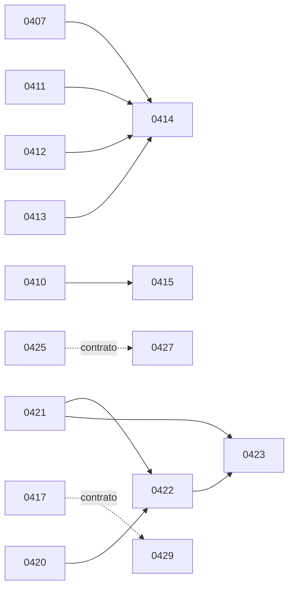

# Bloque C de PR #21: grafo SQL y cierre de contratos

Dueño: Worker c-analisis-bloque-c, subanálisis SQL con archivo asignado. Estado: análisis estático terminado; ejecución y veredicto en el [acta de medición](c-analisis-bloque-c-medicion.md). Fecha: 2026-09-10. Clasificación: interno.

Fuente congelada: refs/dtd/pr/21 = ea9952a4; base e325cb4d. Se leyeron blobs con git show; no se extrajo, copió ni modificó SQL, contratos o specs. Las líneas citadas de #21 pertenecen al blob, no a archivos presentes en este worktree. Este documento contiene inventario derivado y razonamiento original.

## Resultado y cómo leer el grafo

El conjunto contiene 32 migraciones, 35 contratos nuevos y 32 specs nuevas por ruta, con renames desactivados. Son 31 specs ligadas a las 32 migraciones porque SDD-0365 gobierna tanto 0421 como 0422. La spec adicional 0435 corresponde a observabilidad de acciones y no crea una migración C. Los contratos adicionales 0399/0400 prueban migraciones ya presentes en la base; 0423_cloud es un wrapper sintético del contrato 0423. Su nombre no indica una ejecución alojada.

Hay tres clases de aristas: **SQL dura**, cuando un preflight o definición consume un objeto/estado creado por otra migración; **contrato**, cuando el test incluye otra migración o fixture; **release**, cuando retirar el acceso anterior requiere que el consumidor nuevo ya esté desplegado y verificado. Un cierre de SQL no equivale a un release independiente.

## Aristas internas demostradas

| Productor → consumidor | Evidencia exacta en #21 | Consecuencia |
|---|---|---|
| 0407 → 0414 | 0407 L49-57 crea invoices_team_select; 0414 L27-41 la exige y retira | 0414 sola no reconstruye: aún existe invoices by tenant |
| 0411 → 0414 | 0411 L43 crea studio_client_annual_billing(date); 0414 L15-24 exige presencia y SECURITY DEFINER | Incluir facade y consumidor antes del cierre de lectura |
| 0412 → 0414 | 0412 L19 crea conversation_client_outstanding(uuid); 0414 L15-24 | Igual requisito para saldo de conversaciones |
| 0413 → 0414 | 0413 L18 crea sales_order_invoice_refs(uuid[]); 0414 L15-24 | Igual requisito para órdenes de venta |
| 0410 → 0415 | 0410 L41 crea collections_mail_context; 0415 L8-19 verifica definer y EXECUTE | No cerrar mail_logs antes de preparar Cobranzas |
| 0421 → 0422 | 0421 L63,123,353-375 crea recibos/comandos; 0422 L10-61 exige objetos, owner y ACL exactos | No retirar DML antes de instalar comandos |
| 0420 → 0422 | 0420 L42-90 sustituye tres policies; 0422 L64-84 compara hashes exactos de esas expresiones | El fixture no sustituye esta dependencia real |
| 0421 → 0423 | 0421 L63/120 crea recibos y audit entity; 0423 L37-47 los exige | No reemplazar validador sin expansión |
| 0422 → 0423 | 0422 L92-119 retira escritura API y EXECUTE legacy; 0423 L49-55 exige ese cierre | El validador nuevo exige DML API ya retirado |
| 0425 ⇢ contrato 0427 | test0427 L110 incluye 0425; migración0427 L14-31 no exige su policy | Agrupar para conservar el contrato, sin inventar dependencia SQL |
| 0417 ⇢ contrato 0429 | test0429 L41 incluye 0417; migración0429 L11-42 exige tablas/policies propias | Agrupar por cierre del contrato, no por nombre de dominio |

No se encontraron otras aristas duras **entre las 32** al revisar cuerpos, preflights, grants y policies. Compartir tablas o aparecer en related de una spec no crea por sí solo una arista. 0404/0410/0411/0412/0413 leen invoices como definers y no necesitan invoices_team_select de 0407. 0408 no crea el facade ni cierra mail_logs. 0431 y 0433 operan mensajes, pero ninguno llama un objeto creado por el otro.

## Inventario semántico exhaustivo

Los objetos son del schema public salvo prefijo explícito. La última columna nombra migraciones proveedoras del estado consumido; no autoriza reaplicar históricos. Los helpers de equipo activos son get_user_tenant_id y current_studio_role en su versión 0200. El principal Portal deriva de client_users/clients/auth.uid, creados en 0080/0006/plataforma.

| Migración / spec | Crea o modifica | Consume y ubicación | Productores externos; aristas internas separadas |
|---|---|---|---|
| 0401 / 0336 | RPC get_portal_brand() L12-46; ACL L52-55 | client_users, clients, aliados; auth.uid L37-44 | 0080,0006,0362 |
| 0402 / 0337 | RPC get_portal_hidden_shipment_statuses() L11-49; ACL L55-58 | client_users, clients, client_notification_rules L18-41 | 0080,0006,0247 |
| 0403 / 0338 | RPC get_portal_advisor() L10-42; ACL L48-51 | client_users, clients.advisor_id, user_tenants.disabled_at, user_profiles L27-39 | 0080,0006,0151,0001,0019 |
| 0404 / 0339 | RPC get_portal_referral_program() L7-69; ACL L75-78 | client_users, clients, invoices, referrals, referral_settings L14-68 | 0080,0006,0077,0098,0250 |
| 0405 / 0341 | RPC get_portal_private_profile_context() L7-36; ACL L42-45 | client_users, clients.avatar_path/cedula_photo_path, client_markbox_history L15-30 | 0080,0006,0091,0199,0367 |
| 0406 / 0342 | RPC get_portal_packing_list_documents() L7-42; ACL L48-51 | client_users, clients, packing_list_submissions, prealertas L21-39 | 0080,0006,0147,0105 |
| 0407 / 0350 | Retira invoices by tenant; crea invoices_team_select/accounting_insert/accounting_update; revoca DELETE authenticated L49-82 | invoices, policy histórica ALL, helpers activos L25-45 | 0077,0001,0200 |
| 0408 / 0351 | Policies admin en mail_templates/signatures/rules/config/blacklist/scheduled; ACL CRUD mínimo; dos RPC service_role L69-271 | Seis tablas/policies, mail_increment_template_metrics, mail_check_blacklist, helpers L25-66 | 0018,0206,0207 y replays 0271/0280/0287/0288;0200 |
| 0409 / 0352 | Ocho policies accounting/admin en bank_statements/lines; ACL CRUD L42-107 | Dos tablas/policies tenant históricas; helpers L18-39 | 0167,0200 |
| 0410 / 0353 | RPC collections_mail_context(uuid[]) L41-110; conserva policy/ACL mail_logs L119-140 | invoices, clients, mail_logs.complained_at/metadata; helpers; mail_logs_tenant_select; ACL sin TRUNCATE L20-37,74-106,135-140 | 0077,0006,0018 y replays,0200,0399 |
| 0411 / 0354 | RPC studio_client_annual_billing(date) L43-134 | invoices, studio_role_module_overrides, helpers; rol/fecha dentro de RPC L19-40,57-132 | 0077,0357,0200 |
| 0412 / 0355 | RPC conversation_client_outstanding(uuid) L19-91 | conversations, clients, invoices, overrides, helpers L6-14,44-76 | 0106,0006,0077,0357,0200 |
| 0413 / 0356 | RPC sales_order_invoice_refs(uuid[]) L18-70 | sales_orders, invoices.sales_order_id, overrides, helpers L6-13,41-67 | 0125,0127,0077,0357,0200 |
| 0414 / 0357 | Retira invoices_team_select, crea accounting_select, sustituye Portal self read L41-70 | Policy de 0407 y RPCs definer 0411-0413 L15-36; principal/helpers | 0077,0080,0085,0200; internas 0407,0411,0412,0413 |
| 0415 / 0358 | Sustituye mail_logs_tenant_select por admin_select y ACL sólo SELECT L37-45 | RPC 0410 definer ejecutable, policy histórica y helpers L8-32 | 0018 y replays,0200; interna 0410 |
| 0417 / 0361 | ALTER de siete policies Portal suppliers_cn/prealertas/prealerta_documents L55-161 | Principal; tres tablas e inventario de quince policies L12-50; padre prealertas L153-159 | 0080,0006,0105,0118,0229 |
| 0418 / 0362 | ALTER de ocho policies Portal en seis tablas academia L58-198 | Principal; courses/modules/lessons/enrollments/diplomas/lesson_progress; catorce policies L12-51 | 0080,0006,0144,0145,0149 |
| 0419 / 0363 | ALTER de dos SELECT claims/evidence L44-73 | Principal; client_claims/client_claim_evidence; padre vivo/coherente L12-37,65-68 | 0080,0006,0152,0153,0155 |
| 0420 / 0364 | ALTER de tres policies Portal payment_reports L42-90 | Principal; payment_reports; inventario de cinco policies; conserva validator0195 L13-36,54 | 0080,0006,0195,0230 |
| 0421 / 0365 | Tres columnas y dos constraints payment_reports; payment_private.report_commands y dos índices; trigger inmutable; guard de columnas; run_report_command y tres wrappers; audit entity payment_report L41-121,123-382 | payment_reports/invoices, principal/user_tenants/tenants, entity_audit_log/audit_entity_types, append_audit_event/_v1, storage bucket/objects payment-proofs, tipos payment_report_method/status/invoice_status L11-36,63-78,128-145,292,326 | 0001,0006,0077,0080,0195,0258,0261,0267,0294,0200 |
| 0422 / 0365 | Revoca DML y RPC confirm_payment_report; retira cuatro policies; crea accounting_select/service_role read L92-119 | Comandos/recibos/owner/ACL 0421 L10-61; fingerprints 0420 L64-84; helpers/assert y RPC legacy | 0001,0195,0200,0230,0351,0359; internas 0420,0421 |
| 0423 / 0366 | Sustituye payment_reports_validate_invoice(), conserva trigger/ACL L61-158 | md5/trigger exactos 0195 L16-35; rename/history/auditoría; recibos y entidad 0421; ACL 0422 L37-55; clients.merged_into_client_id L122 | 0195,0341,0367,0371,0267,0294,0200; internas 0421,0422 |
| 0424 / 0368 | Sustituye get_portal_person_id(), conserva OID/ACL/policies L105-120 | Principal/persons; cuerpo 0187 exacto; seis consumers pg_depend en Club/cohorts/eventos/proveedores L11-97 | 0080,0006,0170,0172,0177,0185,0186,0187,0188,0235 |
| 0425 / 0372 | ALTER de tres policies Portal client_delivery_addresses L43-94 | Principal; direcciones e inventario de cinco policies L10-38 | 0006,0080,0198,0230 |
| 0426 / 0375 | RPC INVOKER reserve_public_verify_attempt(text); ACL service_role; NOTIFY L103-122 | throttle: tres columnas, PK, índice exacto, sin policies/triggers; service_role BYPASSRLS; runtime READ COMMITTED L13-15,53-99 | 0169 y plataforma/ACL |
| 0427 / 0377 | Audit entity client_delivery_address; schema portal_address_private; comando definer y wrapper público L36-146 | Principal; direcciones; catálogo/log/writer audit seguro L14-31,69-120 | 0006,0080,0198,0258,0261,0267,0294; contrato exige 0425 |
| 0429 / 0381 | ALTER de tres policies psr Portal L47-93 | prealerta_service_requests, principal, prealertas y seis policies L11-42; no exige policy 0417 | 0006,0080,0105,0150,0230; contrato exige 0417 |
| 0430 / 0382 | ALTER clients Portal self read y client_change_requests self or tenant read L46-74 | Principal; change_requests; helpers; inventario de tres policies L8-41 | 0006,0080,0220,0221,0230,0200 |
| 0431 / 0385 | Sustituye portal_post_message(text), mantiene ACL authenticated/service_role L52-130 | Principal; conversations/messages; next_conversation_ref; firma/ACL heredada L10-47 | 0006,0080,0106 |
| 0432 / 0400 | ALTER warehouse_boxes Portal self read L46-59 | Principal; warehouse_boxes e inventario de dos policies L12-41 | 0006,0080,0240,0244 |
| 0433 / 0401 | RPC booleana portal_can_read_conversation_message(uuid,uuid); sustituye expresión policy L51-91 | Principal; conversations/messages; policy histórica con get_portal_client_id L12-46 | 0006,0080,0106,0217 |
| 0434 / 0402 | ALTER prealerta_addons read L53-66 | Principal; addons; policy previa con get_user_tenant_id/get_portal_client_tenant L12-48 | 0006,0080,0105,0150,0200 |

## Raíces externas que no se pueden omitir

Estas referencias pertenecen a la base e325cb4d. Identifican proveedores concretos de objetos y estados. El historial completo aplica además sus correctivos; no se propone reconstruir usando únicamente estos archivos.

| Objeto/estado | Evidencia de origen en base | Consumidores C |
|---|---|---|
| clients/client_users/helpers Portal | 0006_clients.sql L9;0080_portal_cliente.sql L13/40/74; auth.uid viene de plataforma/stub | Portal y contexto de clientes |
| tenants/user_tenants/helpers activos | 0001_init_tenancy.sql L10/23/34;0019_users_roles.sql L50;0200_rbac_disabled_enforcement.sql L50/70 | 0403,0407-0415,0421-0423,0430,0434 |
| aliados y ocho campos de marca; clients.aliado_id | 0362_aliados_base.sql L62-85 y ALTER clients | 0401 |
| client_notification_rules.visible_in_portal | 0247_client_notifications.sql L33/50 | 0402 |
| clients.advisor_id y user_profiles.position_label | 0151_clients_advisor.sql L29;0019_users_roles.sql L62/68 | 0403 |
| invoices/invoice_status/policy tenant/Portal | 0077_invoices.sql L12/24/114;0085_portal_invoices_rls.sql L19 | 0404,0407,0410-0414,0420-0423 |
| referrals/referral_settings | 0098_fidelizacion_referidos.sql L46;0250_referral_settings.sql L29 | 0404 |
| clients.cedula_photo_path/avatar_path | 0091_portal_self_register.sql L24;0199_clients_avatar.sql L21 | 0405 |
| client_markbox_history/rename_client_markbox | 0367_client_markbox_historial.sql L39/254; versión 0371_insignia_pelada_del_aliado.sql L110 | 0405,0423; contrato0422 |
| clients.merged_into_client_id | 0341_client_merge_duplicados.sql L41 | 0423 L122 |
| packing_list_submissions/prealertas/suppliers_cn/prealerta_documents | 0147_supplier_packing_uploads.sql L36;0105_portal_compras.sql L58/83;0118_prealerta_documents.sql L25;0229 policies equipo | 0406,0417,0429 |
| Mailing tablas/RPC/policies y replays | 0018_mailing.sql L70/106/135/175/202/222/240/276;0271/0280/0287/0288 repiten historia;0206 firmas tenant;0207 programados | 0408,0410,0415 |
| mail_logs SELECT y ACL sin TRUNCATE | 0018_mailing.sql L366; último replay0288 L843;0399 revoca TRUNCATE | 0410 L135-140;0415 |
| bank_statements/lines y policies ALL | 0167_bank_reconciliation.sql L33/66/123/134 | 0409 |
| studio_role_module_overrides | 0357_role_module_overrides.sql L44 | 0411,0412,0413 |
| sales_orders/invoices.sales_order_id | 0125_sales_orders.sql L44;0127_sales_order_invoicing.sql L56 | 0413 |
| conversations/messages/next_conversation_ref/portal_post_message | 0106_conversaciones.sql L42/86/162/201 | 0412,0431,0433 |
| Academia tablas y policies | 0144_academia.sql L19/56/81/149/205;0145 Portal;0149 progreso L35 | 0418 |
| Claims/evidence y policies | 0152_client_claims.sql L18;0153 Portal;0155_client_claim_evidence.sql L16 | 0419 |
| payment_reports/enums/validator/trigger | 0195_payment_reports.sql L34/43/52/172; trigger payment_reports_validate_invoice_trg;0230 soft-delete | 0420-0423;0423 exige md5 permitido |
| confirm_payment_report/assert_studio_role | 0195 L223;0359_confirm_payment_report_exige_rol.sql L44;0351_operario_rpc_exige_rol.sql L32 | 0422,0423 |
| Catálogo/log/writer audit y v1 | 0258_audit_entity_catalog.sql L60;0066_foundation_v3.sql L64;0261 validación;0267 L430;0294 L43 renombra original a v1 y L49 crea wrapper | 0421,0423,0427 |
| storage.objects/buckets y payment-proofs privado | Plataforma/stub y0195;0421 L35-36 exige bucket privado y L292 consulta objeto asociado | 0421 |
| persons/client.person_id y Club/cohorts/eventos | 0170 L16;0172,0177,0185,0186,0187,0188,0235 | 0424: seis pg_depend exactos |
| Direcciones y cinco policies | 0198_client_delivery_addresses.sql L23;0230;0347 city_slug en contratos | 0425,0427 |
| Throttle, PK/índice y BYPASSRLS | 0169_public_verify_throttle.sql L23 e índice public_verify_throttle_ip_created_idx; roles de plataforma | 0426 |
| prealerta_service_requests/addons/policies | 0150_prealerta_addons.sql L38/68/180;0230 | 0429,0434 |
| Change requests/source/policy | 0220_client_change_requests.sql L22/78;0221;0230 | 0430 |
| warehouse_boxes y policy Portal | 0240_warehouse_boxes.sql L42;0244_warehouse_boxes_predeclaradas.sql L280 | 0432 |
| conv_messages Portal client read own | 0217_portal_conversation_read.sql L30 | 0433 |

### Interacciones con 0416, 0428 y 0435-0449

No hay llamada, preflight ni ALTER de las 32 que consuma un objeto creado exclusivamente por 0416 o 0428. Estas cambian otras policies: shipments/documents/events y quotes. Sus joins siguen dependiendo de clients/client_users, que 0430 endurece sin cambiar forma ni nombre; es interacción RLS compartida, no dependencia de existencia.

0435-0444 modifican documents/Storage y helpers documentales. Los cierres financieros 0407/0414 no sustituyen esos helpers. El requisito explícito 0416 → 0439 está fuera de C y ya pertenece a la base. 0445-0447 crean ledger/triggers/RPCs de perfil sin reemplazar las dos policies que 0430 altera. 0449 cambia recepción/etiquetas y agrega un trigger de packing_list; 0417/0432 sólo cambian RLS de tablas usadas por el receptor.

Esta separación de objetos explica por qué sería posible obtener el mismo catálogo final en ambos órdenes. No demuestra inocuidad: los preflights comparan inventarios completos, hashes y privilegios, y las filas o los triggers pueden hacer que una base viva tenga efectos distintos. El acta de medición registra los dos órdenes locales; ninguna base sintética contiene las filas o el historial real alojado.

### Qué diferencia tendría producción sin C aunque reconstrucción pase

Las diferencias no son un detalle del ledger. Con 0414 se retira invoices_team_select y se instala invoices_accounting_select; sin 0407/0414 permanece el acceso histórico amplio de invoices. Con 0415 se retira mail_logs_tenant_select; sin esa migración no existe la misma restricción admin. Con 0422 payment_reports pierde DML API y confirm_payment_report pierde EXECUTE para roles API; sin ella esos accesos siguen definidos por el historial anterior. Con 0421 aparecen columnas cancelación, recibos y comandos que el consumidor nuevo podría solicitar a producción, donde no existirían. Con 0433 la policy de Realtime usa una nueva función booleana, mientras la base sin C conserva la expresión histórica con get_portal_client_id. Estos ejemplos describen diferencias de catálogo por SQL, no lecturas de filas ni una auditoría de explotación en producción.

## Cierres candidatos para medición independiente

Son 22 candidatos de inventario **SQL y contratos**, no 22 releases aprobados. Se miden sobre la base completa e325cb4d, con sus migraciones en orden numérico. No basta ejecutar cada grupo encima de un fixture preparado a mano. El documento principal añade el cierre de código de producto y la decisión final.

| Candidato | Migraciones ordenadas | Specs | Contratos | Motivo |
|---|---|---|---|---|
| SQL-01 | 0401 | 0336 | 0401 | Sin productor interno C |
| SQL-02 | 0402 | 0337 | 0402 | Sin productor interno C |
| SQL-03 | 0403 | 0338 | 0403 | Sin productor interno C |
| SQL-04 | 0404 | 0339 | 0404 | Sin productor interno C |
| SQL-05 | 0405 | 0341 | 0405 | Sin productor interno C |
| SQL-06 | 0406 | 0342 | 0406 | Sin productor interno C |
| SQL-07 | 0407,0411,0412,0413 → 0414 | 0350,0354,0355,0356,0357 | 0407,0411,0412,0413,0414 | Cuatro productores necesarios para cerrar lectura |
| SQL-08 | 0408 | 0351 | 0408 | No crea ni consume facade 0410 |
| SQL-09 | 0409 | 0352 | 0409 | Sólo dos tablas y ocho policies |
| SQL-10 | 0410 → 0415 | 0353,0358 | 0410,0415 | Facade y cierre; deploy intermedio obligatorio |
| SQL-11 | 0417 → 0429 | 0361,0381 | 0417,0429 | Cierre del contrato de 0429 |
| SQL-12 | 0418 | 0362 | 0418 | Sin productor interno C |
| SQL-13 | 0419 | 0363 | 0419 | Sin productor interno C |
| SQL-14 | 0420,0421 → 0422 → 0423 | 0364,0365,0366 | 0420,0421,0422,0423,0423_cloud | Policies/recibos → restricción → identidad histórica |
| SQL-15 | 0424 | 0368 | 0424 | Sustituye helper externo 0187 |
| SQL-16 | 0425 → 0427 | 0372,0377 | 0425,0427 | Cierre del contrato de 0427 |
| SQL-17 | 0426 | 0375 | 0426 | Sólo throttle externo 0169 |
| SQL-18 | 0430 | 0382 | 0430 | Sin productor interno C |
| SQL-19 | 0431 | 0385 | 0431 | RPC existente, sin dependencia de 0433 |
| SQL-20 | 0432 | 0400 | 0432 | Sin productor interno C |
| SQL-21 | 0433 | 0401 | 0433 | Policy existente, sin dependencia de 0431 |
| SQL-22 | 0434 | 0402 | 0434 | Sin productor interno C |

Los tests 0399/0400 son evidencia transversal para migraciones de la base; no requieren reextraer esas migraciones. La spec 0435 tampoco pertenece a un candidato SQL: el mapa de contenido compara su equivalente 0449 de main.

**Gates de release que el corte no puede ocultar:** 0411-0413 → despliegue y verificación de sus consumidores → 0414 (SQL0414 L1-3; spec0357 L96-97). 0410 → despliegue y verificación de Cobranzas → 0415 (SQL0415 L1-3; spec0358). 0421 → despliegue y smoke de comandos → 0422 → 0423 (SQL0422 L1-3;0423 L2). 0426 → consumidor reserva (spec0375 L55). Agruparlos en una PR no autoriza aplicarlos de corrido.

**Primer candidato SQL recomendado:** 0409 si la medición confirma ambos órdenes y el mapa de producto cierra consumidores. No tiene productor interno C, afecta dos tablas y ocho policies, mantiene CRUD contable y tiene contrato propio. 0407 también es raíz, pero el cierre común de 0414 incorpora tres facades y una ventana de deploy. Esta recomendación técnica no convierte el grupo SQL en un release autorizado.

## Límites concretos de los contratos

Tests0401-0406 fabrican tablas reducidas antes de instalar la RPC: test0401 L29-58 crea aliados/clients/client_users y test0405 L25-47 crea clients/history. Test0407 L65 crea a mano la policy histórica. Test0414 incluye 0407 y los tres facades reales, pero no reconstruye todo el historial. Test0422 incorpora test0421 y este incorpora0420: su verde ya contiene esa dependencia y no demuestra que omitir0420 sea válido. Test0432 L51 y L80-90 sintetiza warehouse_boxes/policies; test0433 L27-83 sintetiza tablas/identidad/policies; test0434 L51-104 sintetiza catálogo/policies.

Test0423_cloud L5 activa la variable para el cuerpo alterno del validador0195 y L6 incluye el test local. No abre conexión alojada. Test0424 reingresa al propio contrato L681 en escenarios controlados; eso no es una dependencia entre migraciones. Ningún contrato focal sustituye la medición del orden total.

## Validación de este anexo

- PASÓ: diff congelado, lectura de las 32 migraciones, mapa de 31 specs relacionadas y spec 0435 independiente, inventario de 35 contratos y sus includes.
- PASÓ: separación de aristas SQL, contrato y release; los emparejamientos se verificaron con cabeceras SQL y referencias de las specs.
- NO EJECUTADO por este subanálisis: PostgreSQL y contratos. El Worker principal registra las reconstrucciones y comprobaciones efectivamente ejecutadas en el acta de medición; la lista de contratos no promete ni acredita su ejecución focal.
- NO DISPONIBLE aquí: identidad con catálogo/datos reales de producción. No se usaron credenciales ni consultas alojadas.
- NO EJECUTADO: extracción, edición de producto/migraciones/specs, aplicación a producción; fuera de alcance.

## Rutas exactas de migración y spec

Identidad medida en ea9952a4. La cabecera SQL y las referencias de spec establecen el vínculo; no se usó igualdad numérica.

| Migración | Spec | Evidencia en spec |
|---|---|---|
| supabase/migrations/0401_portal_brand_por_principal.sql | docs/specs/0336-marca-portal-por-principal/spec.md | L49 |
| supabase/migrations/0402_portal_hidden_statuses_por_principal.sql | docs/specs/0337-visibilidad-portal-por-principal/spec.md | L45 |
| supabase/migrations/0403_portal_advisor_por_principal.sql | docs/specs/0338-asesor-portal-por-principal/spec.md | L43 |
| supabase/migrations/0404_portal_referidos_por_principal.sql | docs/specs/0339-referidos-portal-por-principal/spec.md | L44 |
| supabase/migrations/0405_portal_perfil_privado_por_principal.sql | docs/specs/0341-perfil-privado-portal-por-principal/spec.md | L42 |
| supabase/migrations/0406_portal_packing_lists_por_principal.sql | docs/specs/0342-documentos-portal-por-principal/spec.md | L44 |
| supabase/migrations/0407_invoices_write_rbac.sql | docs/specs/0350-invoices-write-rbac/spec.md | L61 |
| supabase/migrations/0408_mailing_admin_rbac.sql | docs/specs/0351-mailing-rbac/spec.md | L62 |
| supabase/migrations/0409_bank_reconciliation_rbac.sql | docs/specs/0352-bank-reconciliation-rbac/spec.md | L55 |
| supabase/migrations/0410_collections_mail_context.sql | docs/specs/0353-collections-mail-context/spec.md | L56 |
| supabase/migrations/0411_client_annual_billing_facade.sql | docs/specs/0354-client-annual-billing-facade/spec.md | L61 |
| supabase/migrations/0412_conversation_outstanding_facade.sql | docs/specs/0355-conversation-outstanding-facade/spec.md | L59 |
| supabase/migrations/0413_sales_order_invoice_facade.sql | docs/specs/0356-sales-order-invoice-facade/spec.md | L52 |
| supabase/migrations/0414_invoices_read_rbac.sql | docs/specs/0357-invoices-read-rbac/spec.md | L53 |
| supabase/migrations/0415_mail_logs_read_rbac.sql | docs/specs/0358-mailing-expand-contract-release/spec.md | L48 |
| supabase/migrations/0417_portal_prealertas_tenant_boundary.sql | docs/specs/0361-portal-prealertas-tenant-boundary/spec.md | L49 |
| supabase/migrations/0418_portal_academia_tenant_boundary.sql | docs/specs/0362-portal-academia-tenant-boundary/spec.md | L62 |
| supabase/migrations/0419_portal_reclamos_tenant_boundary.sql | docs/specs/0363-portal-reclamos-tenant-boundary/spec.md | L59 |
| supabase/migrations/0420_portal_payment_reports_tenant_boundary.sql | docs/specs/0364-portal-payment-reports-tenant-boundary/spec.md | L79 |
| supabase/migrations/0421_payment_report_commands.sql | docs/specs/0365-payment-report-command-safety/spec.md | Cabecera SQL; spec describe fase de comandos |
| supabase/migrations/0422_payment_report_command_boundary.sql | docs/specs/0365-payment-report-command-safety/spec.md | L127 |
| supabase/migrations/0423_payment_report_historical_identity.sql | docs/specs/0366-payment-report-historical-identity/spec.md | L72, L161 |
| supabase/migrations/0424_portal_club_principal_tenant.sql | docs/specs/0368-portal-club-principal-tenant/spec.md | L72 |
| supabase/migrations/0425_portal_delivery_addresses_tenant_boundary.sql | docs/specs/0372-portal-delivery-addresses-tenant-boundary/spec.md | L52 |
| supabase/migrations/0426_public_verify_atomic_reservation.sql | docs/specs/0375-public-verify-atomic-reservation/spec.md | L70 |
| supabase/migrations/0427_portal_delete_delivery_address_command.sql | docs/specs/0377-portal-address-delete-command/spec.md | L67 |
| supabase/migrations/0429_portal_service_requests_principal_tenant.sql | docs/specs/0381-portal-service-requests-principal-tenant/spec.md | L54 |
| supabase/migrations/0430_portal_profile_change_requests_principal_tenant.sql | docs/specs/0382-portal-profile-change-requests-principal-tenant/spec.md | L50 |
| supabase/migrations/0431_portal_post_message_principal_tenant.sql | docs/specs/0385-portal-conversation-message-principal-tenant/spec.md | L47 |
| supabase/migrations/0432_portal_warehouse_boxes_tenant_boundary.sql | docs/specs/0400-portal-warehouse-boxes-principal-tenant/spec.md | L38 |
| supabase/migrations/0433_portal_conversation_realtime_principal_tenant.sql | docs/specs/0401-portal-conversation-realtime-principal-tenant/spec.md | L40 |
| supabase/migrations/0434_portal_prealerta_addons_principal_tenant.sql | docs/specs/0402-portal-prealerta-addons-principal-tenant/spec.md | L41 |
| Sin migración C | docs/specs/0435-structured-user-actions/spec.md | L34 excluye migraciones; main conserva equivalente docs/specs/0449-structured-user-actions/spec.md |

## Los 35 contratos y sus includes directos

Las rutas de esta tabla pertenecen a supabase/tests de ea9952a4. La línea indicada es la del contrato que incluye; no es una afirmación de ejecución.

| Contrato | Migración / spec | Cierre | Includes directos y línea del contrato |
|---|---|---|---|
| 0399_revoke_truncate_anon_authenticated.test.sql | 0399 / No asignada (higiene) | Transversal, migración ya base | _supabase-platform-stubs.sql L52; ../migrations/0399_revoke_truncate_anon_authenticated.sql L82 |
| 0400_revoke_public_verify_rpc_execute.test.sql | 0400 / 0328 (externa C) | Transversal, migración ya base | ../migrations/0400_revoke_public_verify_rpc_execute.sql L49 |
| 0401_portal_brand_por_principal.test.sql | 0401 / 0336 | SQL-01 | ../migrations/0401_portal_brand_por_principal.sql L106 |
| 0402_portal_hidden_statuses_por_principal.test.sql | 0402 / 0337 | SQL-02 | ../migrations/0402_portal_hidden_statuses_por_principal.sql L69 |
| 0403_portal_advisor_por_principal.test.sql | 0403 / 0338 | SQL-03 | ../migrations/0403_portal_advisor_por_principal.sql L80 |
| 0404_portal_referidos_por_principal.test.sql | 0404 / 0339 | SQL-04 | ../migrations/0404_portal_referidos_por_principal.sql L106 |
| 0405_portal_perfil_privado_por_principal.test.sql | 0405 / 0341 | SQL-05 | ../migrations/0405_portal_perfil_privado_por_principal.sql L63 |
| 0406_portal_packing_lists_por_principal.test.sql | 0406 / 0342 | SQL-06 | ../migrations/0406_portal_packing_lists_por_principal.sql L56 |
| 0407_invoices_write_rbac.test.sql | 0407 / 0350 | SQL-07 | ../migrations/0407_invoices_write_rbac.sql L90 |
| 0408_mailing_admin_rbac.test.sql | 0408 / 0351 | SQL-08 | ../migrations/0408_mailing_admin_rbac.sql L139 |
| 0409_bank_reconciliation_rbac.test.sql | 0409 / 0352 | SQL-09 | ../migrations/0409_bank_reconciliation_rbac.sql L98 |
| 0410_collections_mail_context.test.sql | 0410 / 0353 | SQL-10 | ../migrations/0410_collections_mail_context.sql L100; ../migrations/0415_mail_logs_read_rbac.sql L105 |
| 0411_client_annual_billing_facade.test.sql | 0411 / 0354 | SQL-07 | ../migrations/0411_client_annual_billing_facade.sql L92 |
| 0412_conversation_outstanding_facade.test.sql | 0412 / 0355 | SQL-07 | ../migrations/0412_conversation_outstanding_facade.sql L80 |
| 0413_sales_order_invoice_facade.test.sql | 0413 / 0356 | SQL-07 | ../migrations/0413_sales_order_invoice_facade.sql L63 |
| 0414_invoices_read_rbac.test.sql | 0414 / 0357 | SQL-07 | ../migrations/0085_portal_invoices_rls.sql L79; ../migrations/0407_invoices_write_rbac.sql L80; ../migrations/0411_client_annual_billing_facade.sql L81; ../migrations/0412_conversation_outstanding_facade.sql L82; ../migrations/0413_sales_order_invoice_facade.sql L83; ../migrations/0414_invoices_read_rbac.sql L130 |
| 0415_mail_logs_read_rbac.test.sql | 0415 / 0358 | SQL-10 | 0410_collections_mail_context.test.sql L5 |
| 0417_portal_prealertas_tenant_boundary.test.sql | 0417 / 0361 | SQL-11 | ../migrations/0080_portal_cliente.sql L61; ../migrations/0105_portal_compras.sql L62; ../migrations/0118_prealerta_documents.sql L63; ../migrations/0229_suppliers_cn_operator_write.sql L64; ../migrations/0417_portal_prealertas_tenant_boundary.sql L168 |
| 0418_portal_academia_tenant_boundary.test.sql | 0418 / 0362 | SQL-12 | ../migrations/0080_portal_cliente.sql L50; ../migrations/0105_portal_compras.sql L51; ../migrations/0144_academia.sql L52; ../migrations/0145_academia_portal_read.sql L53; ../migrations/0149_academia_lesson_progress.sql L54; ../migrations/0418_portal_academia_tenant_boundary.sql L214 |
| 0419_portal_reclamos_tenant_boundary.test.sql | 0419 / 0363 | SQL-13 | ../migrations/0080_portal_cliente.sql L71; ../migrations/0152_client_claims.sql L72; ../migrations/0153_client_claims_portal.sql L73; ../migrations/0155_client_claim_evidence.sql L74; ../migrations/0230_fix_rls_soft_delete_blocked.sql L76; ../migrations/0363_storage_bug_replays_restrictive.sql L78; ../migrations/0419_portal_reclamos_tenant_boundary.sql L215 |
| 0420_portal_payment_reports_tenant_boundary.test.sql | 0420 / 0364 | SQL-14 | ../migrations/0077_invoices.sql L72; ../migrations/0080_portal_cliente.sql L73; ../migrations/0085_portal_invoices_rls.sql L74; ../migrations/0195_payment_reports.sql L75; ../migrations/0230_fix_rls_soft_delete_blocked.sql L76; ../migrations/0351_operario_rpc_exige_rol.sql L79; ../migrations/0359_confirm_payment_report_exige_rol.sql L80; ../migrations/0363_storage_bug_replays_restrictive.sql L81; ../migrations/0420_portal_payment_reports_tenant_boundary.sql L353 |
| 0421_payment_report_commands.test.sql | 0421 / 0365 | SQL-14 | ../migrations/0077_invoices.sql L114; ../migrations/0080_portal_cliente.sql L115; ../migrations/0085_portal_invoices_rls.sql L116; ../migrations/0195_payment_reports.sql L117; ../migrations/0230_fix_rls_soft_delete_blocked.sql L118; ../migrations/0258_audit_entity_catalog.sql L119; ../migrations/0261_audit_entity_catalog_validate.sql L120; ../migrations/0267_audit_contract_append_only.sql L121; ../migrations/0294_audit_d2_human_reasons.sql L124; ../migrations/0351_operario_rpc_exige_rol.sql L125; ../migrations/0359_confirm_payment_report_exige_rol.sql L126; ../migrations/0363_storage_bug_replays_restrictive.sql L127; ../migrations/0420_portal_payment_reports_tenant_boundary.sql L128; ../migrations/0421_payment_report_commands.sql L264 |
| 0422_payment_report_command_boundary.test.sql | 0422 / 0365 | SQL-14 | 0421_payment_report_commands.test.sql L12; ../migrations/0367_client_markbox_historial.sql L94; ../migrations/0371_insignia_pelada_del_aliado.sql L95; ../migrations/0422_payment_report_command_boundary.sql L223 |
| 0423_payment_report_historical_identity.test.sql | 0423 / 0366 | SQL-14 | 0421_payment_report_commands.test.sql L21; ../migrations/0367_client_markbox_historial.sql L56; ../migrations/0371_insignia_pelada_del_aliado.sql L57; ../migrations/0422_payment_report_command_boundary.sql L58; ../migrations/0423_payment_report_historical_identity.sql L285 |
| 0423_payment_report_historical_identity_cloud.test.sql | 0423 / 0366 | SQL-14 | 0423_payment_report_historical_identity.test.sql L6 |
| 0424_portal_club_principal_tenant.test.sql | 0424 / 0368 | SQL-15 | ../migrations/0080_portal_cliente.sql L78; ../migrations/0144_academia.sql L79; ../migrations/0170_persons.sql L80; ../migrations/0172_clients_person_link.sql L81; ../migrations/0177_academia_person_link.sql L82; ../migrations/0185_club_members.sql L83; ../migrations/0186_club_group_buys.sql L84; ../migrations/0187_club_portal_read.sql L85; ../migrations/0188_club_events_context.sql L86; ../migrations/0230_fix_rls_soft_delete_blocked.sql L87; ../migrations/0235_club_registrations_suppliers.sql L88; ../migrations/0424_portal_club_principal_tenant.sql L455; ../migrations/0424_portal_club_principal_tenant.sql L650; 0424_portal_club_principal_tenant.test.sql L681 |
| 0425_portal_delivery_addresses_tenant_boundary.test.sql | 0425 / 0372 | SQL-16 | ../migrations/0006_clients.sql L49; ../migrations/0080_portal_cliente.sql L50; ../migrations/0198_client_delivery_addresses.sql L51; ../migrations/0230_fix_rls_soft_delete_blocked.sql L52; ../migrations/0347_client_delivery_addresses_city_slug.sql L53; ../migrations/0425_portal_delivery_addresses_tenant_boundary.sql L157; ../migrations/0425_portal_delivery_addresses_tenant_boundary.sql L161 |
| 0426_public_verify_atomic_reservation.test.sql | 0426 / 0375 | SQL-17 | ../migrations/0169_public_verify_throttle.sql L21; ../migrations/0426_public_verify_atomic_reservation.sql L60; ../migrations/0426_public_verify_atomic_reservation.sql L65 |
| 0427_portal_delete_delivery_address_command.test.sql | 0427 / 0377 | SQL-16 | ../migrations/0006_clients.sql L53; ../migrations/0080_portal_cliente.sql L54; ../migrations/0198_client_delivery_addresses.sql L55; ../migrations/0230_fix_rls_soft_delete_blocked.sql L56; ../migrations/0347_client_delivery_addresses_city_slug.sql L57; ../migrations/0425_portal_delivery_addresses_tenant_boundary.sql L110; ../migrations/0258_audit_entity_catalog.sql L170; ../migrations/0261_audit_entity_catalog_validate.sql L171; ../migrations/0267_audit_contract_append_only.sql L172; ../migrations/0294_audit_d2_human_reasons.sql L173; ../migrations/0427_portal_delete_delivery_address_command.sql L241 |
| 0429_portal_service_requests_principal_tenant.test.sql | 0429 / 0381 | SQL-11 | ../migrations/0006_clients.sql L34; ../migrations/0080_portal_cliente.sql L35; ../migrations/0105_portal_compras.sql L36; ../migrations/0118_prealerta_documents.sql L37; ../migrations/0150_prealerta_addons.sql L38; ../migrations/0229_suppliers_cn_operator_write.sql L39; ../migrations/0230_fix_rls_soft_delete_blocked.sql L40; ../migrations/0417_portal_prealertas_tenant_boundary.sql L41; ../migrations/0429_portal_service_requests_principal_tenant.sql L188; ../migrations/0429_portal_service_requests_principal_tenant.sql L191 |
| 0430_portal_profile_change_requests_principal_tenant.test.sql | 0430 / 0382 | SQL-18 | ../migrations/0006_clients.sql L50; ../migrations/0080_portal_cliente.sql L51; ../migrations/0220_client_change_requests.sql L52; ../migrations/0221_client_change_request_source.sql L53; ../migrations/0230_fix_rls_soft_delete_blocked.sql L54; ../migrations/0430_portal_profile_change_requests_principal_tenant.sql L204; ../migrations/0430_portal_profile_change_requests_principal_tenant.sql L208 |
| 0431_portal_post_message_principal_tenant.test.sql | 0431 / 0385 | SQL-19 | ../migrations/0006_clients.sql L49; ../migrations/0080_portal_cliente.sql L50; ../migrations/0106_conversaciones.sql L51; ../migrations/0431_portal_post_message_principal_tenant.sql L134; ../migrations/0431_portal_post_message_principal_tenant.sql L139 |
| 0432_portal_warehouse_boxes_tenant_boundary.test.sql | 0432 / 0400 | SQL-20 | ../migrations/0432_portal_warehouse_boxes_tenant_boundary.sql L131 |
| 0433_portal_conversation_realtime_principal_tenant.test.sql | 0433 / 0401 | SQL-21 | ../migrations/0433_portal_conversation_realtime_principal_tenant.sql L145 |
| 0434_portal_prealerta_addons_principal_tenant.test.sql | 0434 / 0402 | SQL-22 | ../migrations/0434_portal_prealerta_addons_principal_tenant.sql L142 |
