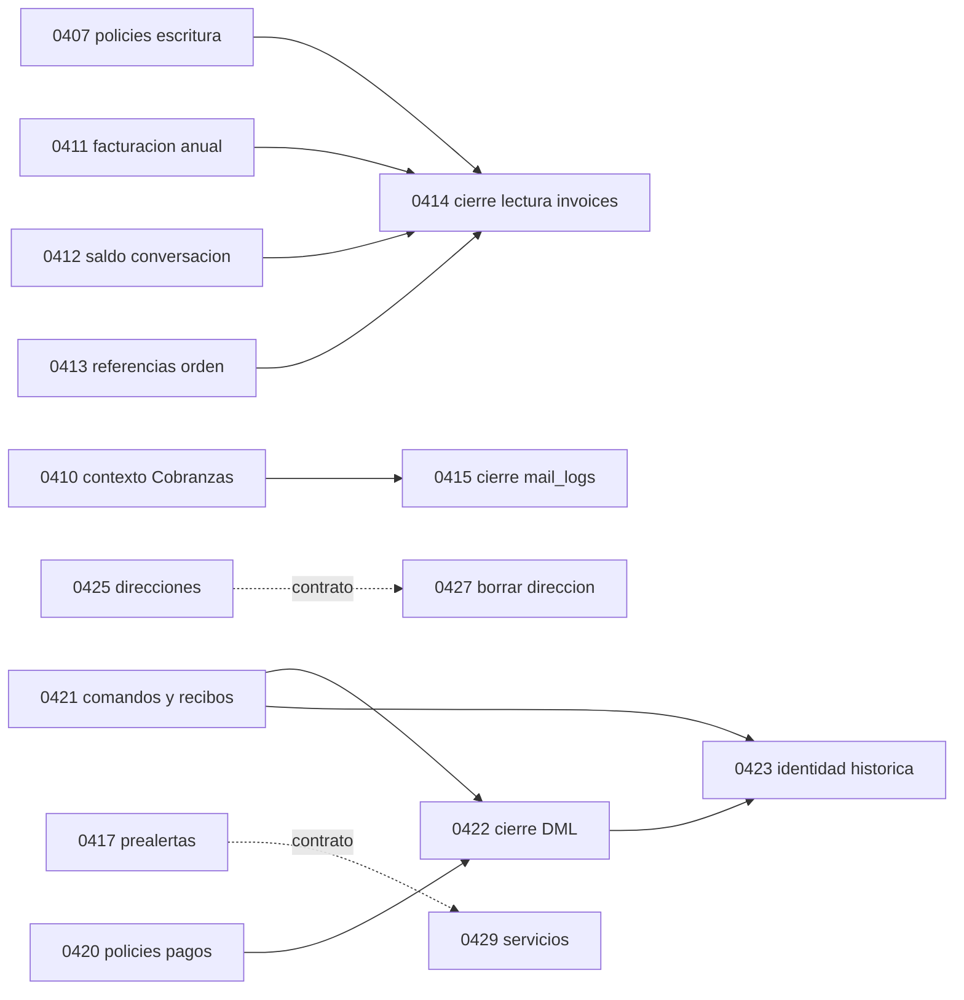

# Plan de lotes del bloque C de PR #21

Dueño: Worker `c-analisis-bloque-c-worker-20260910`. Fecha: 2026-09-10. Estado: análisis completo; [PR #62 en borrador](https://github.com/hailuwaycom-sketch/DTDCARGO/pull/62). Clasificación: interno. SDD: no corresponde reservar número en esta tarea.

## Veredicto de orden

**La reconstrucción numérica con las 32 migraciones PASA; no demuestra que producción tenga ese esquema.** El inventario virtual suma 446 archivos: 414 de la base asignada y 32 de #21. Se ejecutan 428 migraciones de esquema, conservando las 18 excepciones LEDGER_ONLY del check: 379 hasta 0400 y 49 después. El barrido de aislamiento también pasa. Ningún archivo de #21 se agregó al worktree: los blobs se leyeron en memoria y el SQL entró por stdin a Postgres desechable.

El caso observado corresponde al escenario **b** planteado por Sam: incorporar los archivos no instala sus RPC, columnas, triggers ni policies en producción. Según el ledger aportado, incorporar C agrega 32 candidatas pendientes; migrations-applied real fue NO DISPONIBLE sin credenciales, no se midió una lista de pendientes contra producción. Aplicarlas allí después de 0435–0444 sería una historia distinta a la reconstrucción numérica. La comparación local reduce esa incertidumbre, con límites explícitos:

| Comparación sintética, PostgreSQL 17.11 | Resultado |
|---|---|
| Base asignada, sin C, reconstruida numéricamente | 396 migraciones de esquema; aislamiento pasa |
| Base + C reconstruida numéricamente | 428 migraciones de esquema; aislamiento pasa |
| Base numérica primero, luego las 32 en orden | Las 32 aplican; dump de esquema idéntico a base+C numérica |
| Orden comunicado: hasta 0400 sin 0017; 0445, 0448, 0447, 0446, 0449, 0428, 0416, 0435…0444; 0017 al final; luego C | Las etapas y las 32 aplican; cuatro permisos de funciones no_olvidar difieren del orden numérico |
| Misma comparación de orden comunicado contra base, antes de C | Los mismos cuatro permisos ya difieren: deriva externa al bloque C |

Se comparan dumps `pg_dump --schema-only`, conservando cuerpos, ACL y propietarios y retirando únicamente los marcadores aleatorios `\restrict`. La igualdad numérico/tardío sobre la base asignada es evidencia de conmutación **de ese catálogo sintético**. No demuestra equivalencia de filas, seeds, backfills, ledger, configuración de Supabase ni efectos operativos entre despliegues. Producción no se consultó.

Las diferencias que C sí introduce frente al esquema sin C son materiales: desaparece lectura amplia de `invoices` y aparece lectura contable; `mail_logs` pasa de lectura tenant a admin; `payment_reports` pierde DML API directo y gana comandos/recibos/cancelación; aparecen RPC de contexto Portal. Un código que invoque esas RPC antes de aplicarlas puede fallar o degradarse silenciosamente: 0405 ausente deja fotos/historial vacíos y el consumidor de 0402 convierte el error en conjunto vacío de estados ocultos, mostrando todos los hitos. Los hashes y recibos completos están en [medición](c-analisis-bloque-c-medicion.md).

**Decisión:** es viable preparar lotes con cierre de dependencias, pero no importar el bloque histórico completo como una colección de archivos. No hay evidencia de una incompatibilidad global de orden causada por C que obligue a un único lote. Tampoco hay autorización técnica para aplicar sus cierres financieros de corrido: requieren etapas de aplicación entre migraciones. El plan siguiente es de preparación y revisión; cada extracción futura tendrá su tarea, SDD, allowlist y autorización de release.

## Identidad e inventario corregido

- Base asignada: `e325cb4deb7d11375aa2dbca348496177d1e4350`.
- #21 congelada: `ea9952a47f4adf14c48c91e6d0147597beb94aa7`, commit del 2026-09-04; GitHub confirmó el mismo head.
- Base común: `2a2e81bf554dbe7bd4f05170847e8f02e988d320`.
- `main` local observado: `710a8e06`; no se adoptó ni se incorporó a esta rama. La integración del análisis deberá revisar la base vigente.
- 32 migraciones ausentes en la base, de 0401 a 0434 excepto 0416/0428; 35 contratos nuevos; 32 specs nuevas. Hay 31 specs de SQL C porque 0365 gobierna 0421/0422; 0435 es observabilidad de Usuarios, sin migración C.
- Los 111 archivos nuevos de app/lib se cuentan desde la base común: 91 tests, 1 fixture y 19 runtime/CSS. Cinco ya están en la base asignada, por lo que quedan 106 ausentes. No hay nuevas `page.tsx` dentro de esos 111; los nuevos helpers se conectan a páginas/actions modificadas.
- Los 178 solapamientos son la intersección de paths cambiados desde la base común, no 178 conflictos.

El inventario completo no se debe forzar dentro de las 32 migraciones: tests 0399/0400 cubren SQL externo ya presente, la spec 0435 no corresponde a migración 0435 y varios de los 111 archivos pertenecen a accesibilidad, CSP, observabilidad y otros SDD fuera del bloque. El mapa conserva todos los registros y señala esa heterogeneidad.

## Dependencias demostradas y definición del corte

El [grafo SQL](c-analisis-bloque-c-sql.md) enumera los objetos creados/modificados y cada proveedor externo, con referencias a líneas de los blobs. Las aristas duras internas son:

La diferencia entre tipos de arista cambia el corte: 0422 compara fingerprints de 0420 y exige los objetos de 0421; el contrato de 0427 incluye 0425 aunque su SQL no exige esa policy. Ambas relaciones deben conservarse, pero no describirse como la misma dependencia. No se encontró una nueva arista dura C→0416/0428/0435–0449. La dependencia conocida 0416→0439 sigue dentro de la base y se conserva en todas las reconstrucciones.

Raíces externas especialmente sensibles: ACL y mail_logs de 0399 para 0410; helpers activos de 0200; override de módulos 0357 para facades; validador 0195 y rename/history 0341/0367/0371 para 0423; writer de auditoría 0258/0261/0267/0294 para 0421/0427; throttle 0169 para 0426; helper de persona 0187 y sus seis dependientes para 0424. La tabla del anexo nombra también las tablas y migraciones históricas restantes: no se sustituyen por fixtures del contrato.

## Plan de preparación por lotes

Los identificadores L01–L22 corresponden a SQL-01–SQL-22 del anexo. Cada lote incluye **las migraciones indicadas, sus specs fuente y los contratos de igual prefijo enumerados por filename en el anexo SQL**; L14 incluye además 0423_cloud. El [manifest de producto](c-analisis-bloque-c-producto.md#manifest-de-rutas-exactas-declaradas-para-cada-sdd-de-c) fija las rutas candidatas por ID. El corte elegido es **focal sobre la aplicación vigente**, con las exclusiones y productores de código que se fijan abajo: no es la unión de todos los imports de las versiones finales de #21. Las specs son referencias de análisis; no se copiarán automáticamente ni se reutiliza su número para una tarea nueva.

Decisiones de alcance del plan: L02/L03 mantienen las páginas actuales y adoptan sólo las llamadas de visibilidad/asesor; no incluyen `portal-home-private-context`, `shipments-hub-private-context` ni `support-private-context`. L11 tampoco incorpora `purchase-operational-detail` ni `prealerta-document-signing`. L18 introduce `getPortalClientPrincipal`, su tipo y guards de cuenta/change-request en `portal-queries.ts`, conservando las demás funciones vigentes; en `perfil/page.tsx` sólo adapta resolución del principal y preserva presentación/lecturas privadas actuales. La adopción de `profile-private-context` y RPC 0405 ocurre en L05. L16 migra sólo el comando de dirección y sus estados de UI, conservando la observabilidad vigente sin introducir `structured-logger`. Así no se cuelan SDD ajenos ni aparece un ciclo L18↔L05.

Cada reconstrucción independiente usa la base completa y **sólo las migraciones C de ese lote**, en orden numérico, sin productores C ocultos en el fixture. **PASÓ en los 22 lotes y en sus 22 barridos de aislamiento**, con conteos exactos en el recibo definitivo v4. La aplicación de producto de #21 no fue ensamblada, compilada ni probada: esto entrega un plan para hacerlo, no 22 PRs ya validadas.

| Lote | Migraciones / specs | Código de producto propuesto y corte | Orden y motivo |
|---|---|---|---|
| L01 |0401 /0336|brand-resolve, comprobante y etiquetas; test brand-resolve. Manifest 0401.|Sin predecesor SQL C. Coordinar hunks de etiquetas con L22; sólo RPC→consumidor de marca.|
| L02 |0402 /0337|portal-visibility-queries y llamadas focales de home/envíos/detalle; tests del manifest 0402. Sin contextos home/hub finales.|Sin predecesor SQL C; después del productor de código L18. RPC antes de consumidor para evitar fallback abierto. No depende de 0403 con este corte.|
| L03 |0403 /0338|getPortalAdvisor en portal-queries, llamadas focales de home/soporte y test del manifest 0403. Sin contextos privados finales.|Sin predecesor SQL C; después de L18. Serializar páginas compartidas con L02. No depende de 0402 con este corte.|
| L04 |0404 /0339|portal-referral-queries, página referidos y test. Manifest 0404.|Independiente de 0407/0414: RPC definer lee invoices históricas. Instalar RPC antes del consumidor.|
| L05 |0405 /0341|profile-private-context, test y adopción focal en perfil/page. Manifest 0405.|Después del principal de L18; instalar 0405 antes de adoptar contexto privado. Preservar perfil vigente 0445–0447 y sus actions de identidad.|
| L06 |0406 /0342|packing-list-queries, signed-portal-documents, página documentos y tests. Manifest 0406.|RPC y lectura/firma del documento de la misma pantalla. No confundir esta RPC con otras funciones del mismo módulo.|
| L07 |0407, 0411, 0412, 0413, 0414 /0350, 0354–0357|Fidelización/reports; conversations queries/types y API; sales-orders queries; tests exactos de esos manifests.|Los cuatro productores preceden 0414. Preparar SQL expansión→desplegar facades consumidoras→smoke por roles→cierre 0414. No es un único paso DB.|
| L08 |0408 /0351|Sin nueva allowlist app/lib; comprobar consumidores históricos de mailing y RPC service_role.|Independiente de L10: 0408 no crea collections_mail_context. No agrupar por compartir nombre mail.|
| **L09** |**0409 /0352**|**Sin nueva allowlist app/lib**; contrato propio bank_reconciliation_rbac.|**Primero recomendado.** Dos tablas, ocho policies, sin RPC nueva ni despliegue de facades. Validar roles contables/tenant y CRUD en su futura tarea.|
| L10 |0410, 0415 /0353, 0358|recordatorios-queries y test. Manifest 0410.|0410→despliegue/verificación Cobranzas→0415. Exige 0399 de base; no exige L08.|
| L11 |0417, 0429 /0361, 0381|Cambio focal prealertas/queries y service-request-scope. Manifest 0429; sin helpers nuevos de compras/firma.|0417 precede 0429 para que su contrato sea autocontenido. Los productores externos reales permanecen en la base.|
| L12 |0418 /0362|Sin nueva allowlist app/lib; consumers Academia existentes.|Independiente C: policies sobre objetos históricos. Validar principal/tenant en futura integración.|
| L13 |0419 /0363|Sin nueva allowlist app/lib; claims/evidence existentes. No adopta support-private-context.|Independiente C; el helper de soporte sería otra ampliación que exigiría L03/L18.|
| L14 |0420, 0421, 0422, 0423 /0364–0366|Comandos, queries/types/proof, actions Portal/Studio, formularios, confirmación, recibos y tests de manifest 0365; reutiliza principal ya entregado por L18.|**Predecesor de código L18**: reportar/actions importa y ejecuta getPortalClientPrincipal. Después 0420+0421→despliegue/smoke comandos→0422→0423.|
| L15 |0424 /0368|Sin nueva allowlist app/lib; consumers de Club/persona existentes.|Independiente C; preservar OID/ACL y verificar seis consumers externos del helper 0187.|
| L16 |0425, 0427 /0372, 0377|Comando focal en address-actions, estados PortalAddresses y tests; observabilidad vigente, sin logger nuevo. Manifest 0427.|Predecesor de código L18 para principal. 0425 cierra el contrato de 0427. No incorporar los imports de observabilidad del head final.|
| L17 |0426 /0375|lib/public/verify-throttle y test; revisar app/verificar y scripts de concurrencia fuera app/lib.|Independiente C. SQL de reserva antes de consumidor; atención a frontera pública y concurrencia READ COMMITTED.|
| L18 |0430 /0382|Principal/tipo y guards focales de portal-queries, change-request-queries, perfil/page y tests. Manifest 0430; página conserva contexto privado vigente, sin adopción 0405.|Raíz SQL y productor **de código** para L02/L03/L05/L14/L16/L22. No incluye getPortalAdvisor nuevo ni los helpers finales ajenos.|
| L19 |0431 /0385|Sin nueva allowlist app/lib; mensajes/actions ya llama RPC existente.|Independiente de L21; reemplaza cuerpo de portal_post_message, sin nueva llamada de aplicación.|
| L20 |0432 /0400|Sin nueva allowlist app/lib; listMyBoxes/getProfileCompleteness existentes.|Independiente C; no añadir deps de asesor por compartir portal-queries.|
| L21 |0433 /0401|Sin nueva allowlist app/lib; consumidor inmediato es policy de Realtime.|Independiente de L19. Suscripción autenticada se valida aparte del DDL.|
| L22 |0434 /0402|proveedores, compras/nueva, etiquetas y test de scope. Manifest 0434.|Independiente SQL; principal TypeScript común antes del código y serializar etiquetas con L01.|

La numeración de lotes es identificación, no cronograma obligatorio. **Orden operativo recomendado:** L09 como piloto acotado; L18 con el corte focal indicado antes de L02/L03/L05/L14/L16/L22; después las unidades sin cierre financiero según prioridad de producto y ownership de archivos; L07/L10/L14 sólo cuando exista ventana de expansión, despliegue verificado y contracción. Ninguna arista entre lotes puede quedar resuelta únicamente dentro de un test.

No se promete que copiar las versiones completas del head cumpla este plan. Siete helpers nuevos importan `getPortalClientPrincipal`, ausente en la base; home/hub también exigen `getHiddenPortalStatusesForPortal`, y hub `listPrealertaDocumentPresence`. El manifiesto de preparación debe incluir sus productores reales o dejar esos helpers fuera. Si el Director decide conservar completos esos helpers y la observabilidad, habrá que ampliar el lote correspondiente con sus SDD fuente fuera del inventario de 32 y medirlo de nuevo. Esa decisión no autoriza extraerlos en esta tarea.

**Alternativa si no se pueden coordinar los despliegues:** no incorporar todavía los cierres 0414/0415/0422/0423. Preparar primero expansiones compatibles y consumidores, probarlos y luego preparar la contracción como otro paso autorizado. Si el catálogo real no satisface los preflights históricos, preparar migraciones de avance con versiones nuevas asignadas por Director y precondiciones actuales. No renumerar migraciones aplicadas, no alterar cutoff/pendingBelowCutoff y no marcar históricos como aplicados para callar el gate.

## Solapamientos y los 111 archivos

| Clase de solapamiento | Cantidad |
|---|---:|
|Contenido idéntico|120|
|Cambio #21 íntegro ya contenido en main|1|
|Fusión textual limpia con cambios de ambos|17|
|Main contenido en #21, con cambio nuevo pendiente|1|
|Conflicto textual M/M|26|
|Altas diferentes en el mismo path|12|
|Borrado en main/modificado en #21|1|
|Total|178|

Son 39 colisiones textuales/estructurales, no 178. Perfil tiene divergencia funcional real: main incorpora comandos de identidad y retención; #21 conserva actualización administrativa y rollback. En etiquetas, aceptar #21 íntegra perdería presentación actual. Otros conflictos son historia/documentación de cotizaciones. `verify.mjs` fusiona sin conflicto textual, pero los pasos nuevos de #21 no figuran en la política de pasos de la base: compatibilidad semántica no demostrada. Las 178 filas, blobs y ejemplos están en [solapamientos](c-analisis-bloque-c-solapamientos.md); no se resolvió ninguno.

De 19 módulos/CSS runtime, 2 llaman RPC C directamente, 3 indirectamente y 14 son autónomos respecto de objetos nuevos C. Los 92 tests/fixture son inertes para usuarios, aunque puedan usar mocks de RPC todavía inexistentes. Los 111 están clasificados individualmente en [producto](c-analisis-bloque-c-producto.md). No agregan archivos a lib/shared, pero sí lo consumen; los helpers Portal cruzan DB/Studio/Storage con identidad previa, y 0426 toca la superficie pública de verificación. La clasificación no certifica cumplimiento global de las fronteras.

## Validación y límites

El [recibo de medición](c-analisis-bloque-c-medicion.md) documenta PostgreSQL, imagen, conteos, variantes, hashes, reconstrucción por lote y cleanup por ID. El [handoff](../../.agents/handoffs/c-analisis-bloque-c.md) contiene el estado de validación y publicación final.

- PASÓ: instalación `corepack pnpm install --frozen-lockfile`, sin cambio del lockfile; Node 24.20.0 / corepack pnpm 12.3.4. Se observó aviso de configuración pnpm ignorada, sin modificarla.
- PASÓ: inventarios, grafo estático, huérfanas 0, mapa de 178 y clasificación exhaustiva de 111.
- PASÓ: recibo definitivo v4, 428 migraciones de esquema, 22 reconstrucciones independientes y sus 22 aislamientos;18 ledger-only sin cambio de esquema.
- FALLÓ: `corepack pnpm verify`, exit 1. Ejecutó16 de 17 pasos:15 pasaron y E2E falló. Pasaron6526 unitarias, 156 contratos SQL basales, reconstrucción de 396 migraciones y build. Última pasada E2E:153 PASÓ, 15 FALLÓ, 18 omitidas; la primera tuvo150 PASÓ, 3 flaky, 15 FALLÓ y 18 omitidas. El servidor registró falta de URL/clave Supabase en las rutas de autenticación; no se reparó producto ni se agregaron credenciales. El handoff incluye el extracto del cierre.
- NO DISPONIBLE: `migrations-applied` sin credenciales. Su degradación no es PASÓ. El ledger comunicado por Sam se usa como dato del encargo, no como lectura productiva nueva.
- NO EJECUTADO: producto ensamblado de #21, 35 contratos focales nuevos, E2E autenticado/entorno Supabase real, datos/PII, migraciones productivas. Ninguna aprobación de release se deduce de los tests basales de esta rama documental.

## Fuera de alcance detectado

La posición tardía de 0017 genera cuatro permisos adicionales service_role para `no_olvidar_check_admin`, `no_olvidar_get_active_kek_version`, `no_olvidar_handle_new_user` y `no_olvidar_rotate_kek` en la simulación del orden comunicado. Es observable antes de C y merece tarea independiente de reconciliación de catálogo, no cambiar C ni aplicar SQL aquí. La semántica de permisos/policies depende del catálogo completo; [PostgreSQL 17: CREATE POLICY](https://www.postgresql.org/docs/17/sql-createpolicy.html) documenta que las policies permisivas se combinan por OR y que la lectura condiciona escrituras.

También quedan fuera los cambios de observabilidad, CSP, accesibilidad y saneamiento general presentes en los 111; el avance de main y cualquier incidencia basal de verify se registran como evidencia fechada, sin absorber su reparación.
