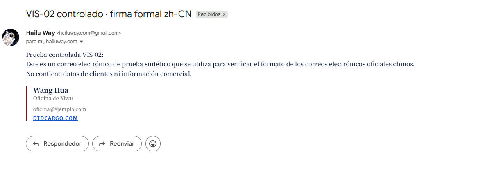
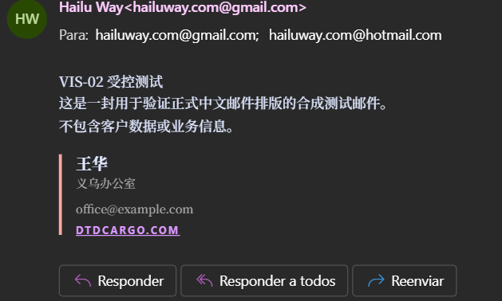

# VIS-02 · evidencia controlada en clientes de correo

| Control | Valor |
|---|---|
| Revisión | REV-VIS-010 |
| SDD | [SDD-0175](../../specs/0175-vis-02-tipografia-voz-idioma/spec.md) |
| Fecha | 2026-07-30 |
| Alcance | Gmail y Outlook · entrega, estructura y render |
| Resultado | Gmail y Outlook cerrados; Apple Mail abierto |

## Muestra controlada

Se envió una única muestra sintética desde `hailuway.com@gmail.com` a estos dos
destinatarios confirmados por el founder:

- `hailuway.com@gmail.com`;
- `hailuway.com@hotmail.com`.

La muestra no contiene datos de clientes, información operativa, adjuntos, CC
ni BCC. Usa el asunto `VIS-02 controlado · firma formal zh-CN` y los valores
sintéticos `王华`, `义乌办公室` y `office@example.com`.

El HTML de la firma fue producido por el renderer canónico
`renderSignatureHtml()` con `layout: "corporate"` y `lang: "zh"`. No se creó
un template alterno para la prueba.

## Evidencia obtenida

| Cliente | Evidencia | Clasificación |
|---|---|---|
| Gmail | Mensaje `19fb649872624409` presente en enviados y recibido en el destinatario Gmail; recepción confirmada por el founder; sin adjuntos | cumplimiento de entrega |
| Gmail · MIME | `multipart/alternative`, UTF-8, partes `text/plain` y `text/html`; el HTML conserva `lang="zh-CN"` y la pila `Noto Serif SC`, `Noto Sans SC`, `sans-serif` | cumplimiento estructural |
| Outlook | Mensaje recibido el `2026-07-31T03:48:23Z` desde `hailuway.com@gmail.com`; recepción confirmada por el founder; caracteres chinos y cuerpo HTML preservados; sin adjuntos | cumplimiento de entrega y contenido |
| Gmail visual | [Captura controlada](assets/vis-02/gmail-zh-cn-redacted.png): conserva jerarquía, barra lateral, firma y enlaces, pero la vista está traducida al español; el founder confirmó el render original y aceptó cerrar sin una segunda captura | excepción de evidencia aprobada; gate cerrado |
| Outlook visual | [Captura controlada](assets/vis-02/outlook-zh-cn-redacted.png): chino legible en modo oscuro, jerarquía y fallback preservados, barra lateral y enlace distinguibles | cumplimiento visual |
| Apple Mail visual | Falta abrir la misma muestra en un cliente Apple Mail real y capturarla | no conformidad de evidencia |

El identificador RFC 5322 de la muestra es
`<CADxWAOieLdwrKQa86m9TuLKUgJDp5XgkQSjrjGzYGsaOqVUsig@mail.gmail.com>`.

## Capturas controladas

### Gmail · vista traducida

SHA-256:
`8856fd65410d7241a7fb76e777d0ba1b70f98206e176fb157e77e51fa31f0be4`.

### Outlook · original `zh-CN`

SHA-256:
`4e730bfe98dc879c7f74070bef09aed8e767d68413086dc81f6ab7638c026623`.

## Límites de la conclusión

La entrega, el contenido y la estructura MIME quedaron verificados en Gmail y
Outlook. Outlook además conserva el contenido original `zh-CN`, su jerarquía y
un fallback CJK legible en modo oscuro. La captura no permite demostrar el
nombre exacto de la fuente resuelta por el motor, pero sí el criterio de
aceptación que exige legibilidad sin depender de una descarga remota.

Gmail conserva el layout, pero su captura muestra la traducción al español y no
prueba por sí sola los glifos chinos del original. El founder confirmó
explícitamente el render original y autorizó continuar sin exigir una segunda
captura; Gmail se cierra como excepción de evidencia, no como evidencia visual
fotográfica equivalente a Outlook.

El gate externo permanece abierto únicamente para Apple Mail. La UI china
sigue fuera de este alcance y debe conservar Noto Sans SC; BD-036 continúa
limitada a documentos formales `lang="zh-CN"`.
