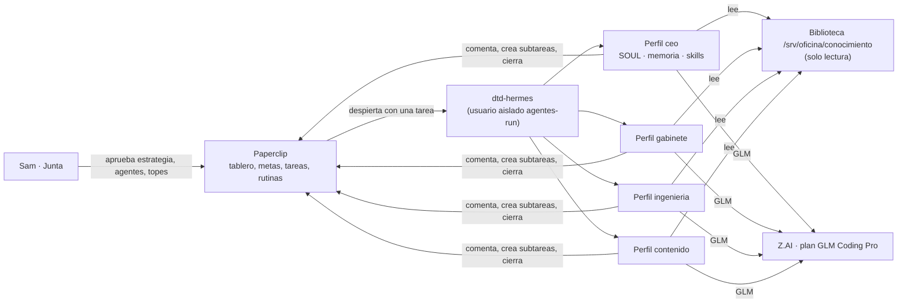

# La oficina de agentes con Hermes y Paperclip

> Estado: **propuesta para Sam** (2026-10-20). Nada de esto está creado todavía.
> Base: SDD-0564, organigrama `organigrama-paperclip.md` (ola 1) y lectura del código instalado en el
> VPS: Hermes Agent v0.22.2 (commit d923a5eb) y Paperclip 2026.1012.0. Lo inferido va marcado
> **INFERIDO** o **NO VERIFICADO**.

## 0. Resumen en una página

- **Sí se puede armar toda la oficina con Hermes.** Paperclip trae el adaptador `hermes_local` y,
  a diferencia de OpenCode, no exige una conexión de OpenRouter: usa la instalación de Hermes que
  ya responde con tu plan de Z.AI (glm-5.3).
- **Cada agente tendrá su propio «perfil» de Hermes**: su identidad (`SOUL.md`), su memoria
  (`MEMORY.md` y `USER.md`), sus skills aprendidas y su historial de sesiones. Así el CEO no
  mezcla lo que aprende con lo que aprende el editor.
- **Paperclip es el tablero; Hermes es el cerebro de cada puesto.** Las tareas, metas, aprobaciones,
  presupuestos y el parte del viernes viven en Paperclip. La memoria y las habilidades de cada
  agente viven en su perfil de Hermes.
- **El conocimiento de la empresa no va en la memoria** (son 2.200 caracteres). Va en una
  **biblioteca de 9 archivos `.md`** de solo lectura, más un `SOUL.md` por puesto. La memoria queda
  para lo que el agente aprende trabajando.
- **La mejora continua se deja encendida, pero vigilada**: el agente guarda lecciones y crea skills
  solo; cada viernes se revisa lo nuevo, se fijan las buenas y se revierte lo malo. Las skills
  nuevas necesitan tu aprobación las dos primeras semanas.
- **Hay que corregir tres cosas antes de crear agentes** (sección 6): Hermes corre siempre sin
  pedir permiso (`--yolo`), hereda todo el entorno del servidor de Paperclip y, sin ajuste,
  todos los agentes compartirían la misma memoria. Se resuelve con un envoltorio `dtd-hermes`
  como el de OpenCode.

## 1. Cómo encajan Hermes y Paperclip

En cada latido, Paperclip arma el prompt y llama a `hermes chat -q "<prompt>" --resume <sesión>`:

1. lo que lo despertó;
2. el traspaso de la sesión anterior;
3. la tarea;
4. sus instrucciones (`AGENTS.md` administrado por Paperclip);
5. cómo usar la API de Paperclip con `curl`.

Hermes, a su vez, mete en su prompt el `SOUL.md`, la memoria congelada y la lista de skills del
perfil. Con eso trabaja y responde comentando la tarea en Paperclip.

| Pieza | Dónde vive | Para qué |
|---|---|---|
| Tablero, metas, proyectos, tareas | Paperclip | Qué hay que hacer y quién lo hace |
| Rutinas (latido diario del CEO, parte del viernes) | Paperclip («Routines» con cron) | El ritmo de la oficina. No se usa el cron de Hermes, para no tener dos relojes |
| Aprobaciones (estrategia, contratar agente, subir tope) | Paperclip | Tus decisiones como Junta |
| Instrucciones del puesto (`AGENTS.md`) | Paperclip, modo administrado | Reglas y alcance, editables desde la pantalla |
| Identidad y voz (`SOUL.md`) | Perfil de Hermes de cada agente | Quién es, cómo habla, qué nunca hace |
| Memoria y perfil del usuario | Perfil de Hermes | Lecciones aprendidas y tus preferencias |
| Skills aprendidas | Perfil de Hermes | Cómo hacer bien una tarea que se repite |
| Historial buscable | `state.db` del perfil (búsqueda FTS5) | «¿Qué decidimos la vez pasada sobre…?» |
| Conocimiento de la empresa | Biblioteca de solo lectura | Lo que todos deben saber de DTD Cargo |

## 2. Qué trae Hermes y cómo lo usamos

### 2.1 Memoria persistente

- **Dos archivos por perfil:**
  - `MEMORY.md`, con las notas del agente (2.200 caracteres).
  - `USER.md`, con tu perfil como usuario (1.375 caracteres).
- **Quién los escribe:** el agente, con la herramienta `memory`. Lo hace por iniciativa propia o en
  la revisión de fondo que corre cada 10 turnos (`memory.nudge_interval: 10`).
- **Cuándo se ven los cambios:** al iniciar la sesión se cargan como foto congelada; lo que guarda
  hoy se ve en la siguiente sesión.
- **Si se pasa del límite** no se compacta solo: da error y el agente tiene que resumir.
- **Uso que proponemos:**
  - `USER.md` (lo sembramos nosotros): Sam es la Junta, habla en español venezolano con tuteo,
    quiere las decisiones en un solo lote con opción recomendada ⭐, y nada sale a clientes sin él.
  - `MEMORY.md`: lo que el agente aprenda. Por ejemplo, «el parte del viernes va en tablas
    cortas» o «el tarifario lo decide la Junta, no proponer precios».
- **Búsqueda de sesiones** (`session_search`): busca en todo el historial del perfil sin gastar
  modelo. Sirve para que el CEO recuerde decisiones de semanas anteriores.
- **Memoria compartida entre agentes:** en la ola 1 **no** usamos proveedores externos (Honcho,
  Mem0…). La memoria compartida es Paperclip: tareas, comentarios y documentos. Si hace falta más
  adelante, la opción local es Holographic (SQLite, sin nube).

### 2.2 Mejora continua: skills que aprende solo

- **Qué es una skill:** un procedimiento guardado en una carpeta, con un `SKILL.md` (frontmatter
  con nombre, descripción, versión y etiquetas) y, si hace falta, `references/`, `templates/` y
  `scripts/`. El agente la crea o la corrige con `skill_manage` cuando:
  - resuelve algo de varios pasos;
  - se equivoca y aprende;
  - tú lo corriges.

  La revisión de fondo también propone skills cada 15 turnos (`skills.creation_nudge_interval`).
- **El curator** cuida las skills que crea el agente:
  - a los 14 días sin uso las marca como viejas;
  - a los 30 las archiva;
  - nunca borra;
  - guarda respaldo y un registro con *rollback*;
  - `pin` protege las buenas.

  Hoy está **pausado** en el VPS (`skills/.curator_state`). Proponemos encenderlo en cada perfil,
  con la consolidación por modelo apagada.
- **Riesgos de que se modifique a sí mismo:**
  - **Aprendizaje de un error:** el agente guarda como lección algo equivocado.
  - **Contenido de internet:** el editor lee una página con instrucciones escondidas y las guarda
    en su memoria.

  Como lo que guarda vuelve a su prompt en la siguiente sesión, el error se repite.
- **Controles que proponemos:**

  | Control | Ajuste | Por qué |
  |---|---|---|
  | Skills nuevas con aprobación las 2 primeras semanas | `skills.write_approval: true` | Ver qué aprende antes de que lo use |
  | Memoria libre pero revisada | `memory.write_approval: false` + revisión del viernes | En corridas sin pantalla nadie aprobaría a tiempo; son 2.200 caracteres fáciles de leer |
  | Editor de contenido con memoria aprobada | `memory.write_approval: true` solo en su perfil | Es el único que lee internet |
  | Revisión de fondo con modelo barato | `auxiliary.background_review.model: glm-5.3-flash` | Hasta 3 a 5 veces menos consumo del plan |
  | Respaldo diario de los perfiles | `tar` nocturno de `/home/agentes-run/hermes/` | Volver atrás si algo se daña |
  | Revisión del viernes | El parte incluye «memorias y skills nuevas» de cada agente | Tú decides qué se fija (`pin`) y qué se revierte |

### 2.3 Identidad y contexto

Hermes carga, en este orden:

1. `SOUL.md` del perfil: la identidad, siempre primero.
2. El archivo de contexto del directorio de trabajo. Carga solo el primero que encuentre:
   `.hermes.md` → `AGENTS.md` → `CLAUDE.md`. Hasta ~20.000 caracteres.
3. Las instrucciones que Paperclip antepone al prompt.

Todos pasan por un escáner contra instrucciones inyectadas.

**Regla de oro:** el `SOUL.md` dice **quién es**, el `AGENTS.md` de Paperclip dice **qué le toca y
qué no**, y la biblioteca dice **qué sabe la empresa**. No se repite lo mismo en tres lugares.

### 2.4 Herramientas por agente

Herramientas de Hermes disponibles: archivos, terminal, memoria, búsqueda de sesiones, skills,
lista de pendientes, web, delegación, cron, navegador y kanban.

| Herramienta | CEO | Gabinete | Ingeniería | Contenido | Por qué |
|---|---|---|---|---|---|
| `file` (leer y escribir en su carpeta) | ✅ | ✅ | ✅ | ✅ | Leer la biblioteca, escribir borradores |
| `terminal` (como `agentes-run`) | ✅ | ✅ | ✅ | ✅ | Hace falta para hablar con Paperclip por `curl`. Ver §6 |
| `memory`, `session_search`, `skills`, `todo` | ✅ | ✅ | ✅ | ✅ | Memoria y mejora continua |
| `web` (leer páginas públicas) | ⛔ | ⛔ | ⛔ | ✅ | Solo el editor investiga tendencias y competencia |
| `delegation` (subagentes de Hermes) | ⛔ | ⛔ | ⛔ | ⛔ | Delegar se hace en Paperclip, con tareas visibles |
| `cronjob`, `kanban`, mensajería | ⛔ | ⛔ | ⛔ | ⛔ | El reloj y el tablero son de Paperclip |
| `browser` | ⛔ | ⛔ | ⛔ | ⛔ | No hace falta en la ola 1 |

## 3. La biblioteca de la empresa: qué `.md` le damos

Carpeta `/srv/oficina/conocimiento/` en el VPS, de solo lectura para los agentes. La fuente vive
en el repositorio (`docs/organizacion/oficina-conocimiento/`), versionada por PR. Se arma con
extractos filtrados de documentos que ya existen: no se inventa nada nuevo.

| Archivo | Contenido | Se arma desde | Para |
|---|---|---|---|
| `00-quienes-somos.md` | Qué es DTD Cargo, desde 2015, misión, visión, valores, ruta China→Venezuela | `public/llms.txt`, `docs/marketing/estrategia.md` §1 | Todos |
| `01-oferta-y-cliente.md` | Las ofertas con nombre («Un Solo Precio, Hasta Tu Puerta», «Pruébanos con un Metro», «Aliados DTD»), cliente ideal, canales | `docs/marketing/adquisicion.md` §2–3 | Todos |
| `02-servicios.md` | Los 20 servicios y la letra chica de la cotización | `servicios-infografias/CATALOGO-MAESTRO.md`, `condiciones-cotizacion.md` | Todos |
| `03-glosario.md` | Glosario ES/EN/中文 y la regla de peso (500 kg/m³ como regla, 1.000 como excepción) | `docs/legal/GLOSARIO.md`, `manual-vendedores-peso.md` | Todos |
| `04-organigrama-y-puestos.md` | Áreas, puestos, dueño humano de cada agente, cadena de valor, cuellos de botella | `organigrama-paperclip.md` §1–2, **sin** VPS ni precios de planes | Todos |
| `05-reglas-de-la-ia.md` | IA-01 («la IA propone, la persona decide»), qué hace un agente solo, con aprobación y nunca; lo que queda en manos de Sam | `docs/governance/policies/ia-01.md`, organigrama §3.3 y §4.3 | Todos (obligatorio) |
| `06-metas-y-sistemas.md` | Meta de 2 contenedores al mes, los 6 sistemas del negocio, las 6 primeras metas, sin montos | `sistemas-negocio.md`, `motor-crecimiento.md` (filtrado), organigrama §3.2 | CEO, gabinete |
| `07-marca-y-voz.md` | Voz de la marca, tono, pauta editorial, qué nunca decir | `BRAND.md` (resumen), `sistema-editorial-tecnico-dtd/README.md`, regla «los servicios informan, no venden» | Contenido, CEO |
| `08-como-trabajamos.md` | Cómo usar Paperclip: tareas, subtareas, revisión, el parte del viernes, idioma, formato de propuestas con ⭐ | Nuevo, corto, a partir de la SDD-0564 | Todos |

**Por puesto, además:**

- **Contenido:**
  - `faq/FAQ-sitio-DTDCargo.md`;
  - las fichas de `servicios-infografias/`;
  - `manual-asesor/`;
  - `guiones-asesor.md`, revisado sin ejemplos reales de clientes.
- **Ingeniería:**
  - `docs/engineering/project-rules.md`, `docs/governance/AGENT-BRIEF.md` y el índice `docs/README.md`;
  - la copia filtrada del código (A1-b).
- **Gabinete:** `sistemas-negocio.md` y una plantilla de SOP.
- **CEO:** `estrategia.md` completo, incluida la parte interna. Sam aceptó la transferencia a
  Z.AI (§D10).

**Lo que NO entra en la biblioteca** (ni en la copia del código):

- `docs/marketing/prospectos-ancla.md`: nombres y contactos de comercios.
- `docs/operaciones/instrucciones-gerente-*`: nombres y teléfonos.
- `.agents/handoffs/` (294 archivos) y los runbooks de servidor: IP, rutas y procedimientos de
  producción.
- Los montos de `motor-crecimiento.md` y de `docs/marketing/README.md`.
- Cualquier secreto, `.env`, dato de clientes o del ERP.

## 4. Cada agente: identidad, potencial y configuración

Todos usan:

- adaptador `hermes_local`, comando `/usr/local/bin/dtd-hermes`;
- modelo `glm-5.3`, proveedor `zai`;
- `persistSession: true`;
- carpeta propia `/srv/oficina/trabajo/<puesto>`, con un git local vacío porque Paperclip lo exige.

### 4.1 CEO

- **Identidad (`SOUL.md`):** «Eres el CEO agente de DTD Cargo. Diriges agentes, no personas.
  Tu trabajo es que la Junta (Sam) decida poco y bien: preparas, das seguimiento y resumes».
- **Potencial con Hermes:**
  - con la búsqueda de sesiones recuerda decisiones y compromisos de semanas anteriores;
  - con skills aprende el formato exacto del parte del viernes y del lote de decisiones;
  - en la memoria guarda tus preferencias de forma.
- **Qué hace:**
  - propone la estrategia de 90 días, que queda pendiente de tu aprobación;
  - desglosa la meta en metas por área;
  - reparte el trabajo en tareas para los otros tres;
  - revisa lo que entregan;
  - en el latido diario detecta bloqueos;
  - arma el parte del viernes y propone agentes nuevos (máximo 8 en la ola 1).
- **Nunca:** hablar con clientes, tocar el ERP, el CRM o la base de datos, publicar, decidir precios
  ni temas de personas.
- **Configuración:**
  - latido por rutina diaria a las 11:00 UTC (7:00 en Caracas), más la rutina del viernes;
  - tope de 40 USD;
  - `maxTurnsPerRun: 60`.

### 4.2 Jefe de gabinete

- **Identidad:** «Ordenas la casa: conviertes lo que se hace de memoria en procedimientos
  escritos».
- **Potencial:**
  - acumula skills como «cómo escribir un SOP de DTD» o «acta de reunión»;
  - con la memoria aprende el formato que la persona de Administración acepta.
- **Qué hace:**
  - redacta los primeros 6 de los 18 SOP;
  - lleva actas y pendientes;
  - persigue fechas comentando tareas.
- **Dueño humano:** el titular de Administración y PMO.
- **Configuración:** solo despierta cuando se le asigna algo; tope de 20 USD.

### 4.3 Puente de ingeniería

- **Identidad:** «Traduces metas del negocio a pedidos claros para el equipo de ingeniería
  (Director y Workers). No programas ni tocas producción».
- **Potencial:**
  - lee la copia filtrada del código y la documentación técnica;
  - aprende como skill el formato de un buen pedido Worker, con alcance, criterios de
    aceptación y SDD.
- **Qué hace:**
  - recibe una meta del CEO;
  - la convierte en un borrador de pedido Worker o de SDD;
  - se lo deja a Sam para que lo lleve al Director.
- **Dueño humano:** Sam.
- **Configuración:** solo despierta cuando se le asigna algo; tope de 20 USD.

### 4.4 Editor de contenido

- **Identidad:** «Escribes para Instagram y el sitio con la voz de DTD Cargo. Los servicios
  informan, no venden; el cierre lleva al registro».
- **Potencial:**
  - es el único con web: investiga tendencias y lo que publica la competencia;
  - acumula skills de formatos (carrusel, guion de reel, ficha de servicio);
  - en su memoria guarda qué piezas aprobó Marketing.
- **Qué hace:** borradores de piezas, calendario editorial y textos de fichas. Todo queda en
  borrador: publica una persona.
- **Dueño humano:** el titular de Dirección de Marketing.
- **Configuración:** solo despierta cuando se le asigna algo; tope de 20 USD;
  `memory.write_approval: true`.

## 5. Puesta en marcha, por fases, cada una con tu OK

| Fase | Qué se hace | Cómo se comprueba |
|---|---|---|
| **H1 · Envoltorio y perfiles** | `dtd-hermes` y perfiles `ceo`, `gabinete`, `ingenieria` y `contenido` para `agentes-run`, con la config de §2.2 y §2.4; skill `paperclip` copiada a cada perfil | Agente de prueba con Hermes: crea un archivo, comenta la tarea en Paperclip, no lee los secretos de Paperclip y guarda una memoria en **su** perfil y no en otro |
| **H2 · Biblioteca** | Los 9 `.md` de §3 en `docs/organizacion/oficina-conocimiento/` por PR; copia de solo lectura en el VPS; copia filtrada del código (A1-b) | Revisión del Director. Ningún archivo trae nombres, IP, montos ni datos de clientes |
| **H3 · Identidades** | `SOUL.md` y `USER.md` de cada perfil; `AGENTS.md` de cada puesto en Paperclip con las reglas de §4.3 del organigrama | Una pregunta de control a cada agente: «¿qué no puedes hacer nunca?» |
| **H4 · Empresa** | Meta, los 4 agentes (ALFRED pasa a ser el CEO), rutinas del CEO, tope de 100 USD, aprobación obligatoria para agentes nuevos | El CEO presenta su estrategia de 90 días y tú la apruebas |
| **H5 · Aprendizaje vigilado** | 2 semanas con aprobación de skills; cada viernes, revisión de memorias y skills nuevas | Lista de lo fijado y lo revertido en el parte |

## 6. Riesgos y cómo se cierran

| Riesgo | Fuente | Control |
|---|---|---|
| Hermes corre siempre con `--yolo` (no pide aprobación antes de comandos peligrosos) | Paperclip, `hermes-paperclip-adapter/dist/server/execute.js` | Corre como `agentes-run`, que no puede leer los secretos de Paperclip ni las sesiones; sin `sudo`; trabaja en su carpeta |
| Hermes heredaría todo el entorno del servidor de Paperclip | El mismo archivo: arma el entorno con `...process.env` | `dtd-hermes` pasa por `sudo` con `env_reset`; solo cruzan `PAPERCLIP_*` y el nombre del perfil |
| Todos los agentes compartirían memoria y sesiones | No hay perfil por agente por defecto | `dtd-hermes` elige `HERMES_HOME` según el perfil del agente, con una lista cerrada |
| Paperclip no sabe instalar sus skills en un perfil de otro usuario | Las instala como enlaces en el `~/.hermes` de `agentes` | Copia de la skill `paperclip` en cada perfil al crearlo. **NO VERIFICADO** si hace falta más |
| Sin Docker para el usuario aislado | El Docker de Hermes es de `agentes` | Terminal «local» como `agentes-run`: el mismo aislamiento probado con OpenCode |
| El costo no se registra en Paperclip | El adaptador lo busca en el texto de salida; **NO VERIFICADO** que Hermes lo imprima | El límite real es el plan de Z.AI; el CEO reporta el uso del plan en el parte |
| GLM a veces dice «lo guardé» sin guardar | Documentación de Hermes (memory.md) | Hermes activa solo `tool_use_enforcement` con GLM; la revisión del viernes mira los archivos reales |
| Envenenamiento de memoria desde internet | Solo aplica al editor | Memoria con aprobación en su perfil; web solo para él |
| Todos los agentes ven las carpetas de los demás | Mismo usuario `agentes-run` | Aceptado en la ola 1: no manejan datos de clientes. En la ola 2, un usuario por agente |

## 7. Decisiones para Sam

1. **Hermes para los cuatro agentes**, en vez de OpenCode. ⭐ Sí: memoria y skills propias por
   puesto. OpenCode queda instalado como respaldo.
2. **Biblioteca de §3 con la copia filtrada del código** (A1-b, sin handoffs). ⭐ Sí.
3. **Aprendizaje vigilado:** skills con aprobación las 2 primeras semanas y memoria del editor con
   aprobación. ⭐ Sí.
4. **ALFRED pasa a ser el CEO** con Hermes y conserva su nombre. ⭐ Sí.
5. **Arrancar por la fase H1** (envoltorio, perfiles y agente de prueba). ⭐ Sí.
