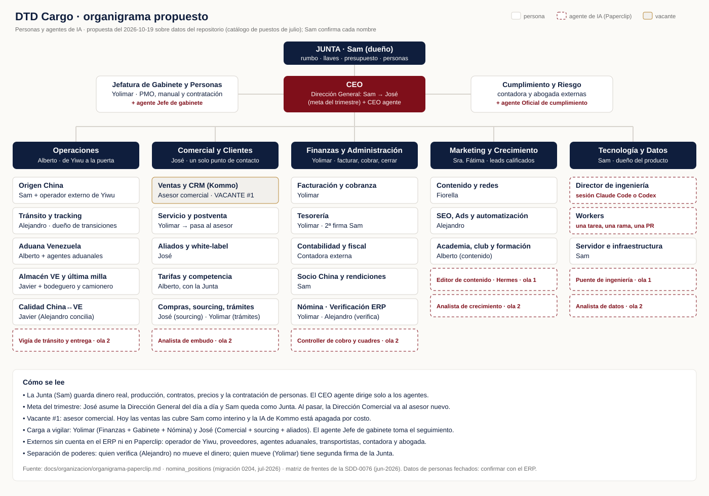
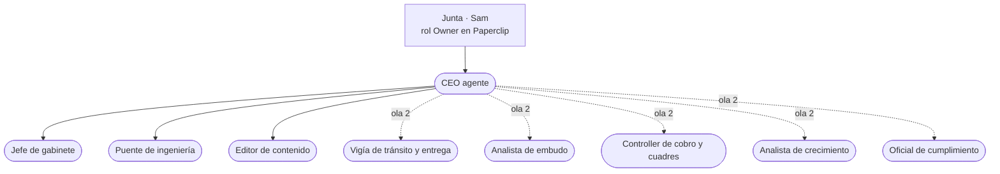
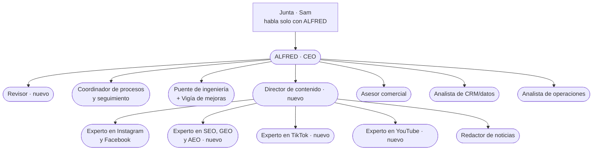

# Organigrama de DTD Cargo para la Oficina Paperclip — propuesta

| Control | Valor |
|---|---|
| Documento | Propuesta de organigrama: personas y agentes de IA |
| Dueño | Sam (founder) |
| Autor | Sesión Worker «Oficina Paperclip» (Claude Code) |
| Estado | **borrador** · Sam respondió las 14 preguntas el 2026-10-19 (estructura, ola 1, GLM, datos de clientes con controles, Kommo primero) y pidió la versión gráfica y la asignación de personas (sección 2.7, por puestos; el análisis por persona se le entregó aparte); falta que confirme los titulares; nada está instalado |
| Fecha | 2026-10-19 |
| Actualización | **2026-11-05 · [SDD-0605](../specs/0605-oficina-reestructura/spec.md):** reestructura de la oficina de agentes en la [sección 9](#9-reestructura-de-la-oficina-de-agentes-2026-11-05--sdd-0605). Reemplaza la vista 2 (§2.3) y la lista de agentes de la ola 1 (§4.4); el organigrama de la empresa por puestos (§2.2) no cambia |
| Base | `main` `bb6bb3e4` |
| Confidencialidad | interno · cita el norte interno; no se publica |

> **Qué es.** La decisión previa a instalar Paperclip: qué puestos necesita DTD Cargo,
> cuáles ocupa una persona y cuáles un agente, qué decide cada uno y qué datos puede ver.
>
> **Qué no es.** No instala nada, no crea cuentas, no cambia permisos del ERP ni toca la
> base de datos. No es una SDD. Los puestos se describen sin nombres de personas: quién
> ocupa cada uno hoy vive en el catálogo de puestos del ERP (`nomina_positions`, migración
> `0204`), que es la fuente correcta.
>
> **Método.** Lectura del repositorio (documentación y código, nunca datos de producción),
> del diagnóstico contable del 2026-10-18 y de la documentación oficial de Paperclip,
> consultada el 2026-10-19. Lo que no se pudo comprobar lleva **NO VERIFICADO**; las
> inferencias propias, **INFERIDO**.

---

## 0. Resumen en una página

1. **El problema de DTD Cargo no es falta de sistema: es falta de dueños y de uso.** El
   ERP tiene 56 módulos, 18 perfiles de puesto y 7 roles con permisos por módulo, pero los
   seis sistemas del Motor de Crecimiento están en rojo (capacidad construida, uso cercano
   a cero) y el founder ocupa la mayoría de los puestos críticos: Dirección General,
   Coordinación China, Aduanas, Trámites, asesor comercial interino y suplente de Compras y
   de PMO.
2. **Propuesta:** una **Junta** (Sam) que fija el rumbo y guarda las llaves; un **CEO** con
   dos caras (la dirección del negocio, que hoy ejerce Sam, y el **CEO agente** que dirige a
   los agentes dentro de Paperclip); **cinco direcciones** —Operaciones, Comercial y
   Clientes, Finanzas y Administración, Marketing y Crecimiento, Tecnología y Datos— y
   **dos áreas de apoyo** al CEO —Jefatura de Gabinete y Personas, y Cumplimiento y Riesgo.
3. **Cada área tiene un dueño humano.** Los agentes preparan, vigilan, resumen y redactan;
   la persona decide y ejecuta. Es la regla que ya aprobaste en la política IA-01: «la IA
   propone; la persona conserva la autoridad».
4. **El CEO agente** convierte la meta interna (2 contenedores al mes sostenidos) en metas
   por área, reparte un presupuesto de IA que tú fijas, revisa el trabajo de los agentes y
   te entrega cada viernes un parte con las decisiones listas para aprobar en un solo lote.
   No toca clientes, dinero, la base de datos ni producción.
5. **Siempre tuyo:** dinero real, producción (base, migraciones, merges, despliegues),
   datos personales, contratos, precios y tarifas, contratación de personas, cuentas en
   servicios externos y el presupuesto total de IA.
6. **Primero Kommo, después GoHighLevel.** Sam decidió el 2026-10-19 que la transición
   espera: primero se hace funcionar Kommo y se conectan los agentes a él; GoHighLevel queda
   en prueba gratis de 14 días (sección 2.6).
7. **Datos de clientes: sí, con controles.** Sam decidió el 2026-10-19 que en Paperclip
   pueden verse datos personales y montos por cliente cuando la tarea lo pida (por ejemplo,
   preparar la respuesta a un cliente), manteniendo la seguridad acordada. Antes de conectar
   cualquier fuente con datos de clientes se cumplen los controles de la sección 2.5 (nota de
   la regla de datos).
8. **Paperclip es joven y potente:** 104.000 estrellas, versiones casi semanales, varias
   fallas de seguridad graves ya corregidas en 2026, y sus adaptadores de Claude Code y
   Codex **saltan los permisos por defecto**. Por eso el arranque recomendado es pequeño:
   **CEO + 3 agentes que solo leen y redactan**, en una máquina aparte, sin ninguna
   credencial de producción, con tope de gasto, durante 4 semanas. Se mide y luego se
   crece.

---

## 1. Diagnóstico corto: cómo funciona DTD Cargo hoy

### 1.1 El negocio

- **Qué vende:** logística puerta a puerta China → Venezuela. Consolidado LCL, FCL (en
  bodega o directo) y **Puerta a Puerta** «pagas al llegar» (antes llamado DDP), más
  servicios adicionales: inspección, verificación de proveedor, compra asistida, muestras,
  etiquetado y reempaque, documentos, tránsito aduanero, visado y registro de marca, y
  cursos. Son 20 servicios en el catálogo (`/studio/servicios`).
- **Dos líneas:** el servicio logístico (lo que vende la web y revenden los aliados) y el
  trading de producto propio (interno, no se comunica).
- **Dos motores de volumen:** mayoristas que reabastecen cada 30–45 días y aliados que
  revenden el servicio con su propia marca (white-label).
- **Dónde opera:** sede y bodega en Valencia; bodega en Yiwu **operada por un operador de
  consolidación externo**; socio en China con su propio libro en dólares y yuanes; puertos
  de La Guaira y Puerto Cabello con agentes aduanales externos.
- **El hilo que une todo:** el **Shipping Mark** (`DTD-NNNN`), un solo código de la mesa
  del proveedor en Yiwu a la puerta del cliente.
- **Norte interno:** pasar de 1 a **2 contenedores al mes sostenidos**, que es el umbral de
  equilibrio (`docs/marketing/estrategia.md` §2).

### 1.2 La cadena de valor

```mermaid
flowchart LR
  A["Captación<br/>web · Instagram · CRM"] --> B["Estimado<br/>tarifas y calculadora"]
  B --> C["Registro<br/>Shipping Mark"]
  C --> D["Compra y prealerta"]
  D --> E["Recepción en Yiwu<br/>CBM medido"]
  E --> F["Consolidación<br/>contenedor C-"]
  F --> G["Zarpe y tránsito<br/>naviera y tracking"]
  G --> H["Aduana Venezuela"]
  H --> I["Almacén Valencia"]
  I --> J["Última milla<br/>TMS y POD"]
  J --> K["Factura y cobro"]
  K --> L["Postventa y recompra<br/>día 30/45"]
  L --> B
```



### 1.3 Las áreas que ya existen en el sistema

| Área | Módulos del Studio | Puestos ya definidos (`nomina_positions`) | Rol del Studio |
|---|---|---|---|
| Dirección | Dirección (tablero ejecutivo), Dashboard, Bitácora | Dirección General (CEO) | `admin` |
| Operaciones China | Almacén CN, Cola de QR, Etiquetas CN, Inspecciones, app `/m/cn` | Coordinación China | `admin` · `operations` · `warehouse` |
| Tránsito | Naviera y Consolidación, Tracking, Calendario, Embarques | — (las transiciones de tracking no tienen dueño) | `operations` |
| Operaciones Venezuela | Almacén VE, Aduana SENIAT, TMS, Despacho, Rutas, Inventario, apps de bodeguero y camionero | Aduanas VE · Bodega VE · Transporte y última milla · QA China↔VE | `operations` · `warehouse` |
| Comercial | Estimados, Clientes, CRM (espejo de Kommo, que pasará a GoHighLevel), Conversaciones, Órdenes de venta, Tarifas, Servicios, PreAlertas, Compras asistidas | Atención al cliente y CRM · Sourcing · Inteligencia de tarifas | `commercial` |
| Postventa | Reclamos, Fidelización, portal › soporte | Reclamos y postventa | `accounting` |
| Finanzas | Facturación, Cobranzas, Gastos, Tesorería, Contabilidad, Fiscal, Costing, Reportes, Rendiciones, Financiero China | Tesorería · Administración y PMO · Operador de ERP | `accounting` (y solo `admin` en Rendiciones y Financiero China) |
| Personas | Nómina y RRHH, app `/m/emp` | (lo cubre Administración y PMO) | `accounting` |
| Marketing | Marketing (hub, calendario, newsletter, documentos), Noticias Web, CMS `/back` | Dirección de Marketing · Contenido y redes · Automatización con IA | `marketing` |
| Formación y club | Academia, Club DTD | Formación (cursos) | `commercial` |
| Trámites | (sin módulo propio) | Trámites (visado y marca) | `operations` |
| Tecnología | Usuarios, Administración, Agentes, Bug Tracker, Torre de control | — (lo hacen Sam y las sesiones Director/Worker) | `admin` · superadmin |

Fuentes: `lib/studio/modules.ts`, `lib/studio/rbac.ts` (matriz `ROLE_MODULE_ACCESS`),
`supabase/migrations/0204_nomina_positions.sql`, `lib/studio/platform-admin.ts`.

### 1.4 Los cuellos de botella

1. **Todo pasa por el founder.** En el catálogo de puestos, Sam es titular o suplente de
   seis puestos. El análisis de servicios lo dejó dueño de **9 de 20 servicios**, con tres
   servicios sin dueño (visado, registro de marca y cursos), y con una advertencia: «si Sam
   falta, nadie coordina» la bodega de Yiwu
   (`docs/specs/0076-configuracion-servicios/assets/FASE-FUTURA-motor-flujo-interno-y-rbac.md` §7).
   El Motor de Crecimiento lo pone como asesor comercial interino y fija como meta «Sam
   fuera de ≥2 puestos» (`docs/marketing/motor-crecimiento.md` §4).
2. **Capacidad construida, sin uso.** Los seis sistemas del Motor —adquisición, ventas,
   entrega, manual, contratación y control financiero— están en rojo, nivel 0–1: hay
   software, no hay rutina. En julio había 0 de 18 procedimientos escritos y la nómina no
   tenía corridas; en agosto 5 de 7 usuarios del Studio nunca habían entrado. Son fotos
   fechadas, no una medición de hoy.
3. **La plata vive fuera del sistema.** El diagnóstico contable del 2026-10-18 midió que
   las 5 facturas emitidas, parciales o pagadas no tienen asiento vivo, que el cobro al
   llegar se maneja fuera del ERP, que la tarifa por CBM no queda congelada en el embarque
   y que cualquier rol puede editar asientos por la API. Quién factura, quién cobra, quién
   concilia y quién cierra el mes sigue sin dueño
   (`docs/audits/2026-10-18-contabilidad-diagnostico-y-plan.md` §0, §3 y B16).
4. **El embarque tiene costuras sin dueño.** La recepción directa en Yiwu no genera
   documento; el contenedor `C-` nace sin cliente; la llegada y la entrega se marcan a mano;
   el POD del camionero está detrás de una bandera apagada; y el estado del embarque no se
   valida en la base (diagnóstico contable §3).
5. **Las ventas se escapan.** Entran unos 16 leads al día. Del 7 al 10 de agosto los 4
   agentes de Kommo se detuvieron por falta de créditos: 63 leads sin atender y 18 perdidos.
   Instagram trae el 32 % de los contactos nuevos y ningún agente lo atiende
   (`docs/marketing/agentes-ia-configuracion.md`). Hoy la IA de Kommo está **apagada por
   decisión de Sam**, porque consume demasiados créditos, y solo se enciende cuando hace falta
   (Sam, 2026-10-19). En la práctica la atención depende del asesor.
6. **El CRM está en transición.** Sam decidió el 2026-10-13 pasar de Kommo a GoHighLevel:
   plan Starter, DTD primero, canal por canal (Instagram y Facebook primero, WhatsApp al
   final), con fecha de corte por decidir. El estudio y el plan por fases existen en un
   **documento sin publicar**: un solo archivo sin commit ni rama remota en el worktree
   `DTD-worktrees/crm-ghl-evaluacion-20261013`
   (`docs/marketing/crm-gohighlevel-transicion.md`). Su publicación la coordina el Director
   con Sam y con la sesión dueña. Mientras tanto Studio sigue integrado con
   Kommo (sincronización, webhook, cola de escritura y el módulo CRM).
7. **Ingeniería en paralelo con producción real.** Hay unos 40 worktrees y varias
   sesiones a la vez. El Director serializa la integración, y un merge a `main` se publica
   solo en el servidor propio, también si es documentación (SDD-0541). La base de producción
   es real y no tiene red de seguridad automática para escrituras de agentes.
8. **Ya hubo paradas por saldo o facturación:** los créditos de Kommo en agosto (medido) y
   GitHub Actions bloqueado por pago (`.agents/handoffs/0464-comentario-y-guia-l14.md`). La
   cuenta de Vercel también llegó a bloquearse por pago según el registro de sesiones
   (**NO VERIFICADO** en el repositorio). Cualquier sistema de agentes nuevo agrega otra
   cuenta que puede quedarse sin saldo.

### 1.5 Lo que ya existe y este organigrama reutiliza

| Pieza | Dónde | Qué aporta |
|---|---|---|
| 18 perfiles de puesto con área, disparadores, KPI, rol sugerido y candados | `nomina_positions` (SDD-0140, migración `0204`) | Los puestos de este documento salen de ahí; los nuevos se cargan igual |
| 7 roles y matriz módulo×rol que niega por defecto | `lib/studio/rbac.ts` (SDD-0085, SDD-0139) | Qué ve cada persona en el ERP |
| Superadmin de plataforma | `platform_admins` (SDD-0250, migración `0355`) | Las llaves del sistema son tuyas |
| Separación de poderes del dinero | candados en `0204`: Tesorería mueve, Operador de ERP verifica, segunda firma internacional y USDT | Base de «quién ejecuta, quién verifica, quién mueve» |
| Política IA-01 (niveles I0–I4) | `docs/governance/policies/ia-01.md` | Qué puede hacer un agente sin pedir permiso |
| Plataforma de agentes del Studio | `lib/studio/agents/` (SDD-0020): presupuesto por agente, pausa automática y ejecuciones auditadas | Los agentes que tocan datos de clientes viven aquí, dentro del ERP, no en Paperclip |
| Resumen diario del CEO por Telegram | `app/api/cron/ceo-brief` | Antecedente del parte del CEO. Corre en el contenedor `cron` del servidor propio todos los días a las 11:00 UTC, 7:00 en Caracas (`infra/dtd-cargo/cron/crontab:9`). El Director midió el 2026-10-19 que en las últimas 72 h se disparó 3 veces, una por día. Esa lectura del registro solo confirma que el cron lo dispara: **NO VERIFICADO** que el mensaje haya llegado |
| Ritual del viernes (30 min) | `docs/marketing/revision-del-motor.md` | El CEO agente le prepara la agenda |
| Sesiones Director y Worker | `docs/runbooks/codex-engineering.md` | Ingeniería ya tiene su propio organigrama; Paperclip no lo reemplaza en la primera ola |
| Estudio de la transición a GoHighLevel | **documento sin publicar**: `docs/marketing/crm-gohighlevel-transicion.md` en el worktree `crm-ghl-evaluacion-20261013` | No hay que volver a estudiar GoHighLevel: hay que publicar ese estudio y ejecutar su plan (sección 2.6) |

---

## 2. Organigrama propuesto

### 2.1 Principios de diseño

1. **Puestos, no personas.** Cada caja es un perfil; persona o agente se asigna después.
   Si mañana cambia quien lo ocupa, el puesto no cambia.
2. **Un dueño humano por área.** El agente responde por su tarea; el humano responde por
   el resultado.
3. **Cuatro llaves separadas:** quien ejecuta, quien verifica, quien mueve el dinero y
   quien publica en producción nunca son la misma pieza. Un agente no tiene ninguna de las
   dos últimas.
4. **La IA propone, la persona decide** (IA-01). Los agentes trabajan en I0–I2: consultar,
   proponer y preparar borradores. I3 solo en cosas reversibles y fuera de producción. I4
   nunca.
5. **Pocas cajas.** DTD es una empresa pequeña: cinco direcciones y dos áreas de apoyo.
   Los subpuestos son «sombreros» que una misma persona puede llevar.
6. **Los externos se quedan fuera.** El operador de Yiwu, los proveedores, los agentes
   aduanales y los transportistas no entran al ERP ni a Paperclip. Es un candado
   permanente del catálogo de puestos.
7. **Paperclip coordina trabajo, no guarda clientes.** Las fuentes de verdad siguen siendo
   el ERP para la operación y Git, PR, SDD y handoffs para la ingeniería.
8. **Un solo vocabulario.** Las áreas calzan con las de `nomina_positions` y con los 7
   roles del Studio. No se crean roles nuevos.

### 2.2 Vista 1 · el organigrama de la empresa

**Versión gráfica, por puestos** (los titulares se confirman en Studio › Nómina; sección 2.7):



Versión en texto (Mermaid). Leyenda: `[ ]` persona · `([ ])` agente · `{{ }}` área con dueño
humano y agentes de apoyo.

```mermaid
flowchart TD
  J["JUNTA · Sam, dueño<br/>rumbo, llaves y presupuesto"]
  CEO{{"CEO<br/>Dirección General humana + CEO agente"}}
  J --> CEO
  CEO --> GAB{{"Jefatura de Gabinete y Personas<br/>PMO, manual, contratación"}}
  CEO --> CUM{{"Cumplimiento y Riesgo<br/>fiscal, legal, datos personales"}}
  J -.-|línea directa| CUM
  CEO --> OPS{{"Dirección de Operaciones<br/>de Yiwu a la puerta"}}
  CEO --> COM{{"Dirección Comercial y Clientes"}}
  CEO --> FIN{{"Dirección de Finanzas y Administración"}}
  CEO --> MKT{{"Dirección de Marketing y Crecimiento"}}
  CEO --> TEC{{"Dirección de Tecnología y Datos"}}

  OPS --> O1["Origen China<br/>+ operador externo de Yiwu"]
  OPS --> O2{{"Tránsito, naviera y tracking"}}
  OPS --> O3["Aduana Venezuela<br/>+ agentes aduanales externos"]
  OPS --> O4["Almacén VE y última milla"]
  OPS --> O5{{"Calidad China↔VE"}}

  COM --> C1{{"Ventas y CRM"}}
  COM --> C2{{"Servicio al cliente y postventa"}}
  COM --> C3{{"Aliados y white-label"}}
  COM --> C4{{"Tarifas y competencia"}}
  COM --> C5["Compras, sourcing y trámites"]

  FIN --> F1{{"Facturación y cobranza"}}
  FIN --> F2["Tesorería"]
  FIN --> F3{{"Contabilidad y fiscal"}}
  FIN --> F4["Socio China y rendiciones"]
  FIN --> F5["Nómina"]
  FIN --> F6["Verificación y operador de ERP"]

  MKT --> M1{{"Contenido y redes"}}
  MKT --> M2{{"SEO, Ads y analítica"}}
  MKT --> M3["Academia, club y formación"]

  TEC --> T1(["Director de ingeniería<br/>sesión existente"])
  TEC --> T2(["Workers<br/>una tarea, una rama"])
  TEC --> T3["Servidor e infraestructura"]
  TEC --> T4{{"Datos y reportes"}}
```



### 2.3 Vista 2 · lo que se carga en Paperclip

En Paperclip solo existen agentes y la Junta. Cada agente anota en sus instrucciones quién
es su **dueño humano**: la persona que revisa lo que entrega fuera de Paperclip. Las
aprobaciones formales (estrategia, contratar un agente, subir un presupuesto) llegan a la
Junta.



Las olas se explican en la sección 4.4.

> **Actualización del 2026-11-05 (SDD-0605).** Este diagrama es la propuesta original de la
> ola 1. La lista vigente de agentes, con el subgrupo de marketing y el Revisor, está en la
> [sección 9.2](#92-los-13-agentes). Tres agentes cambian de nombre: «Jefe de gabinete» pasa a
> «Coordinador de procesos y seguimiento», «Editor de contenido» a «Redactor de noticias» y
> «Community manager asistente» a «Experto en Instagram y Facebook».

### 2.4 Tabla resumen

> **Actualización del 2026-11-05 (SDD-0605).** En las filas P-02, P-41, P-42 y P-53 el nombre
> y el alcance del agente son los de la [sección 9.2](#92-los-13-agentes). Los puestos, sus
> dueños humanos y sus roles del Studio no cambian.

| # | Puesto | Reporta a | Lo ocupa | Rol del Studio | Ola del agente |
|---|---|---|---|---|---|
| P-00 | Junta | — | Sam | `admin` + superadmin | — |
| P-01 | CEO | Junta | Sam (dirección) + CEO agente | `admin` | 1 |
| P-02 | Jefatura de Gabinete y Personas | CEO | persona + agente «Jefe de gabinete» | `accounting` | 1 |
| P-03 | Cumplimiento y Riesgo | CEO, con línea directa a la Junta | contadora y abogada externas + agente «Oficial de cumplimiento» | — (externos sin cuenta) | 2 |
| P-10 | Dirección de Operaciones | CEO | persona (puesto nuevo) | `admin` u `operations` | — |
| P-11 | Origen China | Dir. Operaciones | persona + operador externo | `operations` (región CN) | 3 |
| P-12 | Tránsito, naviera y tracking | Dir. Operaciones | persona + agente «Vigía de tránsito» | `operations` | 2 |
| P-13 | Aduana Venezuela | Dir. Operaciones | persona + agentes aduanales externos | `operations` | 3 |
| P-14 | Almacén VE y última milla | Dir. Operaciones | personas (bodega y transporte, app con PIN) | `warehouse` | 2 (el vigía de P-12) |
| P-15 | Calidad China↔VE | Dir. Operaciones | persona + agente de conciliación | `operations` | 3 |
| P-20 | Dirección Comercial y Clientes | CEO | persona (hoy Sam interino) | `commercial` | — |
| P-21 | Ventas y CRM | Dir. Comercial | asesor + IA del CRM encendida solo cuando hace falta + agente «Analista de embudo» | `commercial` | 2, después del corte a GoHighLevel |
| P-22 | Servicio al cliente y postventa | Dir. Comercial | persona dueña del caso | `accounting` hoy (ver pregunta 2) | 3, dentro del ERP |
| P-23 | Aliados y white-label | Dir. Comercial | persona | `commercial` | 2 |
| P-24 | Tarifas y competencia | Dir. Comercial, con la Junta | persona + agente | `commercial` | 2 |
| P-25 | Compras, sourcing y trámites | Dir. Comercial | persona | `commercial` | — |
| P-30 | Dirección de Finanzas y Administración | CEO | persona | `accounting` | — |
| P-31 | Facturación y cobranza | Dir. Finanzas | persona + agente «Controller de cobro» | `accounting` | 2 |
| P-32 | Tesorería | Dir. Finanzas | persona, con segunda firma | `accounting` | nunca |
| P-33 | Contabilidad y fiscal | Dir. Finanzas | contadora + agente «Auditor de cuadres» | `accounting` | 2 |
| P-34 | Socio China y rendiciones | Dir. Finanzas, con la Junta | persona | `admin` | nunca |
| P-35 | Nómina | Dir. Finanzas | persona | `accounting` | nunca |
| P-36 | Verificación y operador de ERP | Dir. Finanzas | persona | `operations` | — |
| P-40 | Dirección de Marketing y Crecimiento | CEO | persona | `marketing` | — |
| P-41 | Contenido y redes | Dir. Marketing | persona + agente «Editor de contenido» | `marketing` | 1 |
| P-42 | SEO, Ads y analítica | Dir. Marketing | persona + agente «Analista de crecimiento» | `marketing` | 2 |
| P-43 | Academia, club y formación | Dir. Marketing | persona | `commercial` | — |
| P-50 | Dirección de Tecnología y Datos | CEO | Sam (dueño del producto) | `admin` + superadmin | — |
| P-51 | Director de ingeniería | Dir. Tecnología | sesión Director (Claude Code o Codex) | — | fuera de Paperclip |
| P-52 | Workers | Director de ingeniería | sesiones por tarea | — | fuera de Paperclip |
| P-53 | Puente de ingeniería | CEO agente (en Paperclip) | agente | — | 1 |
| P-54 | Servidor e infraestructura | Dir. Tecnología | Sam + sesión del servidor | — | nunca |
| P-55 | Datos y reportes | Dir. Tecnología | agente «Analista de datos» | — | 2 |

### 2.5 Fichas por puesto

Clases de datos que usan las fichas:

| Clave | Qué incluye |
|---|---|
| **PUB** | Lo público: web, tarifas publicadas, redes |
| **INT** | Lo interno sin personas: procesos, specs, SOP, norte interno, KPI agregados |
| **AGR** | Cifras agregadas que no identifican a un cliente (conteos, totales del mes, porcentajes) |
| **FIN** | Montos por cliente o documento, saldos, costos, márgenes, bancos |
| **PII** | Datos personales de clientes: nombre, cédula o RIF, teléfono, correo, dirección, fotos de identidad |
| **EMP** | Datos de empleados: cédula, sueldo, banco, evaluaciones |
| **LEG** | Contratos, evidencia legal, expedientes de reclamo |
| **CN** | Datos tratados en China: proveedores, operador y personal de Yiwu (ley china PIPL) |

> **Regla para todos los agentes (actualizada el 2026-10-19 por decisión de Sam).** Sam:
> «En Paperclip no importa que haya datos personales y montos por cliente, eso puede verse.
> Mientras mantengamos el tema de la seguridad y las precauciones de las que hablamos, no hay
> ningún problema. Las tareas tienen que ser específicas (tal vez contestar a los clientes) y
> para eso se requiere esa información.»
>
> Queda así: un agente puede ver **PII y FIN de clientes** cuando su tarea lo necesita. EMP
> (datos de empleados) y LEG siguen fuera salvo decisión aparte. Lo que esa decisión **no
> cambia**, porque son reglas aprobadas del repositorio:
>
> 1. **Antes de conectar** cualquier fuente con datos de clientes (Kommo, el ERP, correo), se
>    corre `revisar-datos-ve` sobre esa conexión y se abre su SDD. Hoy la política de
>    privacidad publicada dice que los datos se tratan en Venezuela y no nombra a estos
>    proveedores; hay que corregirla antes (la política no puede prometer lo que el sistema
>    no hace).
> 2. **Contestar a un cliente es nivel I4 de IA-01:** el agente prepara la respuesta y una
>    persona la aprueba o la envía. Que un agente escriba solo a clientes requiere cambiar
>    IA-01 con su revisión; no se hace por defecto.
> 3. **Proveedor del modelo:** si los datos de clientes viajan a GLM (Z.AI), es una
>    transferencia internacional a un tercero nuevo; se declara en la revisión del punto 1.
>    Dónde procesa Z.AI sus datos está **NO VERIFICADO**.
> 4. **Mínimo necesario:** la tarea recibe solo los campos que usa; nunca cédula completa ni
>    fotos de documentos.

#### P-00 · Junta — Sam · persona

| | |
|---|---|
| Misión | Fijar el rumbo, guardar las llaves y decidir lo que no se delega |
| Funciones | Aprobar la estrategia anual y la meta del trimestre; fijar el presupuesto total de IA; aprobar o rechazar cada agente nuevo; nombrar a los dueños humanos de cada área; revisar el parte del viernes |
| Decide solo | Todo lo de la sección 3.3 |
| Escala | No escala: es el último nivel. Consulta a la contadora y a la abogada en lo fiscal y lo legal |
| KPI | 2 contenedores al mes sostenidos · Sam fuera de ≥2 puestos operativos · decisiones pendientes con más de 7 días = 0 |
| Módulos y herramientas | Dirección, Reportes, Usuarios, Administración; Paperclip como Owner |
| Datos | Ve todo. Las radiografías de producción siguen necesitando tu autorización escrita |

#### P-01 · CEO — dirección del negocio (persona) y CEO agente

Detalle completo en la **sección 3**.

| | |
|---|---|
| Misión | Que las cinco direcciones caminen hacia la misma meta, con ritmo semanal y sin depender de que Sam empuje cada tarea |
| Funciones | Persona: priorizar, decir «no», resolver conflictos entre áreas, dirigir el ritual del viernes. Agente: desglosar metas, repartir el presupuesto de IA, asignar y revisar el trabajo de los agentes, preparar el parte semanal |
| Decide solo | Persona: prioridades del trimestre dentro de la meta. Agente: el orden de las tareas de los agentes y el reparto del presupuesto dentro del tope |
| Escala | Agente → Junta: estrategia, contratar agentes, subir presupuesto y todo lo I3/I4 |
| KPI | Avance de la meta del trimestre · % de metas por área con dueño y número · bloqueos resueltos antes de 7 días · gasto de IA dentro del tope |
| Módulos y herramientas | Persona: Dirección, Dashboard, Bitácora. Agente: Paperclip; repositorio en solo lectura |
| Datos | Persona: todo lo de `admin`. Agente: PUB, INT y AGR |

#### P-02 · Jefatura de Gabinete y Personas — persona + agente «Jefe de gabinete»

| | |
|---|---|
| Misión | Que nada se pierda entre reuniones y que el saber de la empresa quede escrito para poder delegar |
| Funciones | Persona: seguir las tareas hasta cerrarlas, contratación e inducción, manual de operaciones. Agente: actas y seguimiento de acuerdos, borradores de los 18 SOP desde specs y runbooks, kit de inducción, agenda del viernes con el CEO agente |
| Decide solo | Persona: formato y orden del manual. Agente: qué SOP redactar primero según la meta |
| Escala | Persona → CEO: tareas atrasadas de otras áreas. Agente → dueño humano: cada SOP antes de darse por bueno; a la Junta, cualquier contratación |
| KPI | SOP aprobados /18 · % de acuerdos del viernes cerrados a tiempo · persona nueva productiva en ≤30 días |
| Módulos y herramientas | Bitácora, Nómina (persona), lector de documentos de marketing; agente: repositorio en solo lectura |
| Datos | Persona: INT, EMP (por su rol `accounting`). Agente: PUB e INT; nunca EMP |

#### P-03 · Cumplimiento y Riesgo — externos + agente «Oficial de cumplimiento»

| | |
|---|---|
| Misión | Que la empresa no prometa ni haga lo que la ley o sus propias reglas no permiten |
| Funciones | Contadora: lo fiscal SENIAT (número de control, IVA por concepto, IGTF, retenciones). Abogada: contratos, términos y condiciones, reclamos con riesgo. Agente: aplicar la lista de `revisar-datos-ve` a cada propuesta, llevar el calendario fiscal, vigilar las 18 decisiones abiertas del diagnóstico contable |
| Decide solo | Agente: marcar una propuesta como «no conforme» y detenerla hasta revisión humana |
| Escala | Directo a la Junta, sin pasar por el CEO, cuando el riesgo es legal, fiscal o de datos personales |
| KPI | Decisiones fiscales abiertas · propuestas revisadas antes de ejecutarse · incidentes de datos personales = 0 |
| Módulos y herramientas | Fiscal (lectura), Legal (lectura); skill `revisar-datos-ve` |
| Datos | Agente: PUB e INT. Los externos ven lo que les compartas en cada caso |

#### P-10 · Dirección de Operaciones — persona (puesto nuevo)

| | |
|---|---|
| Misión | Una sola cadena, de Yiwu a la puerta, con un dueño. Hoy la costura del Puerta a Puerta no tiene dueño |
| Funciones | Coordinar origen, tránsito, aduana, almacén y última milla; dueño de las transiciones de tracking; fijar la fecha de corte de cada contenedor; recibir los avisos del vigía |
| Decide solo | Orden de despacho, reprogramaciones, asignación de rutas, incidencias menores |
| Escala | A la Junta: costos extra no presupuestados, retenciones en aduana, siniestros, cambios con el operador de Yiwu |
| KPI | % de cajas que pasan por el pipeline (meta 100 % en 60 días) · tránsito real puerta a puerta · entregas a tiempo · embarques llegados sin facturar = 0 |
| Módulos y herramientas | Embarques, Tracking, Naviera, Almacén CN y VE, Aduana SENIAT, TMS, Despacho, Calendario |
| Datos | PII y FIN de los embarques que maneja, según su rol. Recomendación: rol `operations` con alcance `all` y no `admin`, para no abrirle Tesorería |

**Subpuestos de Operaciones:**

- **P-11 Origen China** · persona y operador externo. *Misión:* que la mercancía salga
  bien medida, etiquetada y a tiempo. *Funciones:* coordinar al operador de Yiwu,
  recepción con CBM medido, consolidación e inspecciones. *Decide solo:* incidencias de
  recepción y reempaque. *Escala:* faltantes, daños y retrasos de fábrica a Dirección de
  Operaciones. *KPI:* recepciones con prealerta / total · contenedores que salen en la fecha
  de corte. *Módulos:* Almacén CN, Cola de QR, Etiquetas, Inspecciones, `/m/cn`. *Datos:* el
  servidor le oculta al personal en China los nombres y datos de clientes
  (`lib/studio/privacidad-cn.ts`, por la ley PIPL), pero el propio archivo advierte que eso
  no protege en la base; el operador externo no tiene cuenta.
- **P-12 Tránsito, naviera y tracking** · persona y agente «Vigía de tránsito» (ola 2).
  *Misión:* que el cliente sepa dónde está su carga sin tener que preguntar. *Funciones:*
  reservas, ETD y ETA, transiciones de tracking, avisos al cliente. El agente detecta
  embarques sin movimiento, ETA vencidas y contenedores sin cliente, y propone la
  transición. *Decide solo:* la persona confirma transiciones; el agente solo propone (I1).
  *Escala:* retrasos de naviera de más de 7 días. *KPI:* embarques con estado al día ·
  avisos enviados en el día del hito. *Módulos:* Naviera, Tracking, Calendario. *Datos:* el
  agente solo ve AGR y códigos (`S-`, `C-`).
- **P-13 Aduana Venezuela** · persona y agentes aduanales externos. *Misión:* despacho sin
  retenciones ni multas evitables. *Funciones:* trámites en La Guaira y Puerto Cabello,
  documentación del Puerta a Puerta, impuestos, incidencias. *Decide solo:* documentación y
  orden de trámites. *Escala:* cualquier pago extraordinario, a la Junta. *KPI:* costo y
  tiempo de despacho · retenciones evitables = 0. *Módulos:* Aduana SENIAT, Documentos.
  *Datos:* PII y LEG de sus expedientes, por rol.
- **P-14 Almacén VE y última milla** · personas con app de PIN. *Misión:* mercancía lista,
  entregada y con prueba de entrega. *Funciones:* recepción contra packing list, almacenaje,
  rutas, POD. *Decide solo:* orden de bodega y rutas del día. *Escala:* daño o faltante, a
  Calidad y a Postventa. *KPI:* exactitud de inventario · entregas a tiempo · entregas sin
  POD = 0 · días en bodega por embarque. *Módulos:* Almacén VE, TMS,
  Despacho, `/m/ve`. *Datos:* dirección y teléfono del destinatario de su ruta, nada más.
- **P-15 Calidad China↔VE** · persona y agente de conciliación (ola 3). *Misión:* que lo
  que salió de Yiwu sea lo que llegó a Valencia. *Funciones:* conciliar packing list contra
  lo recibido, causa raíz, mejora con el operador. *Decide solo:* abrir una discrepancia.
  *Escala:* discrepancias con impacto económico, a Postventa y a Finanzas. *KPI:*
  discrepancias detectadas y cerradas · recurrencia por causa. *Módulos:* Almacén CN y VE,
  Inventario, Reclamos. *Datos:* el agente, solo AGR y códigos de caja.

#### P-20 · Dirección Comercial y Clientes — persona (hoy Sam interino)

| | |
|---|---|
| Misión | Un solo punto de contacto para el cliente, de la primera pregunta a la recompra |
| Funciones | Llevar el embudo del CRM (Kommo hoy, GoHighLevel después del corte), cotizar con el estimado del sistema, recompra día 30/45, aliados, tarifas con la Junta, postventa |
| Decide solo | Seguimiento, cadencias, asignación de leads, condiciones dentro del tarifario vigente |
| Escala | A la Junta: precio fuera del tarifario, descuentos, acuerdos con aliados, indemnizaciones |
| KPI | Primera respuesta en <5 min · 50 toques a la semana · 3–6 estimados a la semana · CBM en el pipeline contra 133/mes · recompra vencida = 0 |
| Módulos y herramientas | CRM, Conversaciones, Estimados, Clientes, Órdenes de venta, Tarifas, Servicios, Fidelización |
| Datos | PII y FIN de sus clientes, por su rol `commercial` |

**Subpuestos Comerciales:**

- **P-21 Ventas y CRM** · asesor, la IA del CRM y agente «Analista de embudo» (ola 2).
  Hoy la IA de Kommo está apagada por costo y se enciende a mano cuando hace falta; en
  GoHighLevel el estudio (documento sin publicar) propone arrancar el bot de entrada en modo sugerido y con tope de
  gasto. El analista arma cada mañana la lista del asesor: leads sin atender, recompras
  vencidas, estimados sin respuesta. Se construye **después del corte**, leyendo el espejo
  neutro del CRM en Studio y no a Kommo, para no hacerlo dos veces. *Decide solo:* el orden
  de la lista. *Nunca:* escribirle al cliente; eso lo hacen el asesor o la IA del CRM.
  *KPI:* los de P-20. *Datos del analista:* AGR y códigos `DTD-NNNN`, sin nombres ni
  teléfonos.
- **P-22 Servicio al cliente y postventa** · persona dueña del caso. *Misión:* cerrar cada
  reclamo con causa raíz, porque es el corazón de la marca «confianza». *Funciones:* abrir
  el caso, enrutarlo a bodega, transporte, aduana o tesorería, perseguirlo y cerrarlo.
  *Escala:* indemnizaciones, a la Junta. *KPI:* tiempo de resolución · % cerrados ·
  recurrencia. *Módulos:* Reclamos, Conversaciones, portal › soporte. *Datos:* PII y LEG de
  sus casos. Un futuro «Gestor de casos» con IA va dentro del ERP (ola 3), nunca en
  Paperclip, porque trabaja con datos personales.
- **P-23 Aliados y white-label** · persona y agente de apoyo (ola 2). *Funciones:* lista de
  prospectos con información pública, acuerdo de una página, seguimiento. *Escala:* firmar
  un acuerdo, a la Junta. *KPI:* aliados activos · volumen aportado por aliados.
- **P-24 Tarifas y competencia** · persona y agente (ola 2). *Funciones:* tarifas navieras
  por vencer, precios públicos de la competencia, propuesta de ajuste. *Nunca:* publicar o
  cambiar un precio; eso lo decide la Junta. *KPI:* tarifas vigentes · margen protegido.
- **P-25 Compras, sourcing y trámites** · persona. *Funciones:* proveedores en Yiwu, 1688 y
  Alibaba, muestras, compra asistida, visado y registro de marca. *Candado:* los
  proveedores nunca entran al ERP. *KPI:* órdenes sin incidencia · trámites en plazo.

#### P-30 · Dirección de Finanzas y Administración — persona

| | |
|---|---|
| Misión | Que cada embarque se facture, se cobre, se costee y cierre el mes dentro del ERP |
| Funciones | Llevar las fases del plan contable del 2026-10-18; facturar al llegar; cobrar contra entrega; cierre mensual con los ocho cuadres; relación con la contadora |
| Decide solo | Calendario de cierre, conciliaciones, recordatorios de cobro |
| Escala | A la Junta: anular una factura emitida, pagos a proveedor sobre el monto que fijes, cualquier decisión de las 18 del diagnóstico contable |
| KPI | % cobrado contra facturado · días de cobro (DSO) · margen por embarque · facturas sin asiento = 0 |
| Módulos y herramientas | Facturación, Cobranzas, Gastos, Tesorería, Contabilidad, Fiscal, Costing, Reportes, Nómina |
| Datos | FIN, PII de facturación y EMP, por su rol `accounting` |

**Subpuestos de Finanzas:**

- **P-31 Facturación y cobranza** · persona y agente «Controller de cobro» (ola 2). El
  agente vigila embarques llegados sin factura, cobros sin recibo, antigüedad de la deuda y
  anticipos sin factura al cierre. *Nunca:* registrar un cobro ni escribirle al cliente.
  *Datos del agente:* AGR y códigos; sin montos por cliente.
- **P-32 Tesorería** · solo persona. Mueve el dinero, USDT y cambistas; la segunda firma
  internacional y en USDT es de la Junta. *Ningún agente* participa.
- **P-33 Contabilidad y fiscal** · contadora y agente «Auditor de cuadres» (ola 2). El
  agente corre la lista de los ocho cuadres del cierre sobre reportes agregados y prepara
  el borrador del informe. *Decide:* la contadora.
- **P-34 Socio China y rendiciones** · persona con rol `admin`; la Junta aprueba. Libro
  doble USD/RMB y rendición a la Operadora. *Ningún agente* participa.
- **P-35 Nómina** · persona. Sueldos, corridas y finiquitos. *Ningún agente* participa.
- **P-36 Verificación y operador de ERP** · persona. Verifica pagos y datos de clientes,
  pero **no mueve el dinero y nunca es admin** (candado de separación de poderes).

#### P-40 · Dirección de Marketing y Crecimiento — persona

| | |
|---|---|
| Misión | Leads calificados de los dos perfiles (mayorista recurrente y aliado) al menor costo |
| Funciones | Estrategia de contenido y campañas, mensaje por cadencia, presupuesto de pauta, medición |
| Decide solo | Calendario editorial, piezas y pruebas dentro del presupuesto aprobado |
| Escala | A la Junta: gasto en pauta, ofertas nuevas, cualquier promesa de precio o plazo |
| KPI | Leads calificados al mes · costo por lead · % de contactos por Instagram atendidos |
| Módulos y herramientas | Marketing, Noticias Web, CMS `/back`, el CRM en lectura (Kommo hoy, GoHighLevel después), GA4, Search Console |
| Datos | PUB, INT y AGR. Analítica fuera de rutas privadas |

**Subpuestos de Marketing:**

- **P-41 Contenido y redes** · persona que graba y publica, y agente «Editor de contenido»
  (ola 1). El agente arma el calendario, guiones, textos borrador y reciclaje de contenido
  desde `docs/marketing/` y las infografías de servicios. *Nunca:* publicar. *KPI:* piezas a
  la semana · constancia · leads que entran al CRM.
- **P-42 SEO, Ads y analítica** · persona y agente «Analista de crecimiento» (ola 2). El
  agente lee reportes agregados, propone palabras clave, páginas y negativas. *Nunca:* cambiar
  campañas ni presupuestos de Ads. *KPI:* clics orgánicos · posiciones · costo por conversión.
- **P-43 Academia, club y formación** · persona. Cursos, cohortes y club. *KPI:*
  inscripciones · conversión de alumno a cliente.

#### P-50 · Dirección de Tecnología y Datos — Sam como dueño del producto

| | |
|---|---|
| Misión | Que el ERP sea la fuente de verdad de la operación y que se construya sin romper producción |
| Funciones | Priorizar el producto, autorizar merges y despliegues, cuidar el servidor, aprobar migraciones una por una |
| Decide solo | Prioridad de producto, aceptar o rechazar PRs, ventanas de despliegue |
| Escala | No escala: es una llave de la Junta |
| KPI | PRs integradas sin incidentes · tiempo de idea a producción · incidentes de producción |
| Módulos y herramientas | Administración, Usuarios, Bug Tracker, Torre de control, GitHub, servidor |
| Datos | Todo, con las reglas de producción del repositorio |

**Subpuestos de Tecnología:**

- **P-51 Director de ingeniería** y **P-52 Workers** · las sesiones que ya existen, con sus
  reglas (`AGENTS.md`, `docs/runbooks/codex-engineering.md`). En la primera ola **no se
  mueven a Paperclip** (sección 5.6).
- **P-53 Puente de ingeniería** · agente en Paperclip (ola 1). Lee el estado de ramas y PRs
  (la salida de `node scripts/director-status.mjs`) y convierte las metas del CEO en
  borradores de prompt Worker, que Sam le pasa al Director. *Nunca:* escribir en el repo,
  abrir PR ni lanzar sesiones.
- **P-54 Servidor e infraestructura** · Sam y la sesión del servidor. *Ningún agente* de
  Paperclip tiene acceso al servidor.
- **P-55 Datos y reportes** · agente «Analista de datos» (ola 2). Solo existe cuando haya un
  «tablero de indicadores agregados» de solo lectura, que necesita su propia SDD (sección 4.4).

### 2.6 La transición del CRM a GoHighLevel: qué cambia y qué no

> **Actualización del 2026-10-19 (Sam):** «El CRM, sí, confirmo que va a haber una
> transición, pero no ahorita. Ahorita vamos a tratar de que funcione Kommo, y ya que veamos
> que se conecta todo y que los AI y los agentes se puedan conectar a Kommo, vemos cómo
> pasamos a GoHighLevel. […] Ya tenemos habilitado GoHighLevel con 14 días de free para hacer
> pruebas.» Por eso el Analista de embudo y la conexión de agentes se hacen **contra Kommo**
> primero, con los controles de la regla de datos (sección 2.5). La transición queda en
> pausa; GoHighLevel se usa solo para pruebas durante su período gratis.

**Decisión: no esperar la transición.** El organigrama se arma ya con lo que existe, y la
transición entra como un **proyecto** dentro de él. Hay tres razones:

1. **El organigrama es de puestos; el CRM es una herramienta.** Pasar a GoHighLevel cambia
   la columna «módulos y herramientas» de tres puestos (Ventas y CRM, Postventa y Marketing),
   no la estructura. Ningún puesto aparece ni desaparece.
2. **La ola 1 de Paperclip no toca el CRM**, por la regla de datos. Las dos cosas pueden
   avanzar en paralelo sin bloquearse.
3. **GoHighLevel ya está estudiado.** El estudio del 2026-10-13 (**documento sin
   publicar**) trae costos, estructura de cuentas, cómo verlo dentro de Studio, migración,
   privacidad, un plan en 9 fases y 8 decisiones pendientes (sección 1.4, punto 6). No hace
   falta otro estudio: hace falta **publicarlo**, porque hoy no tiene commit ni respaldo
   remoto, y ejecutar su plan. Lo que esta sección toma de él vale como referencia hasta que
   esté en `main`.

**Qué espera a la transición y qué no:**

| Pieza | ¿Espera al corte? | Por qué |
|---|---|---|
| Estructura, dueños y fichas | No | No dependen del CRM |
| Ola 1 de Paperclip | No | No lee el CRM |
| Seguimiento de la transición | No: es trabajo del CEO agente y del jefe de gabinete desde la ola 1 | Llevar las fases, recordar las 8 decisiones pendientes y preparar el lote del viernes no exige ver contactos |
| Analista de embudo (P-21) | **No** (cambio del 2026-10-19) | Sam decidió conectar los agentes a Kommo primero. Para no hacerlo dos veces, se conecta a través del espejo de Kommo que ya guarda Studio, de modo que al pasar a GoHighLevel solo cambie la fuente del espejo |
| IA conversacional | Sigue igual | Apagada en Kommo y encendida a mano. En GoHighLevel el estudio propone el bot de entrada en modo sugerido y con tope de gasto («Block AI at the limit») |
| Integración de Studio con el CRM | Sí, con SDD | La sincronización, el webhook, la cola de escritura y el módulo CRM se reescriben para GoHighLevel; son tareas Worker |

**Quién hace qué en la transición:**

| Paso del plan del estudio | Puesto dueño | Papel de los agentes |
|---|---|---|
| Verificaciones, acuerdo con la agencia que entrega la subcuenta, Meta Business, fecha de corte | Junta | El CEO agente lleva la lista y la pone en el lote del viernes |
| Política de privacidad que nombre a GoHighLevel, antes de cargar clientes reales | Cumplimiento y Riesgo + Worker con SDD | El Oficial de cumplimiento (ola 2) revisa que la política no prometa lo que el sistema no hace |
| Configurar la subcuenta, el embudo y los canales | Dirección Comercial y Clientes | Ninguno: es configuración con datos reales |
| Puente Studio → GoHighLevel y espejo `crm_*` | Dirección de Tecnología (Director y Workers) | El Puente de ingeniería convierte cada fase en un borrador de prompt Worker |
| Corte de WhatsApp | Junta + Director | El CEO agente prepara la lista de comprobación del día |

**Una advertencia nueva por GoHighLevel:** su conector oficial para Claude (MCP) le da al
modelo acceso a los contactos. Como el adaptador de Claude Code en Paperclip salta los
permisos también para los MCP conectados, **la máquina de Paperclip no puede tener
configurado el MCP de GoHighLevel** ni ningún otro conector con datos de clientes (riesgo R11).

### 2.7 Quién ocupa cada puesto: criterios de asignación

Sam pidió (2026-10-19) recomendar quién va en cada puesto según la nómina y los perfiles.
**El análisis por persona no está en el repositorio:** son evaluaciones de empleados
identificables, y lo que entra al repositorio lo leen los agentes (A1) y viaja al proveedor
del modelo. Sam lo recibe aparte, en la sesión. Aquí queda la lógica por puestos. El titular
de cada puesto se confirma en Studio › Nómina (`nomina_positions`).

**Criterios con los que se asignó:**

1. **Quien dirige no mueve el dinero.** La Dirección General sale de la tesorería; la
   tesorería queda en Finanzas, con segunda firma de la Junta.
2. **Quien verifica no mueve el dinero** (candado de la migración `0204`): el operador de ERP
   no es tesorero ni `admin`.
3. **La costura del Puerta a Puerta necesita dueño:** el puesto nuevo de Dirección de
   Operaciones lo ocupa quien ya coordina transporte, aduana y recepción en Venezuela.
4. **Las transiciones de tracking son trabajo de escritorio y datos:** van al perfil de
   operador de ERP, que hoy no tiene ese puesto y que está libre.
5. **Ventas necesita una persona dedicada:** vacante #1, asesor comercial. Hasta que llegue,
   la Dirección Comercial cubre el puesto, y Postventa pasa al asesor cuando entre («un solo
   punto de contacto»).
6. **Meta del trimestre (respuesta 3):** la Dirección General del día a día pasa de la Junta
   a una persona del equipo con rol de dirección; la Junta conserva las llaves.
7. **Nadie con más de tres puestos operativos.** Donde la propuesta concentra puestos en una
   misma persona, el agente Jefe de gabinete toma el seguimiento y se mide a las 4 semanas.
8. **Los externos no se asignan:** operador de Yiwu, agentes aduanales, contadora y abogada.

| Puesto | Titular | Rol del Studio sugerido |
|---|---|---|
| Junta | Sam | `admin` + superadmin |
| Dirección General (día a día) | por confirmar en Studio › Nómina (meta del trimestre) | `admin` |
| Jefatura de Gabinete y Personas | por confirmar | `accounting` |
| Dirección de Operaciones (nuevo) | por confirmar | `operations` (alcance `all`) |
| Tránsito y tracking | por confirmar (perfil operador de ERP) | `operations` |
| Dirección Comercial y Clientes | por confirmar | `commercial` |
| Ventas y CRM | **vacante #1: asesor comercial** | `commercial` |
| Dirección de Finanzas y Administración | por confirmar | `accounting` |
| Dirección de Marketing y Crecimiento | por confirmar | `marketing` |
| Dirección de Tecnología y Datos | Sam | `admin` |


---

## 3. El CEO

### 3.1 Funciones como dirección del negocio

1. **Rumbo:** traducir la meta de 2 contenedores al mes en tres prioridades por trimestre.
2. **Decir que no:** cortar lo que no mueve la meta. El Motor ya trae la regla: máximo tres
   tareas por semana por dueño.
3. **Ritmo:** dirigir el ritual del viernes (30 minutos, seis manómetros, hablan primero los
   dueños y cierra la dirección).
4. **Personas y dueños:** que cada área tenga un dueño humano con nombre, y sacar al
   founder de los puestos operativos.
5. **Asignar recursos** dentro del presupuesto que fija la Junta.
6. **Resolver conflictos** entre áreas, por ejemplo Comercial contra Operaciones en una
   fecha de entrega.
7. **Cuidar la promesa pública:** «pagas al llegar», un solo punto de contacto, trazabilidad.

Hoy esto lo hace Sam desde el puesto Dirección General. La recomendación de fondo es
**separar la Junta de la Dirección General**: tú te quedas con las llaves y el rumbo, y la
dirección del día a día pasa con el tiempo a otra persona, ayudada por el CEO agente
(pregunta 3).

### 3.2 Qué hace dentro de Paperclip

El CEO agente es el primer agente de la empresa y el único que reporta directamente a la
Junta. No dirige personas: dirige agentes y le prepara el trabajo a la Junta.

| Momento | Qué hace | Cómo se apoya en Paperclip |
|---|---|---|
| Al crearse | Lee la meta de la empresa y propone una estrategia de 90 días por área | Su primera estrategia queda **pendiente de aprobación de la Junta** (aprobación tipo `strategy`) |
| Metas | Desglosa la meta en metas por área, una por cada sistema del Motor, cada una con su número | Objetivo de la empresa («Goal») → proyectos y tareas por área |
| Presupuesto | Propone cómo repartir entre los agentes el tope mensual que fija la Junta | Topes mensuales en dólares por empresa y por agente. Avisan al 80 % y paran en seco al 100 %. Subir un tope es una aprobación de la Junta |
| Contratar agentes | Propone un agente nuevo solo cuando hay una meta sin dueño y la ola lo permite | Solicitud `hire_agent` con rol, adaptador, presupuesto y jefe. El agente queda en espera hasta que la Junta lo aprueba |
| Latido diario | A las 7:00 de Caracas lee lo que entregaron los agentes, actualiza el tablero y detecta bloqueos | Latido programado una vez al día. Los demás agentes despiertan solo cuando se les asigna algo |
| Revisión | Revisa cada entregable de sus agentes antes de que llegue a un humano | Política de ejecución con etapa de revisión. Nadie se revisa a sí mismo |
| Viernes | Arma el parte semanal: avance por área, lo atrasado, el gasto y **un solo lote de decisiones** con opciones y su recomendación ⭐ | Una tarea recurrente («Routine») asignada al CEO |
| Escalar | Todo lo I3 o I4, y todo lo que toque dinero, producción, datos, precios, contratos o personas, sube a la Junta como propuesta lista | Aprobación `request_board_approval` |

**Lo que el CEO agente no hace nunca:** hablar con clientes, proveedores o aliados; entrar
al ERP, al CRM (Kommo o GoHighLevel) o a la base de datos; publicar; aprobar o fusionar PRs; contratar, evaluar
o despedir personas; tomar decisiones que solo existan dentro de Paperclip. Lo que se decide
se escribe en el repositorio o en el ERP.

**Primeras metas que propondría (para que las apruebes o cambies):**

1. Embarque piloto completo dentro del ERP: facturado, cobrado y costeado.
2. Dueño humano con nombre en cada una de las cinco direcciones.
3. Primeros 6 de los 18 SOP escritos y aprobados.
4. Lista diaria del asesor funcionando; leads sin atender al cierre del día = 0.
5. Ritual del viernes corriendo 4 semanas seguidas.
6. Transición del CRM a GoHighLevel al día con su plan por fases, con las decisiones
   pendientes en el lote del viernes y sin perder conversaciones en el corte.

### 3.3 Lo que queda siempre en manos de Sam

| Llave | Incluye |
|---|---|
| Dinero real | Pagos, cobros, transferencias, USDT, cambistas, segunda firma, aprobar gastos, anular facturas emitidas |
| Producción | Base de datos, migraciones (con OK nominal, una por una), merges a `main` (que publican solos), despliegues, el servidor y sus credenciales |
| Datos personales | Quién accede, exportaciones, borrados, radiografías de producción, cualquier dato que salga a un tercero |
| Contratos | Clientes, aliados, operador de Yiwu, socio China, contadora, abogada, proveedores de servicios |
| Precios | Tarifario, mínimos, descuentos, promesas de plazo, condiciones del Puerta a Puerta |
| Personas | Contratar, despedir, sueldos, evaluaciones, roles y accesos en el Studio |
| Cuentas externas | Crear cuentas, aceptar términos, conectar OAuth, cambiar planes y pagar: Kommo, GoHighLevel, Anthropic, OpenAI, GitHub, Paperclip |
| Voz de la empresa | Todo mensaje a clientes, proveedores, redes o prensa en nombre de DTD |
| Reglas | `AGENTS.md`, políticas de gobernanza aprobadas, este organigrama |
| Agentes | Crear, pausar o terminar un agente y fijar el presupuesto total de IA |

---

## 4. Qué puestos conviene que sean agentes y cuáles personas

### 4.1 Criterios

- **Persona** cuando el puesto exige presencia física (bodega, camión, puerto), firma o
  representación legal, mover dinero, negociar con terceros (aduana, fábricas, operador),
  sostener la confianza del cliente en un momento difícil (reclamo, cobro) o juzgar a otras
  personas.
- **Agente** cuando el trabajo es repetible —leer, resumir, vigilar, redactar—, usa
  información pública o interna sin datos personales, y su salida se puede revisar antes de
  usarla (un borrador, una lista, un reporte).
- **Mixto** cuando el agente prepara y la persona decide y ejecuta. Es el caso de la
  mayoría de las áreas.

### 4.2 Por puesto

| Puesto | Tipo | Por qué |
|---|---|---|
| Junta, Dirección General | Persona | Llaves, rumbo y responsabilidad legal |
| CEO agente | Agente | Planificar, dar seguimiento y resumir es trabajo de información; no ejecuta nada externo |
| Jefatura de Gabinete | Mixto | El agente redacta SOP y actas; la persona persigue y aprueba |
| Cumplimiento | Mixto | El agente aplica listas de control; la decisión es de la contadora, la abogada y la Junta |
| Dirección de Operaciones y subpuestos | Persona, con vigía | Presencia física, terceros y dinero. El agente solo vigila atrasos |
| Ventas y CRM | Mixto | La conversación con el cliente la hacen el asesor y, cuando se enciende, la IA del CRM; el analista ordena el día |
| Postventa | Persona | Datos personales y confianza; la IA, cuando llegue, va dentro del ERP |
| Tarifas | Mixto | El agente investiga; el precio lo decide la Junta |
| Tesorería, Socio China, Nómina, Verificación | Solo persona | Dinero y datos de empleados |
| Facturación, Contabilidad | Mixto | El agente vigila cuadres con cifras agregadas; la persona registra |
| Contenido, SEO | Mixto | El agente redacta y analiza; la persona publica |
| Ingeniería | Agentes que ya existen | Director y Workers siguen con sus reglas; el puente solo traduce metas a pedidos |
| Servidor | Persona | Producción |

### 4.3 Qué hace un agente solo, con aprobación y nunca

| | Ejemplos | Nivel IA-01 |
|---|---|---|
| **Solo** | Leer documentos y reportes agregados; resumir; detectar atrasos; preparar listas; redactar borradores internos (SOP, guiones, textos, prompts Worker); comentar tareas; crear subtareas para otros agentes de su área; proponer con opciones | I0–I2 |
| **Con aprobación** | Que un borrador se use (el humano lo envía o lo publica); pedirle una tarea al Director; crear un agente; subir un presupuesto; cambiar una meta; publicar un documento en el repositorio a través de un Worker y su PR | I2–I3 |
| **Nunca** | Tocar producción (base, migraciones, servidor, despliegues); leer filas de negocio o datos personales; mover dinero o registrar cobros y pagos; escribir a clientes, proveedores, aliados o redes; cambiar precios o tarifas; crear cuentas, aceptar términos o conectar OAuth; fusionar, hacer push a `main` o forzar historia; borrar ramas o worktrees; guardar secretos; saltarse SDD o `verify`; editar `AGENTS.md` o políticas; decidir sobre personas | I4 o prohibido por el repositorio |

### 4.4 Las olas: empezar pequeño

> **Actualización del 2026-11-05 (SDD-0605).** La ola 1 creció a 8 agentes el 2026-10-20
> ([plan maestro](plan-maestro-oficina.md) §1) y Sam aprobó el 2026-11-05 una estructura de
> 13 ([sección 9](#9-reestructura-de-la-oficina-de-agentes-2026-11-05--sdd-0605)). Las olas 2
> y 3 de esta tabla siguen en espera con sus mismas condiciones. La «configuración propuesta
> de la ola 1» de más abajo (Claude Code, topes por agente) es historia: el motor pasó a
> Hermes en la SDD-0564 D11.

| Ola | Agentes | Qué necesitan | Condición para empezar |
|---|---|---|---|
| **1 · piloto, 4 semanas** | CEO · Jefe de gabinete · Puente de ingeniería · Editor de contenido | Una copia de solo lectura del repositorio y documentos públicos. Nada de producción | Tu aprobación de este documento y de la instalación |
| **2** | Vigía de tránsito y entrega · Analista de embudo · Controller de cobro y cuadres · Analista de crecimiento · Oficial de cumplimiento · Analista de datos | Un **tablero de indicadores agregados** de solo lectura que el ERP exponga sin datos personales | Una SDD nueva para ese tablero (con `revisar-datos-ve`) y 4 semanas de la ola 1 dentro del presupuesto. El Analista de embudo, además, espera al corte a GoHighLevel |
| **3** | Gestor de casos de postventa · Asistente documental de aduana · Conciliación de calidad | Datos personales | Se construyen como **agentes del Studio** (SDD-0020) dentro del ERP. Paperclip solo ve su resultado |

**Por qué estos cuatro primero:** atacan el cuello de botella del founder (el CEO y el jefe
de gabinete), el manual que está en 0 de 18, el contenido de Instagram, que es el canal más
fuerte, y la cola de ingeniería; y ninguno necesita datos de clientes ni acceso a
producción.

**Configuración propuesta de la ola 1** (INFERIDO, se ajusta en el piloto):

| Agente | Reporta a | Adaptador | Latido | Tope mensual sugerido | Dueño humano |
|---|---|---|---|---|---|
| CEO | Junta | Claude Code (`claude_local`) con el salto de permisos **apagado** | Diario 7:00 Caracas + viernes | 40 USD | Sam |
| Jefe de gabinete | CEO | Claude Code, salto apagado | Solo al asignarle algo | 20 USD | titular de Administración y PMO |
| Puente de ingeniería | CEO | Claude Code, salto apagado | Solo al asignarle algo | 20 USD | Sam |
| Editor de contenido | CEO | Claude Code, salto apagado | Solo al asignarle algo | 20 USD | titular de Dirección de Marketing |
| **Total de la empresa** | | | | **≤ 100 USD/mes con parada dura** ⭐ (lo decides tú) | |

La guía oficial sugiere 30–50 USD al mes para el CEO y estima 20–100 USD o más al mes por
empresa activa. Con el salto de permisos apagado, Claude Code en modo sin pantalla no
ejecuta las herramientas que piden aprobación; **INFERIDO**: las de lectura siguen
funcionando, y eso es justo el comportamiento de solo lectura que buscamos. Se comprueba en
el piloto.

---

## 5. Riesgos y controles

### 5.1 Lo que encontramos en Paperclip y pesa en la decisión

Verificado en la documentación oficial y en el registro de vulnerabilidades el 2026-10-19:

- **Saltan permisos por defecto.** El adaptador de Claude Code trae
  `dangerouslySkipPermissions: true` y el salto alcanza a los servidores MCP conectados. El
  de Codex corre sin aprobaciones ni sandbox, y hereda el inicio de sesión de ChatGPT del
  equipo (el aviso de seguridad GHSA-gqqj-85qm-8qhf cuenta que así llegó a mandar correos
  reales desde un Gmail conectado).
- **El control de gasto es una instrucción, no un candado.** La documentación dice que la
  aprobación antes de gastar se cumple solo por las instrucciones del agente y que Paperclip
  no intercepta llamadas HTTP, archivos ni comandos. Lo único que hace cumplir el sistema es
  el tope de presupuesto: avisa al 80 % y al 100 % cancela la ejecución en curso.
- **Historial de seguridad en 2026:** ejecución remota sin autenticación al importar, ataque
  por DNS rebinding contra instancias locales, un agente que podía ejecutar comandos en el
  servidor editando su propia configuración (CVE-2026-41208, gravedad 8,8, corregida en la
  versión 2026.416.0), acceso cruzado entre empresas a llaves de API y skills que podían
  sacar datos.
- **Joven y cambiante:** versiones casi semanales con cambios incompatibles; la hoja de ruta
  se declara «direccional, no prometida»; los espacios de trabajo aislados son
  experimentales.
- **Trabajo en Git:** por defecto todos los agentes comparten el checkout principal; el
  worktree por tarea es experimental, y archivar un espacio de trabajo **borra lo que no se
  haya confirmado**. Choca con «una tarea, una rama, un worktree» y con «preserva el trabajo».
- **Windows:** la guía de instalación no menciona Windows ni WSL; cubre Ubuntu y macOS. Tu
  equipo es Windows.
- **Telemetría encendida por defecto** (promete no recoger datos personales ni prompts); se
  apaga con `PAPERCLIP_TELEMETRY_DISABLED=1`.

### 5.2 Matriz de riesgos

| # | Riesgo | Control propuesto |
|---|---|---|
| R1 | Un agente con consola o credenciales toca producción | Paperclip corre en una máquina aparte, con un usuario sin SSH al servidor, sin `.env`, sin llaves de Supabase y sin token de GitHub con escritura. Salto de permisos apagado en todos los agentes. Solo Claude Code en la ola 1 |
| R2 | Instrucciones maliciosas escondidas en contenido (correos, web, mensajes) | Los agentes de la ola 1 no leen contenido de terceros. Preset `low_trust_review` para cualquier agente que lo haga después. Ninguna herramienta de escritura externa |
| R3 | Datos personales en un sistema nuevo (base de Paperclip, registros de actividad que se guardan para siempre) y en el proveedor del modelo | Los datos de clientes se permiten por decisión de Sam (2026-10-19), con los cuatro controles de la sección 2.5: `revisar-datos-ve` y SDD antes de conectar cada fuente, persona que aprueba lo que va al cliente, transferencia a Z.AI declarada y mínimo necesario |
| R4 | Gasto descontrolado por bucles o latidos | Tope por empresa y por agente con parada dura; latido solo en el CEO; un agente a la vez; revisión del gasto en el parte del viernes |
| R5 | Un agente promete precio, plazo o condición | Ningún agente escribe hacia afuera. Todo texto para clientes es borrador para una persona |
| R6 | Las aprobaciones vuelven a amontonarse en Sam | Un solo lote de decisiones por semana, con recomendación ⭐. Solo suben las I3 e I4 |
| R7 | Una falla de seguridad nueva en Paperclip | Versión fijada y actualizada a mano después de leer sus avisos; modo `authenticated` + `private` (Tailscale o VPN) en vez del modo local sin login; nunca expuesto a internet; respaldo de la llave maestra |
| R8 | Dos fuentes de verdad | Git, PR, SDD, handoffs y el ERP siguen mandando (`AGENTS.md`). Ninguna decisión vive solo en Paperclip |
| R9 | Choque con las sesiones de ingeniería | En la ola 1 los agentes de Paperclip no escriben en el repositorio ni lanzan sesiones |
| R10 | Otra cuenta que se queda sin saldo | Aviso al 80 % que revisa la Junta; cada área conserva su forma manual de trabajar |
| R11 | Un conector con datos de clientes, como el MCP de GoHighLevel, queda al alcance de un agente que salta permisos | La máquina de Paperclip no tiene configurado ningún MCP ni conector con datos de clientes; se revisa antes de cada ola |
| R12 | Dos CRM a la vez durante la transición | La fuente de verdad de clientes sigue siendo Studio. El CEO agente reporta la fase en la que va cada canal |
| R13 | Dos presupuestos de IA que crecen por separado: Paperclip y la IA del CRM | Cada uno con su tope duro. El parte del viernes muestra los dos gastos totales, sin detalle por cliente |

### 5.3 Permisos mínimos

- Una cuenta humana por persona en Paperclip. En la ola 1, **solo la Junta** como Owner;
  las demás personas entran después como Viewer u Operator (pregunta 8).
- Un agente, un propósito: cada agente tiene en sus instrucciones qué puede leer y qué no.
  Ninguno recibe secretos.
- El repositorio llega a los agentes como **copia de solo lectura** fuera de los worktrees
  activos, para no tocar los claims de las sesiones existentes.

### 5.4 Auditoría

- El registro de actividad de Paperclip guarda cada acción para siempre; ver los detalles
  de los agentes exige un permiso que ningún rol trae por defecto y que solo tendrá la
  Junta.
- Cada viernes el parte incluye el gasto por agente y las tareas cerradas, con enlace a
  la evidencia (archivo del repositorio, PR o pantalla del ERP).
- Lo que hagan los agentes del Studio en la ola 3 queda en su propia auditoría de
  ejecuciones (SDD-0020) y en la auditoría de mutaciones del ERP.

### 5.5 Presupuestos de gasto

- **Tope de empresa** fijado por la Junta, con parada dura. Sugerencia para la ola 1:
  ≤ 100 USD al mes.
- **Tope por agente** que propone el CEO dentro del tope de empresa.
- Al 80 % el CEO lo reporta; al 100 % el sistema para. Subir el tope es siempre una
  aprobación de la Junta.
- Paperclip no manda alertas por webhook: el aviso tiene que salir del parte del CEO o de
  una revisión tuya en el panel.

### 5.6 Acceso a la base real

- **Ningún agente de Paperclip se conecta a la base de producción**, ni en lectura.
- La ola 2 depende de un tablero de indicadores agregados que el ERP publique con
  permisos y sin datos personales. Eso es una SDD nueva, con su revisión de datos.
- Las radiografías de producción siguen siendo del Director, con tu autorización escrita
  en cada ocasión.

### 5.7 Cómo encaja con las sesiones Director y Worker

| Hoy | Con Paperclip en la ola 1 |
|---|---|
| Sam le pide algo al Director, que arma el prompt Worker | El CEO agente detecta una necesidad, el Puente de ingeniería redacta el borrador del prompt Worker y **Sam se lo pasa al Director**, que lo revisa y asigna como siempre |
| El Worker trabaja en su worktree y abre PR | Igual. La tarea de Paperclip solo guarda el enlace a la PR |
| El Director revisa y Sam autoriza el merge | Igual. Paperclip no aprueba ni fusiona |
| El estado vive en Git, PR, SDD y handoffs | Igual. El Puente de ingeniería lo lee y lo resume para el CEO |

**Más adelante** (ola 3 o después) se podría dejar que Paperclip despierte Workers a través
del adaptador de Claude Code, cada uno en su worktree. Eso exige una SDD que cambie el
runbook: guard y claim obligatorios, una corrida pesada a la vez, nunca el checkout
principal, nunca archivar un espacio de trabajo con cambios sin confirmar y la PR como
frontera. Mientras tanto no conviene: los modos por defecto de Paperclip chocan con las
reglas de `AGENTS.md`, y en Paperclip esas reglas serían solo instrucciones, no controles.

### 5.8 Dónde correría Paperclip

| Opción | Ventaja | Riesgo |
|---|---|---|
| ⭐ **Máquina virtual o VPS pequeño aparte**, Ubuntu 24.04, modo `authenticated` + `private` por Tailscale | Es el camino que documentan; separado de producción y de tu equipo | Un costo mensual más |
| WSL2 en tu PC | Sin costo extra | La guía no cubre Windows ni WSL (**NO VERIFICADO** que funcione); compite por CPU con `verify` y las sesiones |
| El VPS de producción (Contabo) | Ya existe | **No recomendado:** con el historial de ejecución remota, un fallo pondría en riesgo la base y la web. Además ahí corren Loop 3D y Renta Aguada |

### 5.9 El VPS de Contabo para la oficina de agentes (Paperclip + Hermes)

Sam pidió el 2026-10-19 analizar qué VPS de Contabo comprar para arrancar con Paperclip y
con **Hermes**. Hermes es **Hermes Agent, de Nous Research**: un agente de código abierto
(licencia MIT, versión 0.22.2 del 2026-10-15) con memoria propia y conexión a Telegram,
WhatsApp y otras mensajerías. Paperclip lo trae como adaptador de fábrica (`hermes_local`,
que lo corre en la misma máquina, y `hermes_gateway`, que lo llama por HTTP). Verificado en
la documentación de Paperclip y en el repositorio de Nous Research.

**Lo que pesa de Hermes:** por defecto ejecuta comandos directo en la máquina, sin
aislamiento, y con todas sus herramientas encendidas (terminal, archivos, web y navegador).
Su propia guía de seguridad dice que la única frontera real es el sistema operativo y
recomienda el backend Docker y no correr como root. No necesita GPU si usa modelos por API;
correr un modelo Hermes dentro del VPS no conviene (16 GB o más de RAM y muy lento sin GPU).

**Planes vigentes** (configurador oficial de contabo.com, 2026-10-19, precios netos sin IVA
para Venezuela; se confirman en el pago):

| Plan | vCPU | RAM | Disco | 1 mes | 12 meses | Recargo US East |
|---|---|---|---|---|---|---|
| Cloud VPS 4 | 4 | 8 GB | 100 GB SSD | 6,60 USD | 5,61 USD | +1,90 USD |
| ⭐ **Cloud VPS 6** | 6 | 12 GB | 200 GB SSD o 100 GB NVMe | 9,00 USD | 7,65 USD | +3,00 USD |
| Cloud VPS 8 | 8 | 24 GB | 300 GB SSD o 150 GB NVMe | 16,80 USD | 14,28 USD | +5,90 USD |

Sin cargo de instalación en ningún plazo. Respaldo automático diario: 2 USD (VPS 4), 4 USD
(VPS 6) o 6 USD (VPS 8) al mes. Contabo publica una
página para Paperclip que recomienda el VPS 6 como «Power User» y el 8 para equipos, y otra
para Hermes que arranca en el VPS 4.

**Recomendación ⭐ Cloud VPS 6 en US East (New York), Ubuntu 24.04, con respaldo
automático:** unos **16 USD al mes** (9 + 3 de región + 4 de respaldo) pagando mes a mes.

- **Por qué el 6 y no el 4:** 8 GB alcanzan para Paperclip con 3–4 procesos de Claude Code,
  pero Hermes con su backend Docker y la base embebida comen el margen. 12 GB dan holgura
  para la ola 1 sin pagar el doble del VPS 8.
- **Por qué US East:** es la región esperable con mejor latencia a Venezuela (**INFERIDO**;
  se mide con los servidores de Speedtest de Contabo) y la misma del servidor de producción.
- **Por qué mes a mes primero:** el piloto dura 4 semanas. Si funciona, se pasa a 12 meses
  (15 % menos). El desistimiento de 14 días solo aplica a consumidores, no a empresas.
- **Disco:** 100 GB NVMe en vez de 200 GB SSD; la base embebida agradece el disco rápido y
  100 GB sobran.
- **Imagen de un clic:** Contabo ofrece imágenes «Paperclip Server» y «Hermes Agent Server».
  ⭐ **No usarlas** en el piloto: instalan una versión y una configuración que no controlamos
  (salto de permisos, telemetría, modo de acceso). Ubuntu limpio y versiones fijadas en la
  SDD de instalación.
- **Día 1:** medir disco y CPU antes de instalar nada, como pide el runbook del servidor
  propio, porque Contabo entrega nodos muy distintos entre sí.

**Reglas de la máquina** (se escriben en la SDD de instalación): ningún puerto público;
acceso solo por Tailscale; usuario sin root; Hermes con backend Docker y herramientas
recortadas; sin llaves SSH al servidor de producción, sin `.env` de DTD, sin MCP ni
conectores con datos de clientes (R11); y la llave maestra de Paperclip respaldada fuera
de la máquina.

**La compra la haces tú.** El panel de Contabo no abre en el navegador integrado y comprar
es una acción tuya.

---

## 6. Paperclip en una página

| Concepto en Paperclip | Qué es | En DTD Cargo |
|---|---|---|
| «Company» | Organización con objetivo, agentes, tablero y presupuesto | Una empresa: DTD Cargo |
| «Goal» | Objetivo del que cuelgan todas las tareas | 2 contenedores al mes sin depender de Sam en el día a día |
| «Agent» | Empleado de IA con rol, un jefe y presupuesto mensual | Los agentes de la sección 4.4 |
| «Org chart» / `reports_to` | Jerarquía estricta, sin bucles | Vista 2 de la sección 2.3 |
| «CEO» | Primer agente, el único sin jefe; reporta a la Junta | P-01, sección 3.2 |
| «Board» | Las personas que aprueban | La Junta (Sam), rol Owner |
| «Task/Issue», «Project», «Routine» | Trabajo, agrupación y tareas recurrentes | Metas por área y el parte del viernes |
| «Heartbeat» | Ventana de ejecución por horario, asignación, comentario o aprobación. El latido por intervalo viene apagado | Solo el CEO con horario diario |
| «Budget» | Tope mensual en dólares por empresa, agente o proyecto. Avisa al 80 %, para al 100 % | Sección 5.5 |
| «Approval» | `strategy`, `hire_agent`, `request_board_approval`, `budget_override_required` | Sección 3.2 |
| «Execution policy» | Etapas de revisión por tarea; nadie se revisa a sí mismo; escala a una persona tras 3 rondas | El CEO revisa a sus agentes |
| «Activity log» | Auditoría permanente | Sección 5.4 |
| «Adapters» | Claude Code, Codex, Gemini, Cursor, OpenCode, consola y HTTP | Solo Claude Code en la ola 1 |
| Roles humanos | Owner, Admin, Operator, Viewer | Pregunta 8 |

**Identidad:** `paperclipai/paperclip`, de Paperclip Labs, Inc., licencia MIT. Servidor
Node.js con interfaz web y PostgreSQL embebido. Última versión vista: `v2026.1012.0`
(2026-10-12). No es la gema de Ruby del mismo nombre (otra cosa, archivada en 2023). La
fecha de lanzamiento está **NO VERIFICADA** (fuentes secundarias dicen marzo de 2026).

**Instalación (solo descrita; no se instaló nada):** Node 24.11 o superior y pnpm 9 o
superior; `npx paperclipai onboard --yes` crea `~/.paperclip/` y abre
`http://localhost:3100`; la base embebida usa el puerto 54329; no debe correr como root; hay
que respaldar `secrets/master.key`.

**Costos:** la plataforma es gratis. Se pagan los modelos: la guía estima 5–20 USD para
probar y 20–100 USD o más al mes por empresa activa, más la máquina donde corra.

---

## 7. Preguntas para Sam

Las decisiones que necesito antes de pasar a la instalación, ordenadas por lo que bloquean:

1. ~~**Estructura.**~~ **Respondida:** Sam, 2026-10-19: «Me gusta el plan que me estás
   sugiriendo, el organigrama». Queda tal como está: cinco direcciones y dos áreas de apoyo,
   Atención al cliente dentro de Comercial y la Aduana en Operaciones.
2. ~~**Dueños humanos.**~~ **Respondida con propuesta** (2026-10-19): Sam pidió que se
   analizaran la nómina y los perfiles para recomendar quién va en cada puesto. Los criterios
   están en la sección 2.7; el análisis por persona se le entregó a Sam fuera del
   repositorio. **Falta que Sam confirme los titulares en Studio › Nómina.**
3. ~~**Junta y Dirección General.**~~ **Respondida:** Sam, «sí separarla como meta
   trimestral». Propuesta: una persona del equipo con rol de dirección asume la Dirección General del día a día en el trimestre.
4. ~~**Presupuesto.**~~ **Respondida** (2026-10-19): Sam, «va a trabajar en un plan de una IA
   que se llama Z.AI, que es un GLM. Suscripción mensual que está activa: ahí vamos a poner a
   Hermes a trabajar con GLM y Paperclip. Podemos arrancarlo con Claude, pero realmente van a
   trabajar con GLM». El tope de 100 USD con parada dura sigue para lo que se pague por uso
   (la llave de Anthropic del arranque). Ver la SDD-0564 §D6.
5. ~~**Dónde corre.**~~ **Respondida:** Sam compró el VPS de Contabo. Pidió saber si Hermes y
   Paperclip van en el mismo Docker: la respuesta está en la SDD-0564 §D2.
6. ~~**Ola 1.**~~ **Respondida:** «Apruebo la ola 1, me gustó».
7. ~~**Adaptadores.**~~ **Respondida:** «vamos a conectar Claude Code, Codex y también GLM,
   pero principalmente GLM». Controles en la SDD-0564 §D5.
8. ~~**Quién más entra.**~~ **Respondida:** «Ahora solo voy a entrar yo, que soy el owner».
9. ~~**Regla de datos.**~~ **Respondida:** los datos de clientes pueden verse en Paperclip con
   los controles de la sección 2.5.
10. ~~**Parte del CEO.**~~ **Respondida:** «vamos a trabajar por Telegram y correo solamente
    cuando sea necesario». La mensajería de Telegram (A3 de la SDD-0564) pasa a aprobada.
11. ~~**Contratar agentes.**~~ **Respondida:** «la idea es que el CEO pueda contratar agentes
    nuevos […] La creación de agente la puede hacer el CEO». Controles en la SDD-0564 §D5.
12. ~~**Metas.**~~ **Respondida:** «Las metas están bien. Igual cuando ya estemos adentro las
    revisamos bien».
13. ~~**SDD.**~~ **Respondida:** es la SDD-0564.
14. ~~**CRM.**~~ **Respondida:** la transición va, pero después. Primero Kommo y la conexión de
    los agentes a Kommo; GoHighLevel en prueba gratis de 14 días (sección 2.6).

**Queda abierto:** que Sam confirme los titulares en Studio › Nómina.

---

## 8. Qué pasa después de tu aprobación

1. Ajusto este documento con tus respuestas en la misma PR en borrador (#285, solo
   documentación). Integrarla es otra autorización.
2. La SDD de instalación es la [SDD-0564](../specs/0564-instalacion-piloto-paperclip-hermes/spec.md) (propuesta el 2026-10-19): máquina,
   versión fijada, configuración de cada agente, reglas de datos y evidencia del piloto.
3. La instalación y la creación de cuentas las autorizas tú, paso por paso. Nada de eso
   está hecho.

---

## 9. Reestructura de la oficina de agentes (2026-11-05 · SDD-0605)

> **Qué es.** La estructura de agentes que Sam aprobó el 2026-11-05, escrita por la
> [SDD-0605](../specs/0605-oficina-reestructura/spec.md). Reemplaza la vista 2 (§2.3) y la
> lista de la ola 1 (§4.4).
>
> **Qué no es.** No es el estado de la oficina. Esta sección no consultó el VPS ni Paperclip:
> **ningún agente nuevo está contratado, ningún perfil nuevo existe y ningún modelo cambió.**
> «Existe» quiere decir que el agente figura en los documentos del 2026-10-20
> ([plan maestro](plan-maestro-oficina.md) §1), cuyo estado vivo sigue **NO VERIFICADO**. Lo
> único medido el 2026-11-05, en solo lectura, está en el plan maestro §7.1.

### 9.1 Qué cambia y qué no

**Cambia:**

1. **Una sola puerta.** Sam habla solo con ALFRED, el CEO. Antes había dos figuras: ALFRED y
   el perfil con el que Sam conversaba por Telegram.
2. **Discord reemplaza a Telegram** como central única (§9.8).
3. **Marketing pasa a ser un subgrupo** con un Director de contenido y un experto por
   plataforma (§9.4).
4. **Entra un Revisor** (§9.5).
5. **Tres agentes cambian de nombre** y el Puente de ingeniería gana la rutina «Vigía de
   mejoras» (§9.6).
6. **Cada perfil usa el modelo que le conviene** (§9.7).

**No cambia:**

- El organigrama de la empresa por puestos (§2.2) y su gráfico. La Jefatura de Gabinete y
  Personas (P-02) sigue llamándose así: se renombra el agente, no el área.
- La ley de la casa: la IA propone y la persona decide (IA-01). Lo que queda siempre en manos
  de Sam (§3.3) sigue igual.
- Lo que un agente hace solo, con aprobación y nunca (§4.3).
- Las olas 2 y 3 (§4.4). Los agentes que analizan el ERP (cobro, tránsito, cuadres) quedan
  para después: en producción casi no hay datos que analizar y necesitan una salida de datos
  agregados con revisión de privacidad.
- **Esquema mixto** (decisión de Sam, 2026-11-05): los agentes piensan en la oficina; el
  Studio guarda datos, llaves, aprobación y publicación. Hermes no recibe llaves de
  producción ni de Google.

### 9.2 Los 13 agentes

Son 8 actuales, 3 de ellos renombrados, más 5 nuevos. La columna «Reporta a» es
**PROPUESTA**: el plan da las áreas y dice que el Director de contenido reparte entre los
expertos; Sam la confirma al aprobar cada contratación.

| # | Área | Agente | Estado | Perfil de Hermes | Reporta a | Modelo | Trabajo |
|---|---|---|---|---|---|---|---|
| 1 | Dirección | **ALFRED (CEO)** | Existe | `ceo` | Junta (Sam) | Claude Fable 5.1 | Recibe a Sam, reparte, da seguimiento, parte del viernes |
| 2 | Dirección | **Revisor** | Nuevo | `revisor` | ALFRED | Codex de OpenAI | Nada llega a Sam sin pasar por él. Revisa voz de marca, datos sin fuente y reglas |
| 3 | Dirección | **Coordinador de procesos y seguimiento** | Renombrado (era «Jefe de gabinete») | `gabinete` | ALFRED | GLM 5.3 | Procedimientos, actas, fechas |
| 4 | Dirección | **Puente de ingeniería**, con la rutina **Vigía de mejoras** | Existe, con rutina nueva | `ingenieria` | ALFRED | GLM 5.3 | Convierte metas en pedidos para el equipo de código. Cada semana lee las novedades de Hermes y Paperclip |
| 5 | Marketing | **Director de contenido** | Nuevo | `director-contenido` | ALFRED | Claude Sonnet 5.5 | Cabeza del subgrupo: plan del mes, calendario editorial, reparte entre los expertos, cruza el resumen del CRM |
| 6 | Marketing | **Experto en SEO, GEO y AEO** | Nuevo | `seo` | Director de contenido | GLM 5.3 | Search Console cada semana: qué buscan, qué cayó, qué no está indexado. Entrega los temas |
| 7 | Marketing | **Experto en TikTok** | Nuevo | `tiktok` | Director de contenido | GLM 5.3 | Estudia el algoritmo y las tendencias; entrega ganchos, guiones y calendario de TikTok |
| 8 | Marketing | **Experto en YouTube** | Nuevo | `youtube` | Director de contenido | GLM 5.3 | Títulos, miniaturas, guiones, Shorts y búsqueda dentro de YouTube |
| 9 | Marketing | **Experto en Instagram y Facebook** | Renombrado (era «Community manager asistente») | `community` | Director de contenido | GLM 5.3 | Reels, carruseles, historias y respuestas tipo; es el canal principal |
| 10 | Marketing | **Redactor de noticias** | Renombrado (era «Editor de contenido») | `contenido` | Director de contenido | Claude Sonnet 5.5 | Artículos de `/noticias` y textos largos del sitio |
| 11 | Comercial | **Asesor comercial** | Existe | `asesor` | ALFRED | GLM 5.3 | Lista diaria de leads |
| 12 | Comercial | **Analista de CRM/datos** | Existe | `crm` | ALFRED | GLM 5.3 | CRM |
| 13 | Operaciones | **Analista de operaciones** | Existe | `operaciones` | ALFRED | GLM 5.3 | Checklist del embarque y procedimientos |

Los perfiles `director` (configuración de la oficina) y el de recepción con el que Sam
conversa (hoy llamado `telegram`) no son agentes de este organigrama y no se contratan.



El catálogo con lo que cada uno hace y nunca hace está en
[`oficina-conocimiento/07-quien-hace-que.md`](oficina-conocimiento/07-quien-hace-que.md). Es
la tabla con la que el CEO decide a quién asignar.

### 9.3 Cómo se trabaja: Sam habla solo con el CEO

Es el modelo que Paperclip trae de fábrica, según su guía de delegación:

```
Sam le da una meta o tarea al CEO (Discord o Paperclip)
  → el CEO la parte en tareas y las asigna según la tabla «quién hace qué»
  → el agente asignado se despierta, trabaja y actualiza la tarea
  → el Revisor comprueba el resultado
  → el CEO resume y le pasa a Sam solo lo que necesita su decisión
  → lo que sale hacia afuera espera la aprobación de Sam
```

- **Una sola puerta.** Sam habla con ALFRED y el canal pasa a ser Discord. El perfil
  `director` queda para configurar la oficina.
- **No conversan todo el tiempo.** Los agentes se comunican por tareas y comentarios, y se
  despiertan cuando se les asigna algo. El CEO tiene su latido diario (7:00) y el parte del
  viernes. Es así a propósito: controla el gasto y deja rastro.
- **Sam interviene solo cuando algo se traba:** aprobación pendiente, agente en pausa o tope
  agotado.

### 9.4 Marketing: un experto por plataforma, entrando por turnos

**Decisión de Sam (2026-11-05):** marketing es un subgrupo con un Director de contenido y
expertos por plataforma. El Director de contenido evita que Sam coordine a cuatro expertos:
recibe el pedido del CEO y reparte.

Por qué uno por plataforma: cada red tiene su algoritmo y su formato, y un solo «experto en
redes» termina dando consejos genéricos. Con GLM de plan fijo, un agente más casi no cuesta
dinero. Lo que sí cuesta es atención: cada agente trae identidad, entrenamiento, revisión de
lo que aprende y más cosas que aprobar.

**Orden de entrada recomendado** (**PENDIENTE** de que Sam lo confirme o pida todos de una
vez):

| Turno | Experto | Por qué en ese turno |
|---|---|---|
| 1 | Instagram y Facebook | Ya existe el agente y es el canal principal |
| 2 | SEO, GEO y AEO | Junto con el primero: es lo pendiente desde el inicio |
| 3 | TikTok | Después |
| 4 | YouTube | Cuando haya un ritmo de videos que sostenerle |

**Límites que conviene saber antes:**

- **No publican.** Entregan guiones, ganchos, calendarios y textos; grabar y subir lo hace
  una persona.
- **No ven las estadísticas de las cuentas.** Para que estudien el rendimiento propio hay que
  pasarles los números: al principio a mano, después con una salida agregada del Studio.
- **Estudiar el algoritmo exige internet.** Darle la herramienta de web a un experto implica
  que su memoria se apruebe a mano, porque lo que lee afuera puede traer instrucciones
  maliciosas. Qué perfiles tienen web hoy está **NO VERIFICADO**: el plan maestro del
  2026-10-20 la da a `contenido` y `community`; el plan del 2026-11-05 dice que solo un
  agente la tiene.
- **Marketing mira el CRM sin datos personales.** Los agentes no leen conversaciones. El
  Studio les prepara un resumen semanal agregado, sin nombres, teléfonos, textos literales ni
  montos. Necesita SDD propia con `revisar-datos-ve`.

**P-42 y la ola 2.** El Experto en SEO, GEO y AEO cubre la parte de búsqueda del puesto P-42.
Qué pasa con el «Analista de crecimiento» de la ola 2, que también miraba anuncios y
analítica, está **PENDIENTE**: el plan no lo dice.

### 9.5 El Revisor

Es el crítico de la oficina: comprueba el resultado de cada agente antes de que el CEO se lo
resuma a Sam. Revisa tres cosas: la voz de la marca, los datos sin fuente y las reglas.

- **No reemplaza a Sam.** Lo que sale hacia afuera sigue esperando la aprobación de Sam o del
  dueño humano del puesto.
- **Usa un modelo de otra casa** (Codex de OpenAI) a propósito: un revisor de otra familia de
  modelos detecta errores que el modelo que escribió no ve.
- **Nadie se revisa a sí mismo.** Antes la revisión de entregables era de ALFRED; con la
  reestructura pasa al Revisor, y ALFRED resume. Cómo se configura esa etapa en Paperclip es
  parte de su contratación.

### 9.6 Vigía de mejoras

Pedido de Sam: que alguien lea cada semana lo nuevo de Hermes y Paperclip y diga «esto lo
podemos usar».

| | |
|---|---|
| Quién | Una rutina semanal del Puente de ingeniería. No es un agente nuevo |
| Qué entrega | Un resumen en el canal de actividad de la oficina y en el parte del viernes: qué salió, qué arreglaron, qué nos sirve y para qué, y si hay avisos de seguridad |
| Qué no hace | Actualizar. La actualización la hace una persona, con respaldo, y primero en una instancia de pruebas de Paperclip, en otro puerto y sin los agentes reales |
| Regla | Antes de cada actualización se leen las notas de la versión, para aprovechar lo nuevo y para ver qué puede romper el aislamiento |
| Precedente | Administración › Actualizaciones del Studio ya hace esto para Chatwoot (SDD-0588) |

### 9.7 Un modelo por agente

**Decisión de Sam (2026-11-05):** el modelo se cambia **dentro de Hermes, por perfil**. El
agente sigue siendo Hermes y conserva su memoria, sus skills, su conexión y el envoltorio de
aislamiento `dtd-hermes`. No se cambia el motor en Paperclip: así era el ALFRED viejo, que
quedó en pausa, y pierde todo eso.

| Modelo | Fuerte en | Agentes |
|---|---|---|
| Claude Fable 5.1 | Planificar y repartir, seguir reglas largas | ALFRED (CEO) |
| Claude Sonnet 5.5 | Redacción | Director de contenido, Redactor de noticias |
| Codex de OpenAI | Revisión rigurosa, análisis estructurado | Revisor |
| GLM 5.3 | Usar herramientas y ejecutar tareas; el más tolerante dentro de Hermes | Los otros nueve |

Por qué: el CEO decide mejor a quién asignar con un modelo más fuerte; la redacción de GLM
recibe malas opiniones aunque use bien las herramientas; y revisar con un modelo de otra casa
es el patrón más repetido entre quienes mezclan modelos. Son opiniones de usuarios y cifras de
fabricantes, no una prueba controlada.

**Lo que queda fuera por ahora:** Kimi K3 es candidato para los expertos en TikTok, YouTube e
Instagram cuando tengan que mirar videos o miniaturas, y se prueba antes de adoptarlo.
DeepSeek queda fuera hasta que se estabilice dentro de Hermes. OpenClaw no es un modelo sino
otro motor: no se agrega. El arranque es con tres familias: Claude, OpenAI y GLM.

Las condiciones y lo pendiente (cómo se paga, límite mensual en el proveedor, prueba previa y
si la versión instalada de Hermes conoce Fable 5.1) están en el plan maestro §7.5. **Hoy
todos los perfiles usan GLM 5.3** (medido el 2026-11-05).

### 9.8 Discord: quién habla y quién ve

**Decisión de Sam (2026-11-05):** Discord pasa a ser la central de comunicación con los
agentes y de todos los avisos. Telegram deja de usarse, con corte directo. Servidor:
«DTD Cargo».

- **Un solo bot que conversa: ALFRED.** Coincide con «Sam habla solo con el CEO». Los demás
  agentes no entran a Discord; se ven por el canal de actividad.
- **Solo Sam puede hablarle,** por lista de usuarios permitidos, y solo en los canales de la
  oficina.
- **Lo demás son avisos automáticos de canal,** que solo escriben: no leen ni reciben órdenes.
- **Discord es un servicio externo.** No se escriben ahí datos de clientes, montos ni llaves.
  El detalle sensible queda en el Studio.

Los canales nuevos nacen cerrados y se abren por rol, no por persona:

| Rol | Para quién | Oficina | Operación | Servidor |
|---|---|---|---|---|
| Dirección | Sam | Ve y escribe | Ve y escribe | Ve y escribe |
| Atención | Quien atiende clientes | No ve | Ve los avisos de registro, conversaciones del portal, equipo y reporte diario | No ve |
| Técnico | Quien resuelve fallas | No ve | Ve el canal de bugs | Ve todo |
| Recepción (bot) | El bot de la oficina | Ve y escribe | No ve | No ve |
| Todos los demás | El resto de miembros | No ve | No ve | No ve |

**Arranque (decisión de Sam, 2026-11-05): solo Sam.** Los tres roles se crean, pero al inicio
solo los tiene Sam; después nombra a dos personas y decide qué ve cada una. Canales, pasos de
configuración, reglas y orden de migración: plan maestro §7.6.

### 9.9 Decisión tomada y pendiente

| Tema | Decidido por Sam el 2026-11-05 | Sigue pendiente |
|---|---|---|
| Esquema | Mixto: la oficina piensa; el Studio guarda, aprueba y publica | — |
| Puerta | Sam habla solo con ALFRED | — |
| Canal | Discord en lugar de Telegram, primero y con corte directo | Quién más está en el servidor; a quién se le dan los roles Atención y Técnico |
| Marketing | Subgrupo con Director de contenido y expertos por plataforma | Orden de entrada de los expertos, o todos de una vez |
| Revisor | Existe y nada llega a Sam sin pasar por él | — |
| Nombres | «Coordinador de procesos y seguimiento», «Revisor» y «Director de contenido». El plan los listaba por confirmar; Sam los confirmó ese mismo día al revisar la SDD-0605 | — |
| Vigía de mejoras | Rutina semanal del Puente de ingeniería; actualizar leyendo las notas y probando antes | — |
| Modelos | Por perfil de Hermes, con el reparto de §9.7 | Cómo se paga Fable 5.1 y Codex; prueba con tres tareas reales; que Hermes conozca Fable 5.1 |
| Tamaño | 13 agentes en la estructura | Si los 13 caben en el tope de 100 USD al mes |
| Oficina visual | Paperclip tal cual más Discord | La oficina dibujada, después de usarlo unos días |
| Noticias | Se publican solas, con filtros | Su SDD y el registro de la excepción a IA-01. Hasta entonces IA-01 sigue igual |

**Nada de esto está ejecutado.** Cada contratación sigue necesitando su perfil preparado, la
plantilla del plan maestro y la aprobación de Sam con su mano.

---

## Fuentes

**Repositorio** (`main` `bb6bb3e4`): `AGENTS.md`; `docs/engineering/project-rules.md`;
`docs/runbooks/codex-engineering.md`; `docs/marketing/estrategia.md`,
`identidad.md`, `sistemas-negocio.md`, `motor-crecimiento.md`,
`agentes-ia-configuracion.md`; `docs/audits/2026-10-18-contabilidad-diagnostico-y-plan.md`;
`docs/governance/README.md`, `AGENT-BRIEF.md`, `policies/ia-01.md`; `docs/agents/README.md`;
`docs/operaciones/instrucciones-gerente-2026-08-06.md`, `prompt-roles-y-permisos.md`;
`docs/specs/0085-rbac-modulos/spec.md`, `0140-perfiles-puesto-alta-unificada/spec.md`,
`0076-configuracion-servicios/assets/FASE-FUTURA-motor-flujo-interno-y-rbac.md`;
`docs/design/studio/_norte/HANDOFF.md`, `backend/README.md`; `lib/studio/modules.ts`,
`rbac.ts`, `user-types.ts`, `platform-admin.ts`, `privacidad-cn.ts`;
`supabase/migrations/0204_nomina_positions.sql`; `app/api/cron/ceo-brief/route.ts`;
`infra/dtd-cargo/cron/crontab`; y, como **documento sin publicar**, el estudio de GoHighLevel del 2026-10-13 (`docs/marketing/crm-gohighlevel-transicion.md` en el worktree `DTD-worktrees/crm-ghl-evaluacion-20261013`; no está en `main`).

**Paperclip** (consultado el 2026-10-19): github.com/paperclipai/paperclip (README, releases,
`SECURITY.md`, `ROADMAP.md`, avisos de seguridad); registry.npmjs.org/paperclipai;
paperclip.ing; docs.paperclip.ing: qué es, conceptos clave, instalación, primer agente,
agentes, delegación, catálogo de equipos, miembros y acceso, registro de actividad, espacios
de trabajo, política de ejecución, espacios aislados, confianza y revisión de baja confianza,
presupuesto mensual, aprobación antes de gastar, conexión con GitHub, adaptadores (general,
Claude Code, Codex), despliegue y variables de entorno; cveawg.mitre.org (CVE-2026-41208).

**Sección 9** (2026-11-05): el plan de la oficina que Sam aprobó ese día, escrito en una
sesión de trabajo fuera del repositorio y pasado a documentos por la
[SDD-0605](../specs/0605-oficina-reestructura/spec.md). Sus mediciones del VPS son de solo
lectura y de esa fecha; esta sección no las repitió.
