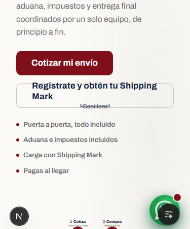
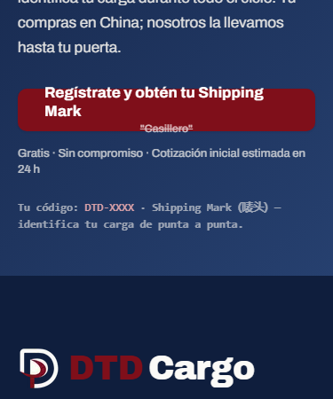
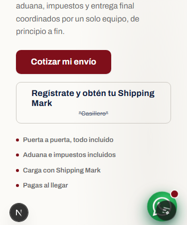
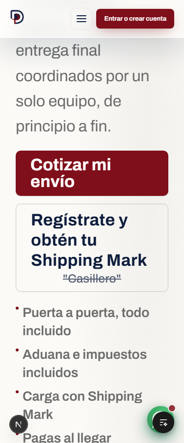
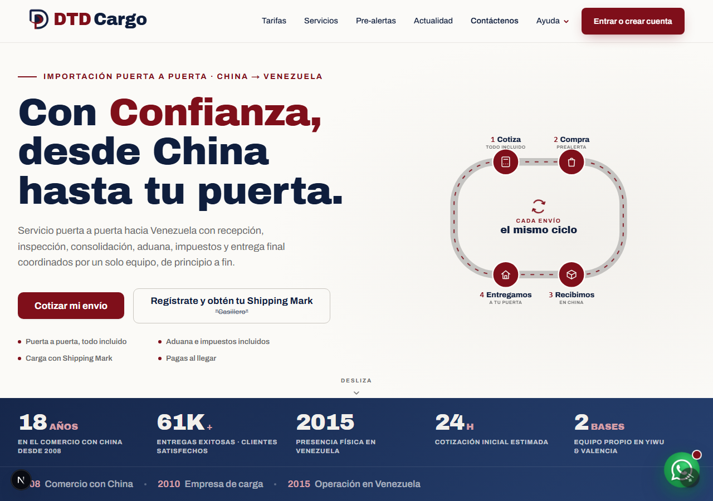

# QA — SDD-0580 Shipping Mark CTA móvil

Fecha: 2026-10-23. Base integrada `d410ab2e23e74e5bcf7fdc7cc595371b24cc03a8`.
Reserva `dd0ea538b49dfa01f7126a4ef737e7cedb3691b3`. Ensayo local sin producción.

## Reproducción anterior

Chromium y WebKit locales, ambos con Archivo del repositorio. A 375 px, el hero
necesitaba 83,171875 px de alto y el cierre 81,171875 px, pero ambos tenían 48 px.
La etiqueta sobresalía aproximadamente 4,58 px por arriba y el tachado 4,59 px
por debajo. `overflow: visible`: es contenido fuera de su caja, no clipping CSS.
A 1280 px el texto entra pero el relleno no: requeridos 62,78125/60,78125 px.
El scroll horizontal seguía correcto, por eso el contrato anterior no lo veía.

La nueva regresión vertical falló en baseline en los 24 escenarios iniciales
(8 anchos + cuatro ampliaciones, dos motores). Los 20 contratos previos de
scroll horizontal/menú pasaron. Una activación de teclado Chromium falló por
carrera de primera carga; se conservó el resultado y se agregó espera explícita
de red quieta, hidratación y foco antes de Enter. No se cambió producto por eso.




## Corrección

`height: "auto"` en el estilo del componente compartido. Ambos enlaces dejan
de heredar el alto fijo de `.btn`; no se cambia `.btn` global ni `app/page.tsx`.
Fuente, tamaño 17 px/12 px, copy, tachado, colores, padding del componente y destinos
se conservan. La altura resulta del contenido; no hay valores por dispositivo.

El ensayo con altura automática detectó una segunda causa a 200 %: la pista 1fr
del hero móvil crecía a 441,921875 px dentro de 256 px disponibles. Su mínimo pasa
a `minmax(0, 1fr)` en el selector móvil existente. El cierre no necesitó cambio.

Ese ajuste hizo envolver «Cotizar mi envío» en dos renglones a 320/375 px. Se
midió como regresión derivada de la corrección, no como ajeno: con la pista
anterior el rango de texto medía 37 px y quedaba en la caja de 48 px; con la pista
acotada el rango pasó a 71 px y salió 12 px arriba/11 px abajo. La regla local
`.home-surface .hero-ctas > .btn` permite altura automática, mínimo 48 px
(`var(--s-12)`) y padding vertical 12 px (`var(--s-3)`). La geometría normal
se conserva; a 200 % el vecino crece a 92 px y contiene sus dos rangos de 37 px.
`Range.getClientRects()` comprueba también ese vecino en la regresión.

La atribución está en `.codex/qa/attribution-{chromium,webkit}-{320,375}.json`,
con pista original, estado intermedio y estado corregido. La matriz intermedia
de altura solamente se conserva en `fixed-height-only-results.json`, no se
presenta como aceptación final.

## Método y aislamiento

Dependencias instaladas con `pnpm install --offline --frozen-lockfile`: 817
paquetes reutilizados, cero descargas. Navegadores ya existentes localmente.
Se niegan `.env` reales y se retiran secretos del entorno. GA desactivado;
Hailuway/Supabase apuntan a un servidor loopback con respuestas sintéticas.
Preload propio Node propagado a hijos y proxy + route guard de navegador.
Controles negativos: fetch, socket, DNS, hijo Node, curl real, proxy WebKit
remoto y navegación browser `.invalid`; todos deben bloquearse antes de salida.
El proxy WebKit loopback se acepta como bandera del navegador, no ejecutable curl.
Esto es una barrera de ensayo, no una sandbox universal del sistema operativo.

Copias propias de helpers de ensayo desde SDD-0579 commit
`d069b5b26df962b25f6476bfd7c3c626c4764be2`; ninguna dependencia runtime de ese
worktree y ninguna implementación de 0579 incorporada.

La ampliación 200 % duplica los tamaños computados de todo el texto de la home
sin cambiar su viewport, anchos ni alturas. No se usa CSS zoom. El ancho 640 px
comprueba además el reflow equivalente de viewport 1280 px a 200 %; no certifica
el gesto de zoom nativo del navegador ni una prueba en dispositivo físico.
El toque se comprueba con `hasTouch: true` y `.tap()`; teclado con Enter.
No se envían formularios, registros, mensajes ni eventos a terceros.

Logs ignorados por modo en `.codex/qa/`; matrices `baseline-results.json` y
`fixed-results.json` contienen geometría y caras locales de fuente cargadas.
El registro `e2e-baseline.log` conserva el fallo anterior a la corrección.

## Resultados finales

Matriz UI final: **PASÓ**, 26 escenarios de geometría (13 por motor), más seis
recorridos de observación (tres por motor). Ambos CTA dentro de viewport y con
texto completo. Anchos 320/360/375/390/414/430/640/768/1280 px, y texto 200 % en
320/375/768/1280 px. A 320 px con texto 200 %: hero 256×219,984375 px, cierre 280×217,984375 px.
La geometría normal del vecino es exactamente 191,203125×48 px antes/después en
los nueve anchos y en ambos motores. Archivo/ArchivoBlack aparecen `loaded`
con recursos WOFF2 bajo `/_next/static/media/`; no se certifica por fallback.
No hubo intentos remotos inesperados Node/browser; controles negativos bloqueados.






E2E: la primera corrida final aprobó 47/48. El único fallo fue la espera nueva
de navegación Chromium (expectURL de 5 s) en la primera compilación de `/registro`:
respuesta 200 en 2,8 s, de ellos 2,3 s de compilación. Se conserva el log
`e2e-first-final-47of48.log`. No se cambió producto. La prueba espera ahora
`waitForURL` junto al evento real y con límite explícito de 20 s dentro del presupuesto
de 60 s; conserva Enter, toque real y URL exacta. Además se espera hidratación antes
de duplicar el tamaño de texto, evitando un mismatch inducido por el ensayo.
El recheck afectado aprobó **10/10**, ocho ampliaciones y activación en ambos
motores; cada activación incluye los dos CTA con Enter y tap, sin enviar datos.
Los casos completos de activación duraron 9,0 s Chromium/9,8 s WebKit.

| Comprobación | Estado y evidencia |
|---|---|
| `node scripts/verify.mjs`, vía runner cerrado | **FALLÓ / INCOMPLETO**. Corrieron 12/17 pasos; se conserva el resultado original. |
| Harness original | **FALLÓ: 236/237**. El único fallo fue la barrera local bloqueando un clone bare desde un origen temporal del propio test. |
| Harness focal después de corregir la barrera | **PASÓ: 10/10**, `scripts/tests/harness-worktree.node.mjs`. Sin modificar el test existente. |
| Controles negativos de esa excepción | **PASÓ: 9/9**: worktree real, origen/destino fuera del mismo temporal, URL/UNC, fetch del fixture, curl y proxy remoto/file rechazados antes de conexión. |
| Lint | **PASÓ**, cero errores y 15 advertencias existentes. |
| Frontera RSC / TypeScript | **PASÓ**, 1.706 módulos revisados por la frontera. |
| Vitest general | **PASÓ**, 860 archivos, 12.278 pruebas; un archivo/una prueba omitidos. Una sola pasada, sin retry. |
| Docs, numeración, constantes, componentes, gobernanza y símbolos de migraciones pendientes | **PASÓ**. Avisos históricos de numeración conservados. |
| Build local de release | **PASÓ**. Fuentes locales, fixture loopback y medición apagada. |
| Edge | **NO EJECUTADO**, `VERIFY_SKIP_EDGE=1`; sin descargas ni servicios externos. |
| Ledger productivo | **NO EJECUTADO**, sin service key; no se consultó producción. |
| SQL / reconstrucción de esquema | **NO EJECUTADO**, `VERIFY_SKIP_SQL=1`; no hay cambios de DB y no se levantó una base para este ajuste visual. |
| E2E global | **NO EJECUTADO**, `VERIFY_SKIP_E2E=1`; el ensayo usa el contrato focal con proxy/route guard, sin cuentas ni env reales. |

La omisión de Vitest corresponde al corpus real de proformas (SDD-0473), ausente
sin `DOCUMENT_IMPORT_CORPUS`; no se abrieron documentos comerciales para esta tarea.
La excepción del guard se restringió después de terminar la corrida original al
clone exacto del fixture `dtd-harness-bare-*`: cwd y origen reales, destino nuevo
del mismo temporal, sin URL/UNC y `GIT_ALLOW_PROTOCOL=file`. El proyecto real
sigue bloqueado. El registro `verify.log` y `network-verify.jsonl` se conservan;
el recheck está en `harness-worktree-recheck.log`, `negative-bare-recheck.jsonl`
y `network-bare-recheck.jsonl` (este último vacío). No se repitió el gate completo
después del ajuste de la barrera y no se presenta como una corrida general verde.

## UI-check advisory previo al commit

Alcance: ShippingMarkCta, selector hero móvil y botones dentro de hero-ctas.
Marca: sin colores/fuentes/radius nuevos, solo tokens de espaciado existentes;
label y gesto pedagógico conservados. Estados hover/active/focus heredados.
Jerarquía conservada, controles de al menos 44 px, nombre accesible, foco de teclado,
destino y activación cubiertos por E2E. Capturas normales/ampliadas inspeccionadas.
Veredicto: OK para commit en el alcance del recorte. Los hallazgos globales de
reflow 200 % y flotante WhatsApp están separados; no son correcciones de esta tarea.

## Hallazgos fuera de alcance y límites

- Con todo el texto de home a 200 % aún hay scroll horizontal de 480 px a 320/375 px.
  Los dos CTA están contenidos; los elementos medidos que se salen incluyen
  «Confianza,» (`.h1 .hl`, borde derecho 473,92 px), estadísticas (`.hstat`, 380,80 px)
  y `.jy-star-stat` (480,48 px). No se oculta el desborde ni se rediseñan.
  La prueba de los CTA no equivale a conformidad global de reflow 200 %.
- WhatsApp: se reproducen intersecciones geométricas durante scroll con un CTA
  de home y en tarifas con «Calculadora» y tarjeta Consolidado LCL; FAQ no mostró
  intersecciones en el muestreo. No se accionó ni modificó el flotante. Es una
  observación de cajas durante scroll, no evidencia de que toda el área clicable
  quede bloqueada. Un ajuste del flotante necesita alcance propio.
- CJK: «(唛头)» se ve renderizado en la captura de cierre y resuelve la pila
  CJK de sistema; no se reprodujo texto en cuadrados en estos motores locales.
  No demuestra comportamiento en todos los dispositivos físicos.
- Zoom nativo, dispositivos físicos y E2E global: no ejecutados. Se documentan
  ampliación real del texto y viewport de 640 px equivalente de reflow, sin confundirlos.

## Reproducción local

Desde la raíz de este worktree, sin `.env` reales y con las dependencias/browser locales:

```text
node docs/specs/0580-shipping-mark-cta-movil/assets/local-ui-check.mjs fixed
node docs/specs/0580-shipping-mark-cta-movil/assets/local-ui-check.mjs e2e
node docs/specs/0580-shipping-mark-cta-movil/assets/local-ui-check.mjs verify
```

El modo `baseline` mide el código que esté presente; no revierte producto.
Las capturas anteriores se tomaron con el componente exacto de la reserva y
se restauraron después los bytes del componente corregido antes de continuar.
