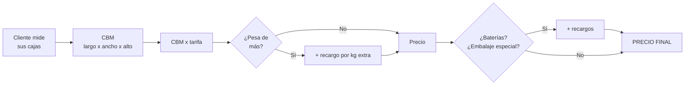

# A · Cómo se calcula el precio
### Manual del equipo · DTD Cargo

> 🔒 **INTERNO.** Las cifras de este documento **no se le dicen al cliente**. Al cliente se
> le dice el precio que sale de la calculadora, y ya.

---

## Lo esencial

**Cobramos por VOLUMEN, no por peso.** El peso solo importa si la carga es muy densa.

---

## Los números (internos)

| Concepto | Valor |
|---|---|
| **Tarifa base Puerta a Puerta** | **$800 por CBM** |
| Tarifa Consolidado LCL (hasta puerto) | $580 por CBM · mínimo 1 CBM |
| **Peso incluido** | **500 kg por cada CBM** |
| Recargo por kg extra | **$1 por kg** sobre esos 500 kg/CBM |
| Embalaje especial (madera o paleta) | +$50 **una sola vez**, no por caja |
| **Baterías** | **×1,5 sobre el flete** (+50%) |
| Precio mínimo | $50 |

> **Ejemplo de peso:** 1 CBM que pesa 600 kg → incluye 500, sobran 100 → **+$100**.

---

## Cuándo la calculadora NO cotiza sola

Estos son los tres topes. Si la carga los pasa, **la web manda al asesor**:

| Tope | Límite | Por qué |
|---|---|---|
| Volumen | **más de 68 CBM** | Ya no entra en un contenedor → se cotiza FCL |
| Peso total | **más de 27.000 kg** | Supera el peso admitido por contenedor |
| Peso de un solo envío | **más de 9.000 kg** | Un envío tan pesado llena el contenedor con poco volumen y nadie más entra |

Cuando pasa esto **no es un error** — es a propósito. Se pasa a cotización manual.

---

## Las dos calculadoras

| Cuál | Para qué | Enlace |
|---|---|---|
| **Tarifas** | Carga normal por cajas (LCL) | `dtdcargo.com/tarifas` |
| **FCL** | Contenedor completo | `dtdcargo.com/fcl` |
| *Terrestre* | Nacional en Venezuela | `dtdcargo.com/calculadora-terrestre` |

---

## 💬 Qué le dices al cliente cuando pregunta por qué subió

**Sin dar cifras.** Traduce así:

| Lo que pasó (interno) | Lo que le dices |
|---|---|
| Pasó los 500 kg/CBM | *"Tu carga es más densa que el margen que incluye la tarifa, así que la calculadora le sumó un pequeño ajuste por el peso extra."* |
| Lleva baterías | *"Las baterías requieren bodega certificada, documentos y manejo especial. Ese recargo es el costo de que viaje legal y asegurada."* |
| Embalaje en madera/paleta | *"El embalaje reforzado tiene un costo adicional único."* |
| Pasó un tope | *"Tu carga es lo bastante grande como para que te convenga revisarla con un asesor — puede que te salga mejor un contenedor completo."* |

---

## ⚠️ Tres cosas que no se rompen

1. **El precio que das es un ESTIMADO.** El final lo confirma un asesor al reservar.
2. **Nunca cites un precio de memoria ni de un chat viejo.** Sale de la calculadora.
3. **Al recibir la carga la pesamos y medimos.** Si coincide con lo declarado, no cambia
   nada. Díselo antes, para que no sea sorpresa.

---

*Fuente: `lib/calculadora.ts`. Si un número de acá no cuadra con la web, gana la web —
y avisa para corregir este documento.*
