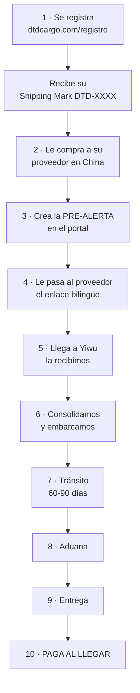
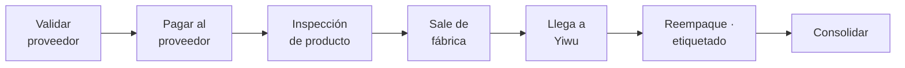

# B · Paso a paso de cada servicio
### Manual del equipo · DTD Cargo

> Para cuando el cliente pregunta *"¿y ahora qué hago?"*. Es el orden real, sin saltos.

---

## El camino completo, de cero a entregado

**El paso que más se salta: el 3.** Sin pre-alerta, la caja llega y no sabemos de quién es.

---

## Los 5 servicios y en qué se diferencia el camino

| Servicio | Dónde termina | Quién hace la aduana |
|---|---|---|
| **Puerta a Puerta** | Su dirección | Nosotros — **todo incluido** |
| **Consolidado LCL** | Puerto, con su BL | Él |
| **FCL directo de fábrica** | Según lo acordado | Según lo acordado |
| **FCL en bodega** | Según lo acordado | Según lo acordado |
| *Transporte terrestre* | Dentro de Venezuela | *Próximamente* |

> 🔑 **Las dos decisiones son independientes.** Una es *quién hace la aduana* (Puerta a
> Puerta o con su propia aduana). Otra es *si comparte contenedor* (LCL o FCL). No las
> mezcles.

---

## Servicios adicionales · cuándo se piden

El orden importa. Si lo pide tarde, ya no se puede.

| Servicio | Se pide… | Si lo pide después |
|---|---|---|
| **Validar proveedor** | Antes de pagarle | Ya pagó — el riesgo ya lo corrió |
| **Inspección de producto** | Antes de que salga de fábrica | Ya no se puede corregir con el proveedor |
| **Reempaque / etiquetado** | Antes de que llegue a Yiwu | Hay que desconsolidar, cuesta más |
| **Compra asistida** | Antes de comprar | — |

---

## ⏱️ Las decisiones que NO se pueden cambiar después

| Decisión | Se toma | Por qué no se puede cambiar |
|---|---|---|
| ¿La importación a mi nombre? | **Antes de embarcar** | Cambia documentos, impuestos y precio |
| ¿Puerta a Puerta o mi aduana? | **Antes de cotizar** | Son precios que no se comparan |
| ¿Lleva baterías? | **Antes de comprar** | Necesita documentos del fabricante |

> Si el cliente pregunta esto con la carga ya navegando, la respuesta es
> **"déjame confirmarlo con Operaciones"**. No prometas que se puede.

---

## 📋 Chuleta de "¿y ahora qué?"

| El cliente dice | Le respondes |
|---|---|
| "Quiero empezar" | Regístrate en `/registro` — es gratis y te da tu Shipping Mark |
| "Ya me registré" | Cuando compres, crea la pre-alerta en el portal |
| "Mi proveedor pide la dirección" | Desde tu portal › Compras generas el enlace bilingüe. Él no necesita cuenta. |
| "Ya despachó mi proveedor" | Crea la pre-alerta con el número de guía |
| "¿Dónde va mi carga?" | En tu portal › Envíos |
| "Ya llegó a Valencia" | Coordinamos la entrega. El pago es al llegar. |

---

*Fuente: `lib/shared/shipment-public.ts` y el flujo del portal. Ante un caso raro,
Operaciones.*
