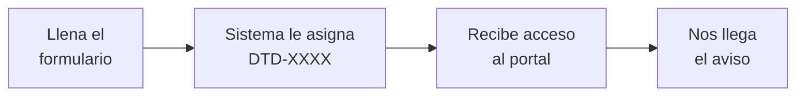
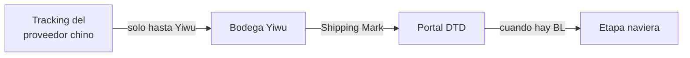

# C · Registro, portal y seguimiento
### Manual del equipo · DTD Cargo

> Las tres cosas que el cliente hace solo. Si sabes guiarlas, te ahorras la mitad de los
> mensajes.

---

## 1 · El registro

**`dtdcargo.com/registro` — gratis, y es real:** crea el cliente en el sistema, le asigna su
Shipping Mark y nos avisa a nosotros.

### El Shipping Mark

- Formato **`DTD-XXXX`**. Se genera solo.
- Va **en el nombre del destinatario Y en cada caja**.
- En China se conoce como **唛头**.
- 🔴 **No es un número de rastreo.** Es la identidad de su mercancía dentro de DTD.

> ⚠️ Al cliente se le dice **"Shipping Mark"**. En el sistema verás **"MARKBOX"** — es lo
> mismo, pero ese nombre no se usa con él.

---

## 2 · El portal del cliente

**`dtdcargo.com/portal` — entra sin contraseña** (le llega un enlace o código).

| Sección | Para qué |
|---|---|
| **Envíos** | Ver dónde va su carga |
| **Compras** | Registrar una compra y **generar las etiquetas del proveedor** |
| **Facturas** | Ver, aceptar y **reportar el pago** |
| **Finanzas** | Su saldo |
| Cotizaciones · Estimados | Lo que ha pedido cotizar |
| Documentos · Proveedores | Sus archivos y proveedores |
| Reclamos · Mensajes · Soporte | Escribirnos |
| Academia · Club · Referidos | Formación y beneficios |

### 🎯 La regla que ahorra tiempo

**Si el cliente pregunta algo que él mismo puede ver, mándalo al portal.**

| Pregunta | Respuesta |
|---|---|
| "¿Dónde está mi carga?" | → Envíos |
| "¿Cuánto debo?" | → Finanzas |
| "Ya pagué" | → que **reporte el pago** desde la factura |
| "¿Cómo le mando la dirección a mi proveedor?" | → Compras › genera el enlace |
| "Quiero reclamar" | → Reclamos |

---

## 3 · El seguimiento

**Lo que hay que entender y explicar:**

- El tracking que le dio el proveedor **solo cubre China por dentro**, hasta nuestra bodega.
- De ahí en adelante lo identificamos por el **Shipping Mark** y lo ve en el portal.
- Cuando el embarque ya tiene **BL o número de contenedor**, se puede consultar la etapa
  naviera.

🔴 **No prometas seguimiento satelital ni "tiempo real".** No todos los embarques tienen
esa información.

### Los estados, en cristiano

| Estado | Qué le dices |
|---|---|
| **En bodega** | Ya llegó a nuestra bodega en China |
| **Consolidando** | La estamos juntando para armar el contenedor |
| **Embarcado** | Ya salió |
| **En tránsito** | Navegando |
| **En aduana** | En nacionalización |
| **En bodega VE** | Llegó a Valencia |
| Bodegaje | Está esperando en bodega |
| **En reparto / Última milla** | Va camino a tu dirección |
| **Entregado** | Listo |
| Alerta | Pasó algo — lo revisamos y te avisamos |

---

## 🔴 Datos del cliente

Cédula, dirección, teléfono y comprobantes viven **en el CRM y el ERP**. No se pegan en
chats grupales, no se pasan de un cliente a otro, no se sacan en listas.

Si pide que borren sus datos o pregunta qué tenemos de él → **escala**, no improvises.

---

*Fuente: rutas de `app/portal/` y `lib/shared/shipment-public.ts`.*
