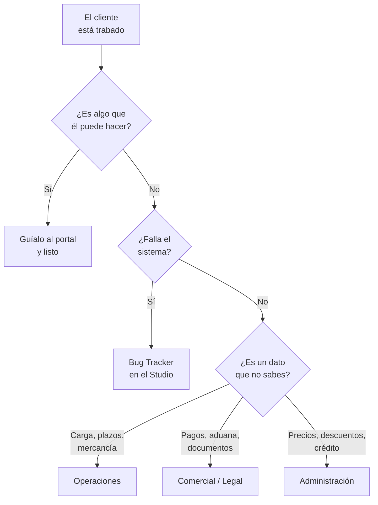

# D · Cuando algo falla
### Manual del equipo · DTD Cargo

> El cliente está trabado, la web no le responde, o algo del sistema está raro.
> **Qué haces, en orden.**

---

## El árbol de decisión



---

## Los bloqueos más comunes en la web

| El cliente dice | Qué pasa de verdad | Qué haces |
|---|---|---|
| "No me deja registrarme" | Suele ser un dato repetido (cédula o correo ya usados) | Pregúntale si ya se había registrado. Si sí, ya tiene Shipping Mark. |
| "No me llega el correo del portal" | Va a spam, o escribió mal el correo | Que revise spam. Si no, confirma el correo y **escala** |
| "La calculadora no me da precio" | Su carga pasó un tope (68 CBM · 27.000 kg · 9.000 kg por envío) | **No es un error.** Es a propósito: pasa a cotización con asesor |
| "El link que me mandaron no abre" | Enlace viejo de un chat | Mándale el nuevo. Los viejos redirigen, pero no copies de chats. |
| "No veo mi envío en el portal" | Todavía no está creado, o no hizo la pre-alerta | Revisa en el Studio › Embarques antes de responder |
| "Puse el tracking y no aparece" | El tracking chino **solo llega hasta Yiwu** | Explícale que de ahí lo sigue por Shipping Mark |

---

## Cuando es un bug de verdad

**Se reporta en Bug Tracker, dentro del Studio.** No por WhatsApp, no en un grupo — ahí se
pierde.

**Qué poner para que sirva:**

1. **Qué hiciste** — paso por paso, hasta donde falló
2. **Qué esperabas** que pasara
3. **Qué pasó** en su lugar
4. **Captura de pantalla**
5. **Quién es el cliente** (Shipping Mark) si aplica

> Sin los pasos, nadie puede reproducirlo y el reporte muere.

---

## Cómo escalar bien

**No basta con reenviar el mensaje del cliente.** Manda:

```
Cliente:      [nombre + Shipping Mark si lo tiene]
Preguntó:     [textual, copiado]
Ya le dije:   [lo que le respondiste]
Necesito:     [qué exactamente hay que confirmar]
```

### Mientras esperas, al cliente:

```
Déjame confirmarte ese dato con el equipo para no darte información a medias.
Te escribo hoy mismo.
```

🔴 **No lo dejes en visto.** Un *"lo estoy confirmando"* vale más que una respuesta
inventada.

---

## Qué NO prometas nunca

| ❌ No digas | ✅ Di |
|---|---|
| "Te llega el [fecha]" | "El estimado es 60-90 días; los tiempos los define la naviera" |
| "Sí se puede mandar" (mercancía dudosa) | "Déjame confirmarlo con Operaciones" |
| "Te lo arreglo hoy" (bug) | "Ya lo reporté al equipo técnico, te aviso apenas se resuelva" |
| "Te hago un precio" | "Déjame consultarlo" → Administración |
| Un monto de memoria | El que salga de `/tarifas` |

---

## 🆘 Tabla rápida de a quién

| Tema | A quién |
|---|---|
| Plazos, cobertura, mercancía restringida, baterías, inspecciones | **Operaciones** |
| Pagos, aduana, quién es el importador, documentos, contratos | **Comercial / Legal** |
| Márgenes, tarifas especiales, descuentos, crédito | **Administración** |
| El sistema falla | **Bug Tracker** (Studio) |

---

*Si un caso se repite y no está acá, avisa — este documento se actualiza.*
