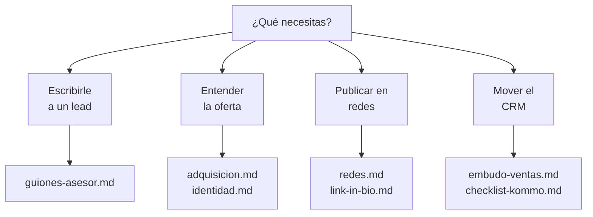

# E · Marketing — dónde está cada cosa
### Manual del equipo · DTD Cargo

> Hay una carpeta grande de marketing (`docs/marketing/`). Este es el mapa: **qué puedes
> usar y qué es solo del founder.**

---

## 🔴 Primero, lo que NO sale de la oficina

Tres documentos de esa carpeta **no se comparten, ni se citan, ni se pegan en un chat**:

| Documento | Qué tiene |
|---|---|
| `manual-vendedores-peso.md` | Los topes de peso exactos y cómo negociarlos |
| `competencia-precios.md` | Precios verificados de la competencia |
| `prospectos-ancla.md` | La lista de ~60 prospectos |

> ⚠️ Y **no uses el "lector de marketing" offline** (`pnpm marketing:reader`): mete esos
> tres adentro sin filtrar. Para leer marketing entra por
> **Studio › Marketing › Documentos**, que sí controla quién ve qué.

---

## Lo que sí puedes usar a diario

| Necesitas | Documento |
|---|---|
| **Mensajes listos para pegar** | `guiones-asesor.md` *(ya están en tu documento 02)* |
| Cómo se vende, la oferta única | `adquisicion.md` |
| Nombres, NAP, cómo nos llamamos | `identidad.md` |
| Misión, visión, valores | `estrategia.md` |
| Las etapas del embudo en Kommo | `embudo-ventas.md` |
| Qué falta configurar en Kommo | `checklist-kommo.md` |
| Instagram, YouTube, plan de redes | `redes.md` |
| El link de la bio de Instagram | `link-in-bio.md` |
| Perfiles de WhatsApp Business | `whatsapp-business.md` |
| La letra chica del precio | `condiciones-cotizacion.md` |
| Las 20 preguntas del CRM | `seo-aeo-preguntas-crm.md` |
| Copy de servicios para piezas | `servicios-infografias/` |

**Todo entra por** `docs/marketing/README.md`, que es el índice.

---

## Para hacer piezas (video, post, presentación)

**No busques en marketing.** Tienes dos fuentes mejores:

| Qué | Dónde |
|---|---|
| Colores en hex, fuentes, logo, qué es AI slop | Tu documento **06 · La marca** |
| Logos, plantillas, fondos, iconos, fotos, el Brand Book | **`dtdcargo.com/marca`** |

> Entras a `/marca` con tu usuario del ERP, **sin código**. Cada sección trae su `.zip`.
>
> 🔴 **No guardes copias del Brand Book.** Cuando llega una versión nueva se reemplaza
> entera y la copia vieja no avisa que venció. Bájalo de `/marca` cada vez.

---

## Las reglas de marketing que no se rompen

1. **Nunca mandes a `doortudoor.com`.** Existe solo para redirigir. El dominio vivo es
   **dtdcargo.com**.
2. **`/marca` no se comparte con clientes** — es para el equipo y diseño externo.
3. **Razón social y RIF no van en piezas públicas.** Solo en documentos legales.
4. **La oferta se llama "Puerta a Puerta"**, con la aclaración *"(todos los gastos
   pagados)"*. Nunca "DDP".
5. **"Pagas al llegar"** — nunca "prepago" ni "financiamiento".

---

## 📱 Los canales

| Canal | Estado |
|---|---|
| **Instagram `@dtdcargo.ve`** | 🟢 El más fuerte — 5.003 seguidores |
| YouTube `@dtdcargo` | 🔴 Abandonado — el plan de reactivación está en `redes.md` |
| WhatsApp CRM | **+58 412 166 8021** |
| Fijo Valencia | **+58 241 414 7886** |
| Correo | **info@dtdcargo.com** |
| Link de la bio | `dtdcargo.com/enlaces` |

---

*Índice completo: `docs/marketing/README.md`. Si algo de acá no cuadra, gana ese README.*
